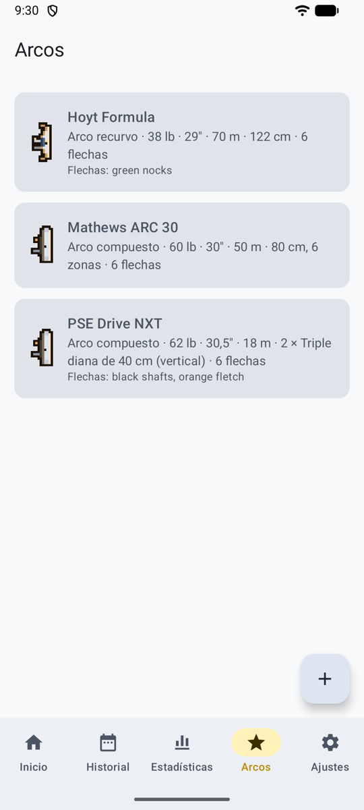
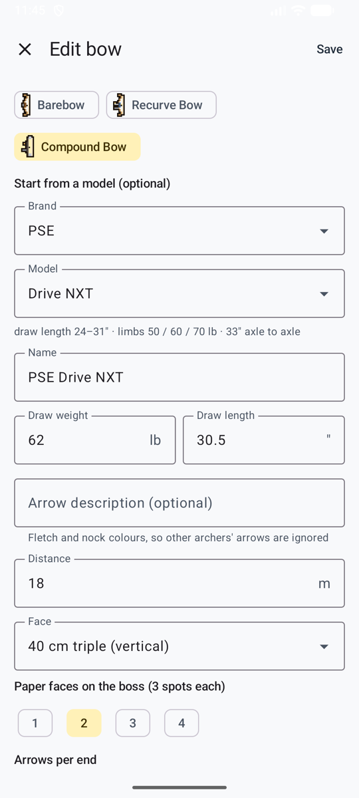
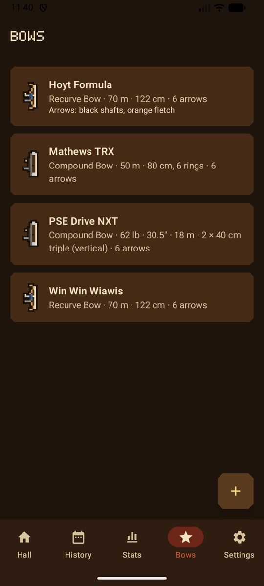
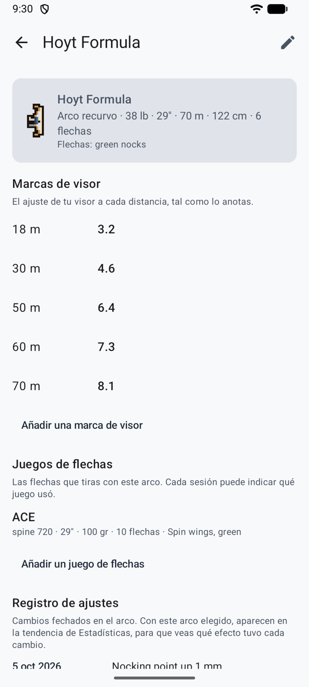
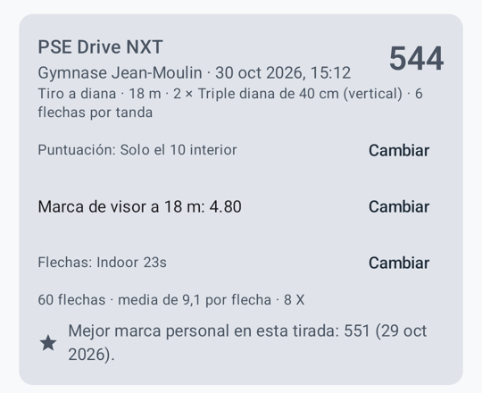

# Arcos { #bows }

La pestaña **Arcos** muestra tus arcos. Toca uno para abrir su página: su configuración, **Marcas de visor**, **Juegos de flechas** y **Registro de ajustes**. En el modo juego, cuelgan del **armero de arcos** del salón, cada uno dibujado según su tipo, y tu arquero lleva el tipo de tu primer arco.

<figure markdown>
{ .shot }
<figcaption><b>Tus arcos</b></figcaption>
</figure>
<figure markdown>
{ .shot }
<figcaption><b>Partir del catálogo</b></figcaption>
</figure>
<figure markdown>
{ .shot }
<figcaption><b>Tus arcos</b>, con el aspecto del juego</figcaption>
</figure>

## Añadir un arco { #add-a-bow }

**Añadir arco**:

- **Nombre** y **tipo de arco**. Cada tipo tiene un pequeño dibujo que marca el arco en las listas: arco desnudo; recurvo con visor y estabilizador; compuesto con poleas.
- Para un compuesto, puedes partir de una **marca y modelo** del catálogo integrado (PSE, Hoyt, Mathews, Bowtech). Rellena el nombre, muestra las especificaciones del modelo y te avisa si tu apertura está fuera del rango del modelo.
- **Potencia** (lb) y **Apertura** (pulgadas). Las dos aceptan coma o punto.
- **Descripción de las flechas**, por ejemplo «tubos negros, emplumado naranja». Se envía con la foto para que la IA ignore las flechas de otros arqueros en el mismo parapeto.
- **Valores predeterminados:** diana, dianas de papel, distancia y flechas por tanda, para rellenar las sesiones nuevas.

## Marcas de visor, juegos de flechas y registro de ajustes { #sight-marks-arrow-sets-and-tuning-log }

<figure markdown>
{ .shot }
<figcaption><b>La página de un arco</b></figcaption>
</figure>
<figure markdown>
{ .shot }
<figcaption><b>En la sesión</b>, la marca y las flechas</figcaption>
</figure>

- **Marcas de visor**: el ajuste de tu visor a cada distancia, escrito a tu manera: `5.2`, `3 turns + 12`, o para un arco desnudo tu string walking o tu punto de mira, con una nota opcional. Una por distancia. La marca del arco y la distancia de la sesión aparece al empezar una sesión y en la propia sesión, donde **Cambiar** la actualiza desde la línea de tiro.
- **Juegos de flechas**: nombre, spine tal como está impreso en el tubo, longitud, peso de punta, número de flechas, emplumado y notas. Una sesión nueva empieza con el juego que usó el arco la última vez; elige otro en el formulario o pulsa **Cambiar** en la sesión. **Retirar este juego** lo oculta para las sesiones nuevas y lo mantiene en las sesiones tiradas con él. En [Estadísticas](stats.md#filters), filtra por juego de flechas.
- **Registro de ajustes**: notas con fecha de lo que cambiaste: fistmele, tiller, punto de enfulque, una cuerda nueva. Con el arco elegido en [Estadísticas](stats.md#average-per-arrow-by-session), cada nota aparece en la tendencia, para que veas qué efecto tuvo.

## Cambiar o quitar un arco { #change-or-remove-a-bow }

**Editar** (el lápiz, arriba a la derecha en la página del arco) abre el formulario. Cambiar un arco más tarde no cambia las sesiones pasadas. **Eliminar este arco** pregunta antes; las sesiones pasadas tiradas con él se conservan.
