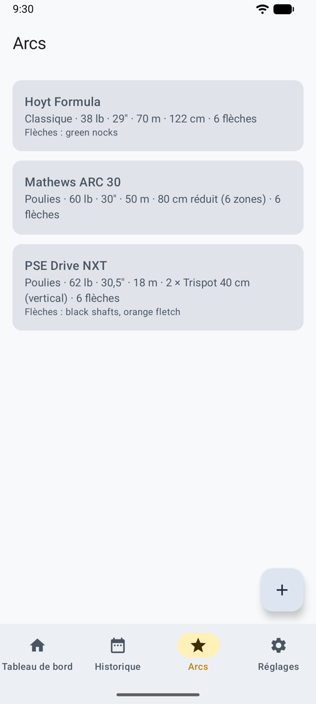
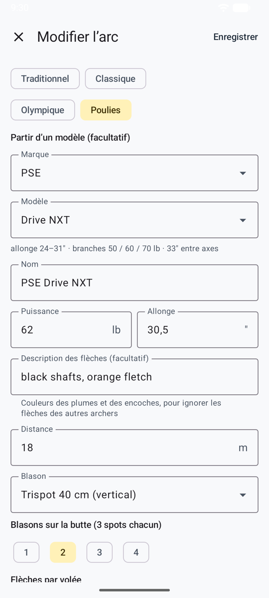
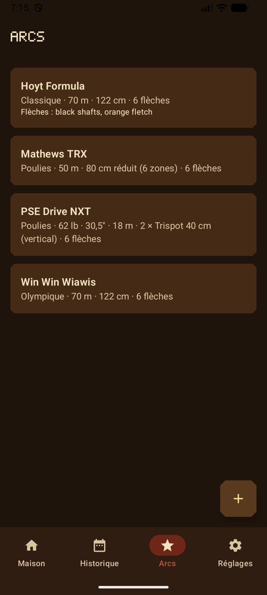

# Arcs

L’onglet **Arcs** liste vos arcs. En mode jeu, ils sont accrochés au **râtelier à arcs** de la maison, chacun dessiné selon son type, et votre archer tient le type de votre premier arc.

<figure markdown>
{ .shot }
<figcaption><b>Vos arcs</b></figcaption>
</figure>
<figure markdown>
{ .shot }
<figcaption><b>Partir du catalogue</b></figcaption>
</figure>
<figure markdown>
{ .shot }
<figcaption><b>Vos arcs</b>, dans le style du jeu</figcaption>
</figure>

## Ajouter un arc

**Ajouter un arc** :

- **Nom** et **type d’arc**. Chaque type a un petit dessin qui marque l’arc dans les listes : arc nu ; arc recourbé avec viseur et stabilisateur ; arc à poulies avec ses cames.
- Pour un arc à poulies, vous pouvez partir d’une **marque** et d’un **modèle** du catalogue intégré (PSE, Hoyt, Mathews, Bowtech). Il remplit le nom, montre les caractéristiques du modèle, et vous prévient si votre allonge sort de la plage du modèle.
- **Puissance** (lb) et **allonge** (pouces). Les deux acceptent une virgule ou un point.
- **Description des flèches**, par exemple « tubes noirs, plumes orange ». Elle est envoyée avec la photo pour que l’IA ignore les flèches des autres archers sur la même butte.
- **Valeurs par défaut :** blason, blasons sur la butte, distance et flèches par volée, pour remplir les nouvelles séances.

## Modifier ou retirer un arc

Modifier un arc plus tard ne change pas les séances passées. **Retirer cet arc** demande d’abord confirmation ; les séances passées tirées avec cet arc sont conservées.
