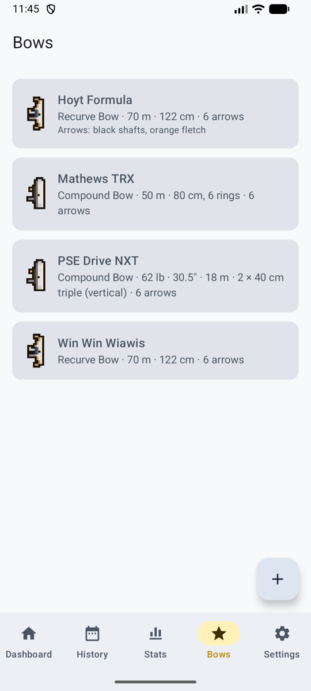
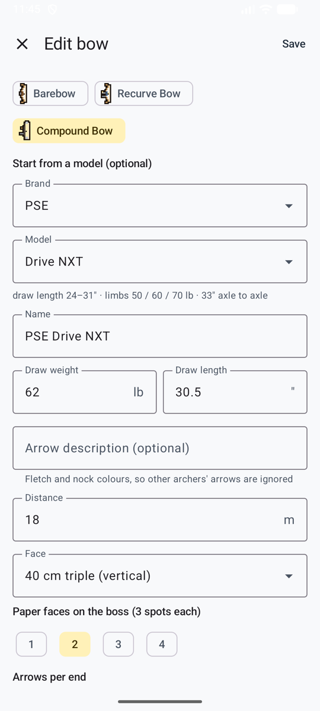
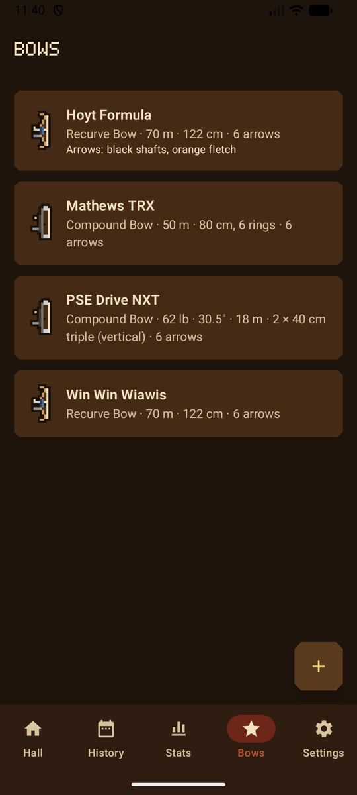

# Bows

The **Bows** tab (*Arcs*) lists your bows; in game mode, they hang on the **bow rack** in the hall, each drawn as its type, and your archer holds the type of your first bow.

<figure markdown>
{ .shot }
<figcaption><b>Your bows</b></figcaption>
</figure>
<figure markdown>
{ .shot }
<figcaption><b>Starting from the catalog</b></figcaption>
</figure>
<figure markdown>
{ .shot }
<figcaption><b>Your bows</b>, in the game look</figcaption>
</figure>

## Add a bow

**Add bow** (*Ajouter un arc*):

- **Name** and **bow type**. Each type has a small drawing that marks the bow in lists: barebow; recurve with sight and stabilizer; compound with cams.
- For a compound, you can start from a **brand and model** in the built-in catalog (PSE, Hoyt, Mathews, Bowtech). It fills in the name, shows the model's specs, and warns you if your draw length is outside the model's range.
- **Draw weight** (lb) and **draw length** (inches). Both accept a comma or a dot.
- **Arrow description**, for example "black shafts, orange fletching". It's sent with the photo so the AI ignores other archers' arrows on the same boss.
- **Defaults:** target face, paper faces, distance and arrows per end, used to fill in new sessions.

## Change or remove a bow

Changing a bow later doesn't change past sessions. **Remove this bow** (*Retirer cet arc*) asks first; past sessions shot with it are kept.
