# Spielmodus { #game-mode }

Ullr lässt sich auch ganz anders nutzen: **dieselbe App als kleines Pixel-Art-Videospiel.** Deine Figur läuft durch eine nordische Halle und über einen Bogenplatz, und jeder Ort öffnet einen Bildschirm. Deine Bögen, Einheiten und Ergebnisse sind genau dieselben wie im Normalmodus, und die Wertungsbildschirme funktionieren gleich.

Schalte ihn ein unter **Einstellungen → Aussehen und Spiel → Spiel (Vorschau)**. **Normal** schaltet jederzeit zurück; dabei geht nichts verloren.

<figure markdown>
{ .shot }
<figcaption><b>Die Halle.</b> Tippe auf einen Ort, und deine Figur geht dorthin.</figcaption>
</figure>
<figure markdown>
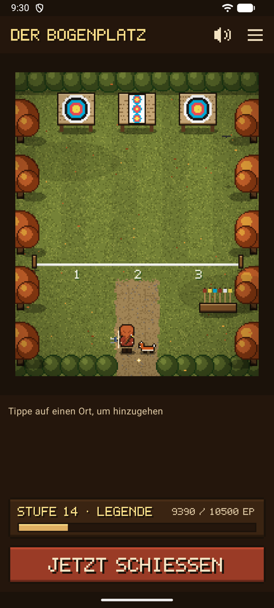{ .shot }
<figcaption><b>Der Bogenplatz.</b> An der Schießlinie beginnt eine Einheit.</figcaption>
</figure>
<figure markdown>
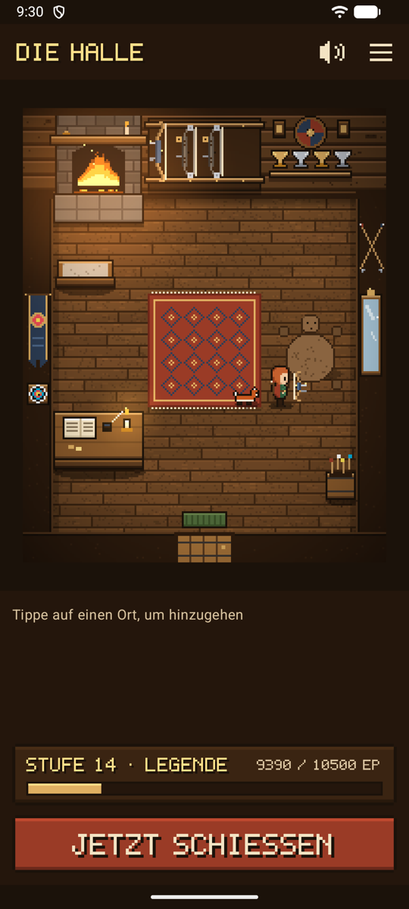{ .shot }
<figcaption><b>Ein Begleiter</b> folgt dir überallhin.</figcaption>
</figure>

## Unterwegs { #getting-around }

- **Tippe auf einen Ort:** Deine Figur geht auf dem kürzesten Weg dorthin, um die Möbel herum, dann öffnet sich der Ort. Sein Name steht darüber und im Feld unten, mit **Los** oder **Öffnen**.
- **Tippe auf den Boden**, um einfach dorthin zu gehen.
- **Orte** (☰, oben rechts) listet jeden Ort in beiden Räumen auf und öffnet ihn sofort, ohne Laufen. Praktisch, wenn du es eilig hast, und einfach mit einem Screenreader zu bedienen.
- **Jetzt schießen**, ganz unten, führt direkt zur Kamera für deine laufende Einheit oder zu einer neuen Einheit. Auf dem Bogenplatz hält dich das Spiel nie auf.
- **Zurück** bringt dich von jedem Bildschirm ins Spiel zurück, genau dorthin, wo deine Figur stand.

| In der Halle | Öffnet |
|-------------|-------|
| **Bogenständer** (deine eigenen Bögen hängen daran, jeder nach seinem Typ gezeichnet: Blankbogen, Recurvebogen mit Visier und Stabilisator, Compoundbogen mit Cams; deine Figur hält denselben Typ) | Deine Bögen |
| **Trophäenwand** | Deine Trophäen: Stufe, Abzeichen und Bestleistungen |
| **Schreibpult** | Einstellungen |
| **Spiegel** | Deine Figur |
| **Feuerstelle** | Deine Statistik, „am Feuer“ |
| **Tür** | Den Bogenplatz |

| Auf dem Bogenplatz | Öffnet |
|--------------|-------|
| **Schießlinie** | Eine neue Einheit oder die laufende |
| **Scheiben** | Die laufende Einheit (solange eine offen ist, stecken Pfeile in den Scheiben) |
| **Pfeilständer** | Die Passe, die auf deine Prüfung wartet. Ein **!** erscheint über dem Ständer, wenn eine wartet. |
| **Heimweg** | Die Halle |

## Deine Figur { #your-archer }

Geh zum **Spiegel**, um deine Figur einzukleiden. Die Vorschau bleibt oben, während du durch die Auswahl scrollst, und jede Änderung wird sofort gespeichert.

<figure markdown>
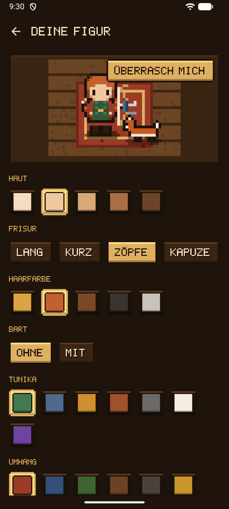{ .shot }
<figcaption><b>Der Spiegel.</b> Auswählen und sofort sehen.</figcaption>
</figure>
<figure markdown>
{ width="360" .pixel }
<figcaption><b>Outfits</b>, von allen Seiten gezeichnet.</figcaption>
</figure>

| Auswahl | Möglichkeiten |
|--------|---------|
| Haut | Fünf Töne |
| Frisur | Lang, kurz, Zöpfe oder Kapuze, in fünf Farben |
| Bart | Mit oder ohne |
| Tunika, Umhang, Hose | Sechs, fünf und fünf Farben, und auf Wunsch kein Umhang; zum Verdienen eine **königspurpurne Tunika** (Stufe 8), ein **goldener Umhang** (Stufe 5) und ein **silberner Umhang** (Abzeichen *Zehn X*) |
| Kopfbedeckung | Helm, Pelzmütze, Blumenkranz, Stirnband; zum Verdienen ein **Goldreif** (Stufe 3), ein **Lorbeerkranz** (Abzeichen *Perfekte Passe*) und ein **Federhut** (Abzeichen *Entdecker*) |
| Accessoire | Pelzkragen, Schal, Hammeramulett, Brille; zum Verdienen ein **Köcher** (Abzeichen *Erste Passe*) und eine **Medaille** (Abzeichen *Neuer Rekord*) |

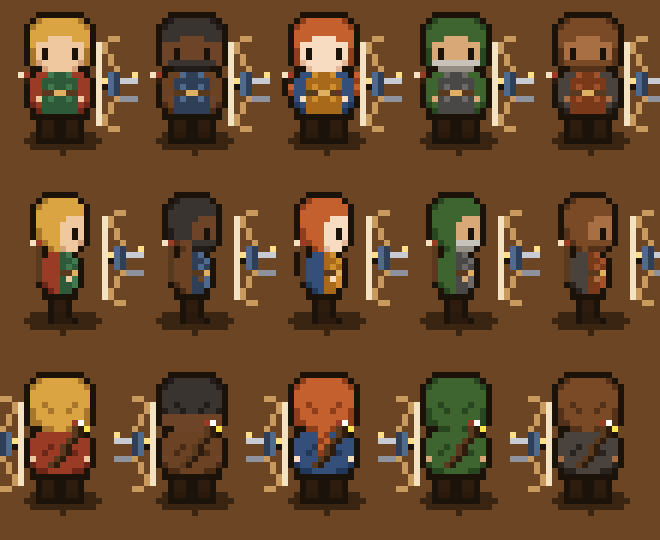{ width="330" .pixel }

**Überrasch mich** wählt ein zufälliges Aussehen. Deine Figur hält den Typ deines ersten Bogens: Blankbogen, Recurvebogen oder Compoundbogen.

**Bogenlegenden.** Oben am Spiegel stellen vier fertige Figuren mit einem Tippen das ganze Aussehen samt Begleiter ein: **Artemis**, griechische Göttin der Jagd, mit ihrem Jagdhund; **Ullr**, nordischer Gott des Bogenschießens und des Winters, in Pelzen, mit einem Raben; **Robin Hood** in Lincoln-Grün, mit einem Fuchs; und **Hou Yi**, der chinesische Bogenschütze, der neun Sonnen vom Himmel schoss. Danach kannst du jedes Teil ändern.

{ width="420" .pixel }

## Begleiter { #companions }

Wähle am Spiegel einen Begleiter: einen **Hund**, eine **Katze**, einen **Fuchs** oder einen **Raben**, eine **Eule**, sobald du vier Wochen in Folge geschossen hast, und noch einen, den du selbst entdecken darfst. Er folgt dem Weg, den deine Figur gegangen ist, etwa einen Schritt dahinter, läuft also nie durch die Möbel, und setzt sich neben dich, wenn du stehen bleibst. Hund, Katze und Fuchs traben und wedeln mit dem Schwanz, der Rabe hüpft, und die Eule hüpft und blinzelt mit ihren großen Augen.

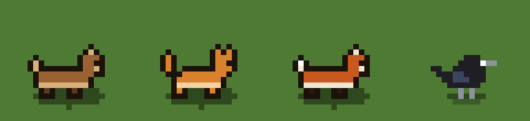{ width="420" .pixel }

## Stufen, Abzeichen und Trophäen { #levels-badges-and-trophies }

Nur echtes Schießen bringt etwas ein: **10 Erfahrungspunkte** für jede bestätigte Passe, **30** für jede abgeschlossene Einheit und **50** für jedes Abzeichen. Nichts zu kaufen, und nichts nur fürs Öffnen der App. Deine Stufe und ihr Balken stehen unten im Spiel, mit einem Titel, der von **Neuling** über **Schütze**, **Meisterschütze** und **Bogenmeister** bis zur **Legende** wächst.

<figure markdown>
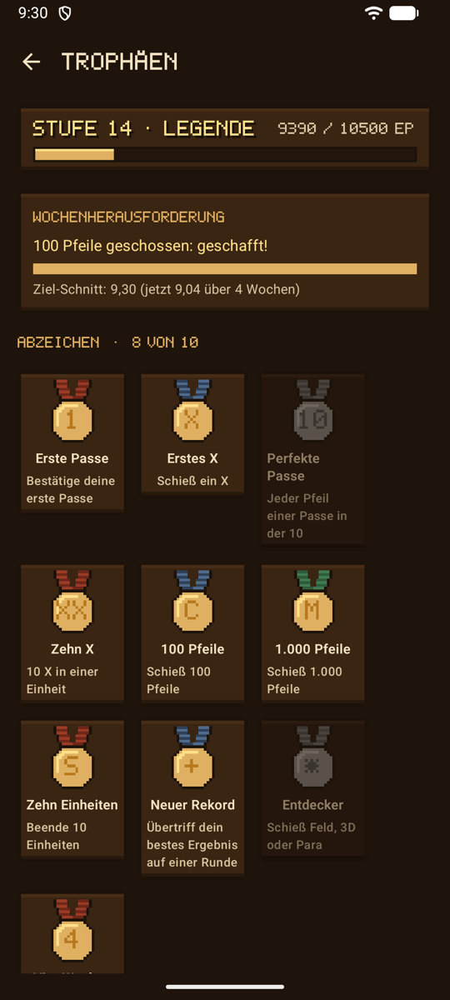{ .shot }
<figcaption><b>Trophäen</b>, an der Trophäenwand.</figcaption>
</figure>
<figure markdown>
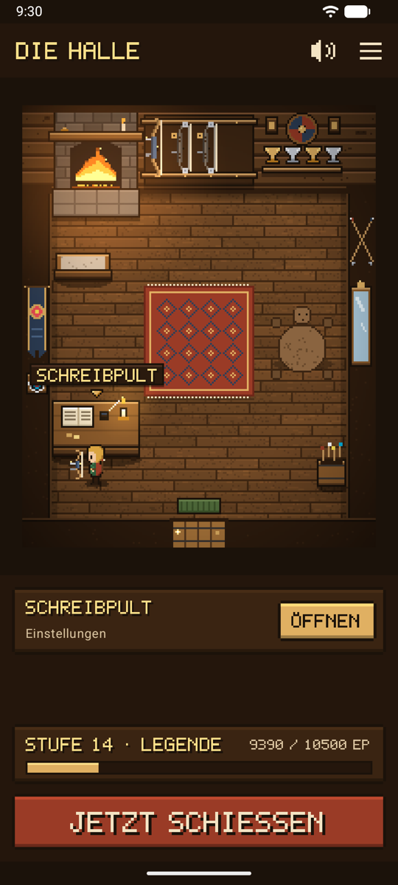{ .shot }
<figcaption>Deine Stufe und ein Pokal für jeden Rekord.</figcaption>
</figure>

- **Zehn Abzeichen** für echte Meilensteine, golden, sobald verdient, und bis dahin grau. Jedes bringt außerdem eine [Belohnung](#rewards):

| Medaille | Abzeichen | So verdienst du es | Belohnung |
|:-:|-------|----------------|--------|
| 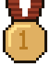{ width="36" .pixel } | **Erste Passe** | Bestätige deine erste Passe | Köcher |
| 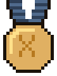{ width="36" .pixel } | **Erstes X** | Schieß ein X | Bemalte Scheibe in der Halle |
| 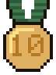{ width="36" .pixel } | **Perfekte Passe** | Alle Pfeile einer Passe in der 10 | Lorbeerkranz |
| 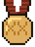{ width="36" .pixel } | **Zehn X** | 10 X in einer Einheit | Silberner Umhang |
| 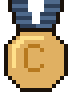{ width="36" .pixel } | **100 Pfeile** | Schieß 100 Pfeile | Gekreuzte Pfeile in der Halle |
| 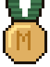{ width="36" .pixel } | **1.000 Pfeile** | Schieß 1.000 Pfeile | Fell neben dem Teppich |
| 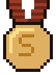{ width="36" .pixel } | **Zehn Einheiten** | Beende 10 Einheiten | Banner in der Halle |
| 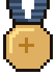{ width="36" .pixel } | **Neuer Rekord** | Übertriff dein bestes Ergebnis auf einer Runde | Medaille |
| 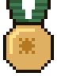{ width="36" .pixel } | **Entdecker** | Schieß Feld, 3D oder Para | Federhut |
| 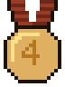{ width="36" .pixel } | **Vier Wochen** | Schieß vier Wochen in Folge | Eule als Begleiter |

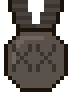{ width="36" .pixel } Eine noch nicht verdiente Medaille bleibt grau. Das Zeichen auf jeder Medaille (Zahlen, römische Ziffern) liest sich auf Englisch, Französisch, Deutsch und Spanisch gleich.

- **Bestleistungen** für jede Runde (Entfernung, Auflage und Pfeilzahl). Jede stellt einen Pokal auf das Trophäenregal, und die Plaketten leuchten auf, wenn Abzeichen dazukommen. Tippe auf einen Rekord, um seine Einheit zu öffnen.
- Eine neue Stufe oder ein neues Abzeichen wird einmal mit **Fanfare und Banner** verkündet. Übertriffst du deine Bestleistung auf einer Runde, die du schon geschossen hast, ertönt das **Kriegshorn**.
- Alles wird aus deinen Einheiten berechnet: Löschst du eine Einheit, verschwindet auch, was sie eingebracht hat.
- **Erfahrung und Abzeichen zurücksetzen**, unten bei den Trophäen, beginnt nach einer Rückfrage wieder bei Stufe 1 ohne Abzeichen. Deine Einheiten, Ergebnisse und Bestleistungen bleiben; ab dann bringt dein Schießen wieder Erfahrung und Abzeichen, und die Trophäen zeigen, seit wann. Um auch Einheiten zu löschen, siehe [Speicher und Sicherung](backup.md#erase-data).

## Die Wochenherausforderung { #this-weeks-challenge }

Wenn du [Trainingsziele](normal.md#training-goals) festgelegt hast, zeigt die Trophäenwand die **Wochenherausforderung**: die Pfeile, die du diese Woche schießen willst, mit einem goldenen Balken, und den Schnitt pro Pfeil, den du erreichen willst. Erreichst du das Pfeilziel einer Woche zum ersten Mal, spielt die Halle eine **Fanfare** mit dem Banner **Herausforderung geschafft!**. Ziele bringen keine Erfahrung, deshalb verändert das Ändern eines Ziels nie deinen Fortschritt.

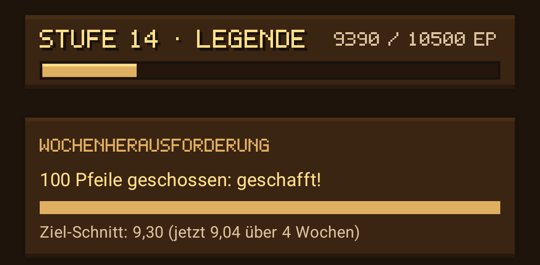{ .shot width="320" }

## Belohnungen { #rewards }

Was du beim Schießen verdienst, schaltet **Belohnungen** frei, aufgelistet an der Trophäenwand. Nichts wird gekauft, und alle anderen Outfits sind von Anfang an frei.

| Belohnung | So verdienst du sie |
|--------|----------------|
| **Goldreif**, am Spiegel | Erreiche Stufe 3 |
| **Goldener Umhang**, am Spiegel | Erreiche Stufe 5 |
| **Königspurpurne Tunika**, am Spiegel | Erreiche Stufe 8 |
| **Köcher**, am Spiegel | Verdiene das Abzeichen *Erste Passe* |
| **Eine bemalte Scheibe in der Halle**, an der linken Wand | Verdiene das Abzeichen *Erstes X* |
| **Lorbeerkranz**, am Spiegel | Verdiene das Abzeichen *Perfekte Passe* |
| **Silberner Umhang**, am Spiegel | Verdiene das Abzeichen *Zehn X* |
| **Gekreuzte Pfeile in der Halle**, über dem Spiegel | Verdiene das Abzeichen *100 Pfeile* |
| **Ein Fell neben dem Teppich** | Verdiene das Abzeichen *1.000 Pfeile* |
| **Ein Banner in der Halle**, an der linken Wand | Verdiene das Abzeichen *Zehn Einheiten* |
| **Medaille**, am Spiegel | Verdiene das Abzeichen *Neuer Rekord* |
| **Federhut**, am Spiegel | Verdiene das Abzeichen *Entdecker* |
| **Eule**, ein Begleiter am Spiegel | Verdiene das Abzeichen *Vier Wochen* |

<figure markdown>
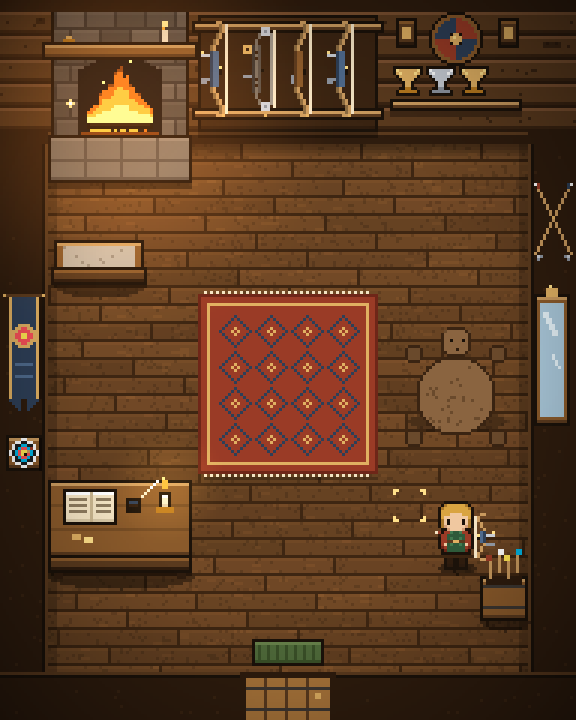{ .shot }
<figcaption>Alle Dekorationen verdient.</figcaption>
</figure>
<figure markdown>
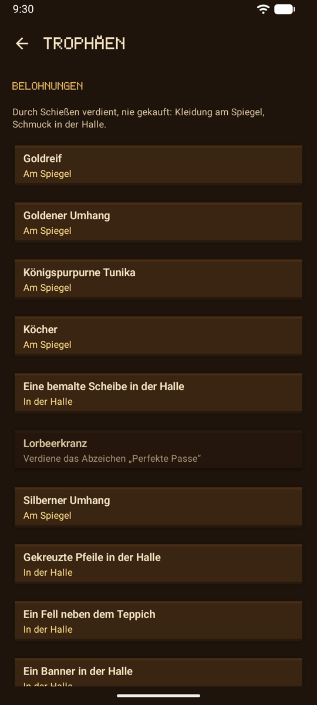{ .shot }
<figcaption><b>Belohnungen</b>, an der Trophäenwand.</figcaption>
</figure>
<figure markdown>
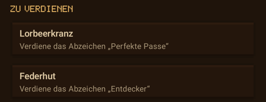{ .shot }
<figcaption><b>Zu verdienen</b>, am Spiegel.</figcaption>
</figure>

Outfits, die du noch verdienen musst, warten unten am Spiegel unter **Zu verdienen**; sobald du sie verdient hast, erscheinen sie bei den anderen, und **Überrasch mich** kann sie wählen. Nach einem Zurücksetzen bleibt eine Belohnung, die du gerade trägst, an.

## Jahreszeiten { #seasons }

Der Bogenplatz folgt dem Kalender: Schnee und Nadelbäume im Winter (Dezember bis Februar), Blüten und Wildblumen im Frühling, sattes Grün im Sommer und rote und goldene Bäume mit fallendem Laub im Herbst (September bis November).

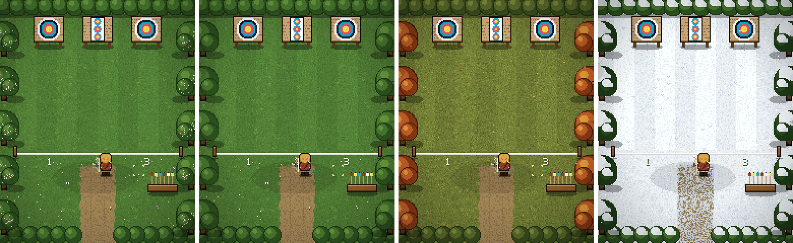

## Ton und Musik { #sound-and-music }

Schritte auf dem Holzboden und im Gras, ein kleiner Piepton, wenn du einen Ort wählst, ein Glockenklang, wenn er sich öffnet, das Knarren der Tür, das Knistern des Feuers in der Halle, Wind und Vögel auf dem Bogenplatz und eine leise Lautenmelodie. Alles wurde eigens für Ullr gemacht.

- Der Ton läuft mit der **Medien**-Lautstärke des Handys, wie bei anderen Spielen: Lautlos und Vibration schalten Anrufe und Benachrichtigungen stumm, nicht Spiele.
- Der **Lautsprecher-Knopf** oben im Spiel schaltet den Ton aus und wieder an. **Einstellungen → Aussehen und Spiel → Spielgeräusche** und **Musik** schalten beides getrennt aus.
- Der Ton verstummt, sobald die App im Hintergrund ist.

## Jeder Bildschirm im Spiel-Look { #every-screen-in-the-game-look }

Im Spielmodus trägt jeder Bildschirm den Stil des Spiels: dunkles Holz und Gold, Pixelschrift für Titel, Knöpfe und große Ergebnisse, und jedes Ergebnis in der Farbe seines Rings.

<figure markdown>
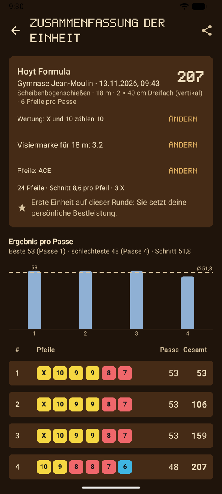{ .shot }
<figcaption>Eine Zusammenfassung der Einheit</figcaption>
</figure>
<figure markdown>
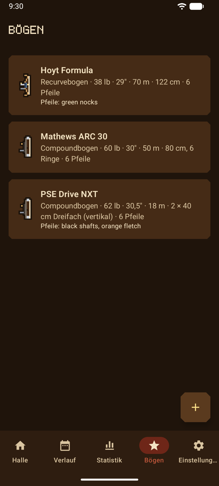{ .shot }
<figcaption>Deine Bögen</figcaption>
</figure>
<figure markdown>
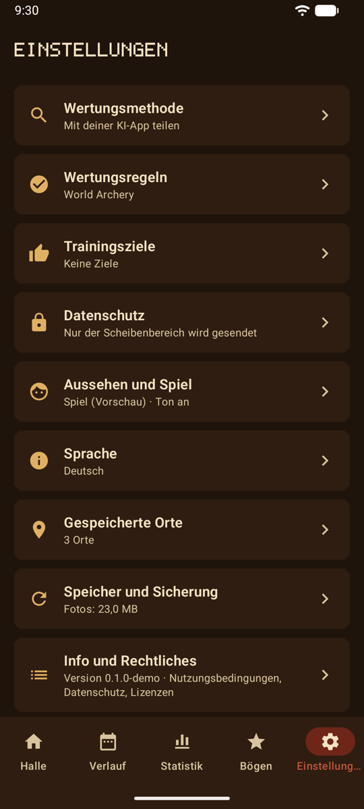{ .shot }
<figcaption>Einstellungen, nach Thema gruppiert</figcaption>
</figure>

## Datenschutz { #privacy }

Der Spielmodus sendet nichts. Das Aussehen deiner Figur, dein Begleiter und deine Toneinstellungen bleiben mit den anderen Einstellungen auf dem Handy. Die Bilder zeichnet die App selbst, und die Klänge sind Teil der App: Nichts wird heruntergeladen, und es kommt keine Berechtigung hinzu.

## Wie es weitergeht { #whats-next }

Der Spielmodus ist eine Vorschau. Was als Nächstes kommt, steht in der [Roadmap](roadmap.md).
