# Mode jeu

Ullr s’utilise aussi autrement : **la même application, en petit jeu vidéo en pixel art.** Votre archer se promène dans une maison nordique et sur un pas de tir, et chaque endroit ouvre un écran. Vos arcs, vos séances et vos scores sont exactement les mêmes qu’en mode normal, et les écrans de comptage fonctionnent de la même façon.

Activez-le dans **Réglages → Apparence et jeu → Jeu (aperçu)**. **Normal** revient en arrière à tout moment, sans rien perdre.

<figure markdown>
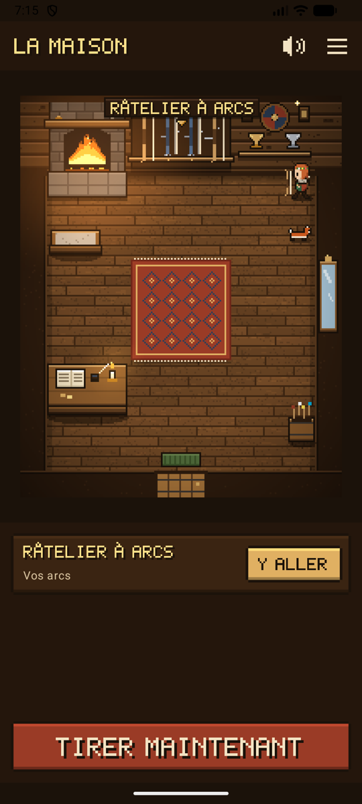{ .shot }
<figcaption><b>La maison.</b> Touchez un endroit et votre archer s’y rend.</figcaption>
</figure>
<figure markdown>
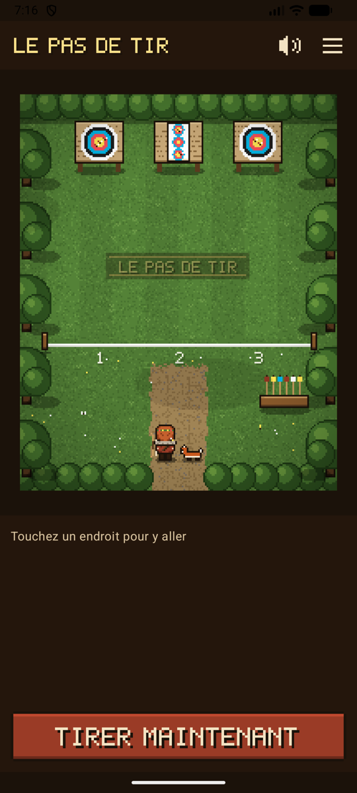{ .shot }
<figcaption><b>Le pas de tir.</b> La ligne de tir commence une séance.</figcaption>
</figure>
<figure markdown>
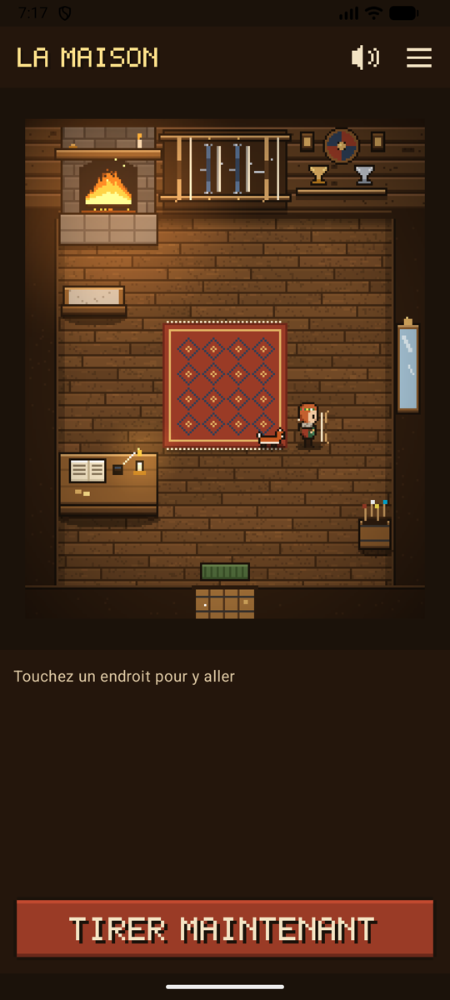{ .shot }
<figcaption><b>Un compagnon</b> vous suit partout.</figcaption>
</figure>

## Se déplacer

- **Touchez un endroit :** votre archer s’y rend par le plus court chemin, en contournant les meubles, puis l’endroit s’ouvre. Son nom s’affiche au-dessus et dans le panneau du bas, avec **Y aller** ou **Ouvrir**.
- **Touchez le plancher** pour simplement y marcher.
- **Endroits** (☰, en haut à droite) liste tous les endroits des deux pièces et les ouvre directement, sans marcher. Pratique quand on est pressé, et facile avec un lecteur d’écran.
- **Tirer maintenant**, en bas, ouvre directement l’appareil photo de votre séance en cours, ou une nouvelle séance. Le jeu ne vous ralentit jamais au pas de tir.
- **Retour**, depuis n’importe quel écran, vous ramène au jeu, là où se tenait votre archer.

| Dans la maison | Ouvre |
|----------------|-------|
| **Râtelier à arcs** (vos propres arcs y sont accrochés, chacun dessiné selon son type : arc nu, arc recourbé avec viseur et stabilisateur, arc à poulies avec ses cames ; votre archer tient le même type) | Vos arcs |
| **Mur des trophées** | Vos trophées : niveau, insignes et records personnels |
| **Bureau** | Les réglages |
| **Miroir** | Votre archer |
| **Âtre** | Vos statistiques, « au coin du feu » |
| **Porte** | Le pas de tir |

| Sur le pas de tir | Ouvre |
|-------------------|-------|
| **Ligne de tir** | Une nouvelle séance, ou celle en cours |
| **Cibles** | La séance en cours (pendant une séance, des flèches sont plantées dans les cibles) |
| **Porte-flèches** | La volée qui attend votre vérification. Un **!** apparaît au-dessus quand une volée attend. |
| **Chemin de la maison** | La maison |

## Votre archer

Rendez-vous au **miroir** pour habiller votre archer. L’aperçu reste en haut pendant que vous faites défiler les choix, et chaque changement est enregistré aussitôt.

<figure markdown>
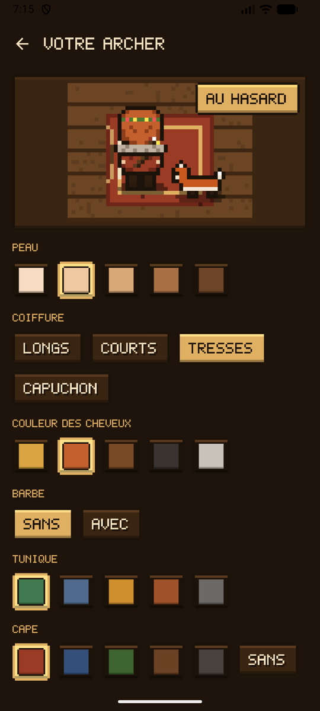{ .shot }
<figcaption><b>Le miroir.</b> Choisissez, et voyez le résultat tout de suite.</figcaption>
</figure>
<figure markdown>
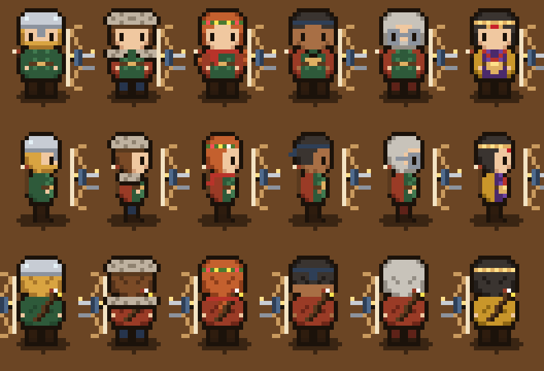{ width="300" .pixel }
<figcaption><b>Les tenues</b>, dessinées sous tous les angles.</figcaption>
</figure>

| Choix | Options |
|-------|---------|
| Peau | Cinq teintes |
| Cheveux | Longs, courts, tresses ou capuchon, en cinq couleurs |
| Barbe | Avec ou sans |
| Tunique, cape, pantalon | Cinq couleurs chacun, et pas de cape si vous préférez |
| Coiffe | Casque, toque de fourrure, couronne de fleurs, bandeau |
| Accessoire | Mantelet de fourrure, écharpe, amulette marteau, lunettes |

**Au hasard** choisit une apparence au hasard. Votre archer tient le type de votre premier arc : arc nu, arc recourbé ou arc à poulies.

**Archers légendaires.** En haut du miroir, quatre archers tout prêts règlent toute l’apparence et le compagnon en une touche : **Artémis**, déesse grecque de la chasse, avec son chien ; **Ullr**, dieu nordique du tir à l’arc et de l’hiver, en fourrures, avec un corbeau ; **Robin des Bois**, tout en vert, avec un renard ; et **Hou Yi**, l’archer chinois qui abattit neuf soleils. Changez ensuite ce que vous voulez.

{ width="420" .pixel }

## Les compagnons

Choisissez un compagnon au miroir : un **chien**, un **chat**, un **renard**, ou un **corbeau** (et un autre à découvrir). Il suit le chemin parcouru par votre archer, environ un pas derrière, sans jamais traverser les meubles, et s’assoit à côté de vous quand vous vous arrêtez. Le chien, le chat et le renard trottinent et remuent la queue, et le corbeau sautille.

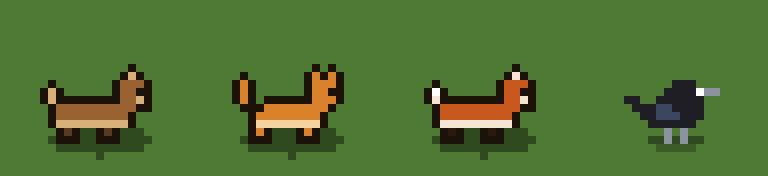{ width="420" .pixel }

## Niveaux, insignes et trophées

Seul le vrai tir rapporte : **10 points d’expérience** par volée confirmée, **30** par séance terminée et **50** par insigne. Rien à acheter, et rien pour simplement ouvrir l’application. Votre niveau et sa barre s’affichent en bas du jeu, avec un titre qui passe de **Novice** à **Archer**, **Tireur d’élite**, **Maître archer** et **Légende**.

<figure markdown>
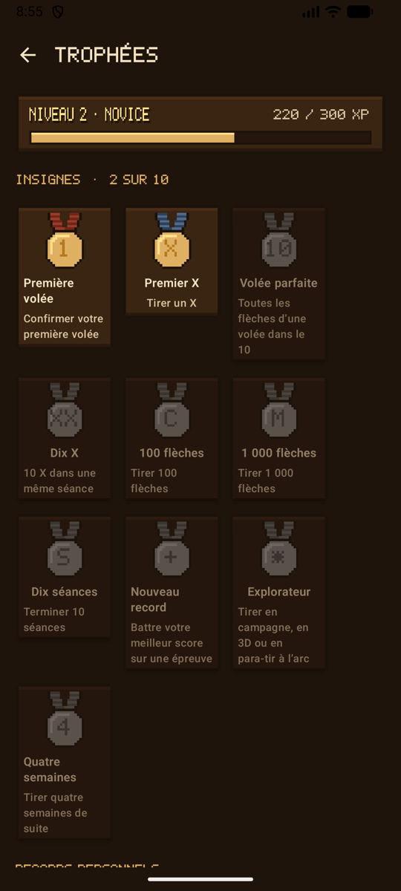{ .shot }
<figcaption><b>Les trophées</b>, au mur des trophées.</figcaption>
</figure>
<figure markdown>
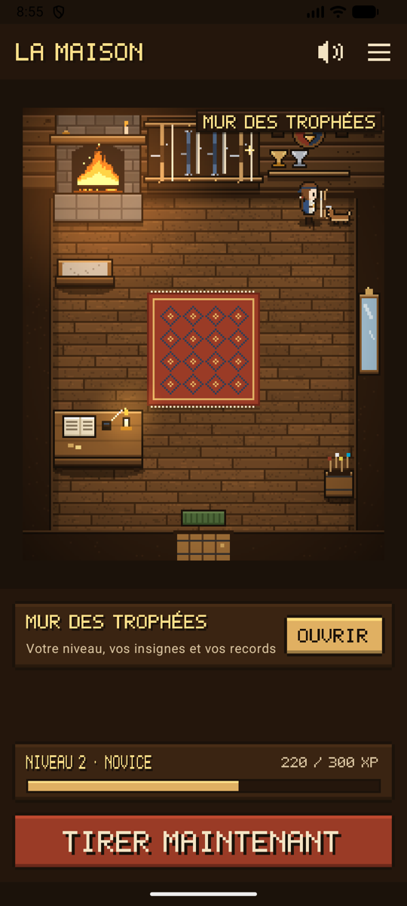{ .shot }
<figcaption>Votre niveau, et une coupe par record.</figcaption>
</figure>

- **Dix insignes** pour de vraies étapes : votre première volée, votre premier X, une volée parfaite, dix X dans une séance, 100 et 1 000 flèches, dix séances, un nouveau record personnel, tirer en campagne, en 3D ou en para-tir à l’arc, et quatre semaines de suite.
- **Records personnels** pour chaque épreuve (distance, blason et nombre de flèches). Chacun pose une coupe sur l’étagère, et les plaques s’allument au fil des insignes. Touchez un record pour ouvrir sa séance.
- Un nouveau niveau ou un nouvel insigne est annoncé par **un cor et une bannière**, une seule fois.
- Tout est calculé à partir de vos séances : supprimez une séance et ce qu’elle a rapporté disparaît avec elle.
- **Remettre à zéro l’expérience et les insignes**, au bas des trophées, vous ramène au niveau 1 sans insigne, après confirmation. Vos séances, vos scores et vos records restent ; à partir de là, ce que vous tirez rapporte de nouveau de l’expérience et des insignes, et les trophées indiquent depuis quand. Pour effacer aussi les séances, voir [Stockage et sauvegarde](backup.md#effacer-les-donnees).

## Sons et musique

Des pas sur le plancher et dans l’herbe, un petit son quand vous choisissez un endroit, un carillon quand il s’ouvre, le grincement de la porte, le crépitement du feu dans la maison, le vent et les oiseaux sur le pas de tir, et un petit air de luth. Tout a été composé pour Ullr.

- Le son joue au volume **multimédia** du téléphone, comme les autres jeux : les modes silencieux et vibreur coupent les appels et les notifications, pas les jeux.
- Le **bouton haut-parleur**, en haut du jeu, coupe et remet le son. **Réglages → Apparence et jeu → Sons du jeu** et **Musique** les coupent séparément.
- Le son s’arrête dès que l’application passe en arrière-plan.

## Tous les écrans au style du jeu

En mode jeu, chaque écran prend le style du jeu : bois sombre et or, lettres en pixels pour les titres, les boutons et les gros scores, et chaque score dans la couleur de sa zone.

<figure markdown>
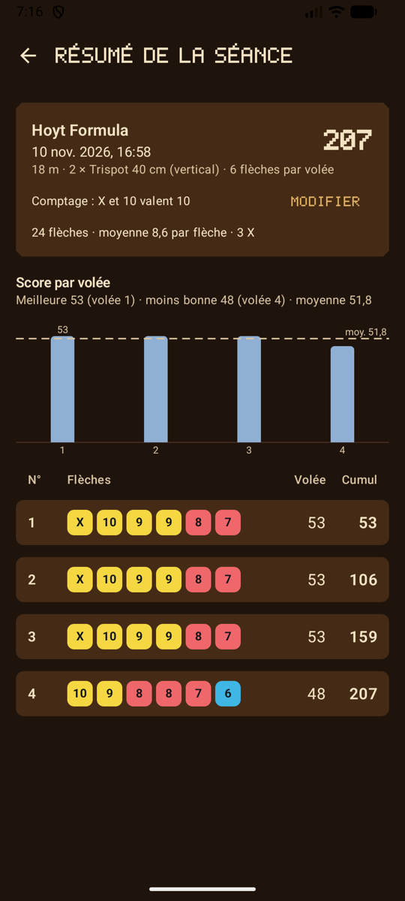{ .shot }
<figcaption>Un résumé de séance</figcaption>
</figure>
<figure markdown>
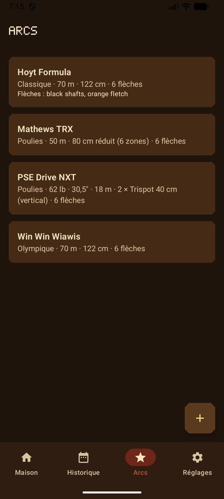{ .shot }
<figcaption>Vos arcs</figcaption>
</figure>
<figure markdown>
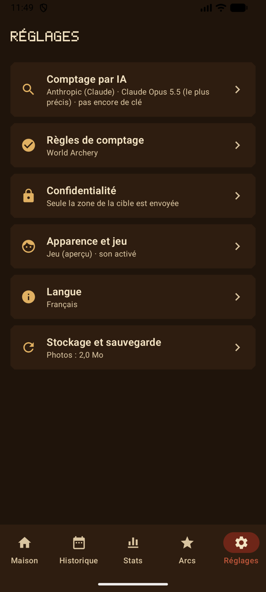{ .shot }
<figcaption>Les réglages, regroupés par thème</figcaption>
</figure>

## Confidentialité

Le mode jeu n’envoie rien. L’apparence de votre archer, votre compagnon et vos réglages de son restent sur le téléphone avec les autres réglages. Les images sont dessinées par l’application et les sons en font partie : rien n’est téléchargé, et aucune permission n’est ajoutée.

## La suite

Le mode jeu est un aperçu. À venir : des tenues débloquées par les niveaux et les insignes. Voir la [feuille de route](roadmap.md).
