# Game mode

Ullr has a second way to use it: **the same app, as a small pixel-art video game.** Your archer walks around a Norse hall and an archery range, and each place opens a screen. Your bows, sessions and scores are exactly the same as in the normal mode, and the scoring screens work the same way.

Turn it on in **Settings → Appearance and game → Game (preview)** (*Réglages → Apparence et jeu → Jeu (aperçu)*). **Normal** switches back at any time; nothing is lost either way.

<figure markdown>
{ .shot }
<figcaption><b>The hall.</b> Tap a place and your archer walks there.</figcaption>
</figure>
<figure markdown>
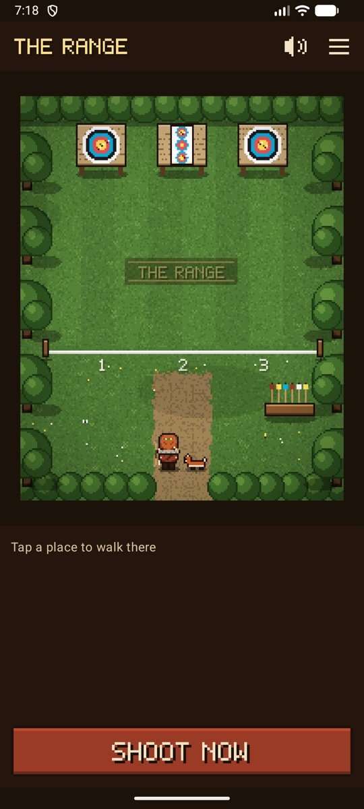{ .shot }
<figcaption><b>The range.</b> The shooting line starts a session.</figcaption>
</figure>
<figure markdown>
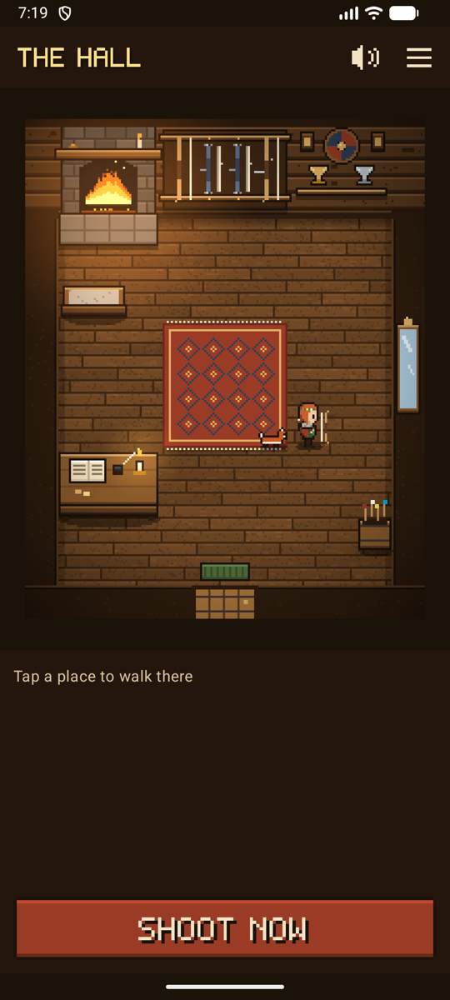{ .shot }
<figcaption><b>A companion</b> follows you around.</figcaption>
</figure>

## Getting around

- **Tap a place:** your archer walks there by the shortest way, around the furniture, then the place opens. Its name shows above it and in the panel at the bottom, with **Go** or **Open**.
- **Tap the floor** to just walk there.
- **Places** (☰, top right) lists every place in both rooms and opens it straight away, without walking. Handy when you're in a hurry, and easy to use with a screen reader.
- **Shoot now** (*Tirer maintenant*), at the bottom, goes straight to the camera for your session in progress, or to a new session. The game never slows you down at the range.
- **Back** from any screen returns you to the game, where your archer was standing.

| In the hall | Opens |
|-------------|-------|
| **Bow rack** (your own bows hang on it, each drawn as its type: barebow, recurve with sight and stabilizer, compound with cams; your archer holds the same type) | Your bows |
| **Trophy wall** | Your trophies: level, badges and personal bests |
| **Writing desk** | Settings |
| **Mirror** | Your archer |
| **Hearth** | Your statistics, "by the fire" |
| **Door** | The range |

| On the range | Opens |
|--------------|-------|
| **Shooting line** | A new session, or the one in progress |
| **Targets** | The session in progress (while one is open, arrows show in the targets) |
| **Arrow stand** | The end waiting for your check. A **!** shows over the stand when one is waiting. |
| **Path home** | The hall |

## Your archer

Walk to the **mirror** to dress your archer. The preview stays at the top while you scroll through the choices, and every change is saved at once.

<figure markdown>
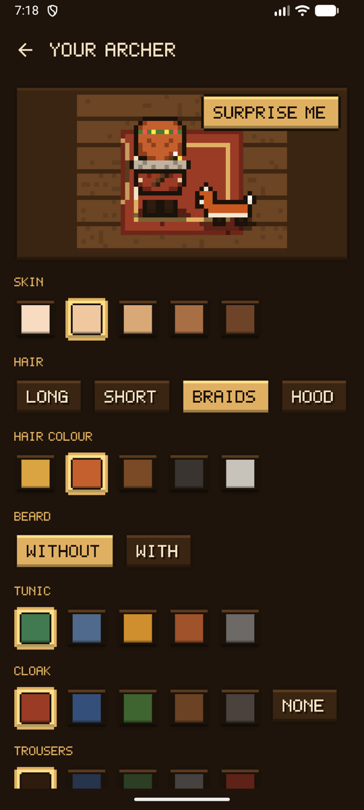{ .shot }
<figcaption><b>The mirror.</b> Pick, and see it at once.</figcaption>
</figure>
<figure markdown>
{ width="360" .pixel }
<figcaption><b>Outfits</b>, drawn from every side.</figcaption>
</figure>

| Choice | Options |
|--------|---------|
| Skin | Five tones |
| Hair | Long, short, braids or a hood, in five colours |
| Beard | With or without |
| Tunic, cloak, trousers | Six, five and five colours, and no cloak if you prefer; a **royal purple tunic** (level 8), a **gold cloak** (level 5) and a **silver cloak** (badge *Ten X*) to earn |
| Headwear | Helmet, fur hat, flower crown, headband; a **gold circlet** (level 3), a **laurel wreath** (badge *Perfect end*) and a **feathered hat** (badge *Explorer*) to earn |
| Accessory | Fur mantle, scarf, hammer amulet, glasses; a **quiver** (badge *First end*) and a **medal** (badge *New record*) to earn |

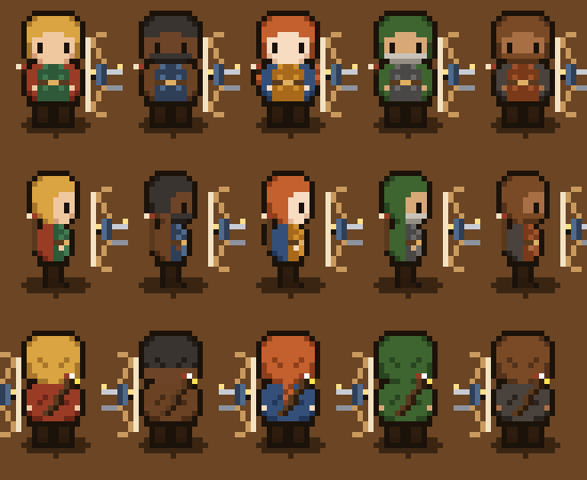{ width="330" .pixel }

**Surprise me** (*Au hasard*) picks a random look. Your archer holds the type of your first bow: barebow, recurve or compound.

**Legendary archers.** At the top of the mirror, four ready-made archers set the whole look and companion in one tap: **Artemis**, Greek goddess of the hunt, with her hound; **Ullr**, Norse god of archery and winter, in furs, with a raven; **Robin Hood** in Lincoln green, with a fox; and **Hou Yi**, the Chinese archer who shot down nine suns. Change any piece after.

{ width="420" .pixel }

## Companions

Choose a companion at the mirror: a **dog**, a **cat**, a **fox** or a **raven**, an **owl** once you've shot four weeks in a row, and one more to discover. It follows the path your archer walked, about a step behind, so it never cuts through the furniture, and sits beside you when you stop. The dog, cat and fox trot and wag their tails, the raven hops, and the owl hops and blinks its big eyes.

{ width="420" .pixel }

## Levels, badges and trophies

Only real shooting earns anything: **10 experience** for each confirmed end, **30** for each finished session and **50** for each badge. Nothing to buy, and nothing for just opening the app. Your level and its bar show at the bottom of the game, with a title that grows from **Novice** to **Archer**, **Marksman**, **Master archer** and **Legend**.

<figure markdown>
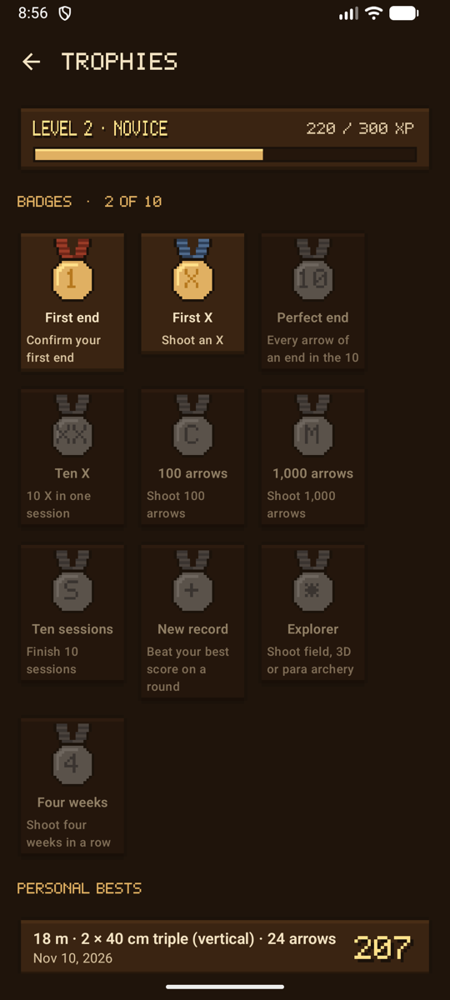{ .shot }
<figcaption><b>Trophies</b>, at the trophy wall.</figcaption>
</figure>
<figure markdown>
{ .shot }
<figcaption>Your level, and a cup for each record.</figcaption>
</figure>

- **Ten badges** for real milestones, gold once earned and grey until then. Each one also earns a [reward](#rewards):

| Medal | Badge | How to earn it | Reward |
|:-:|-------|----------------|--------|
| { width="36" .pixel } | **First end** | Confirm your first end | Quiver |
| 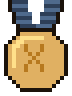{ width="36" .pixel } | **First X** | Shoot an X | Painted target in the hall |
| 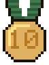{ width="36" .pixel } | **Perfect end** | Every arrow of an end in the 10 | Laurel wreath |
| 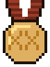{ width="36" .pixel } | **Ten X** | 10 X in one session | Silver cloak |
| { width="36" .pixel } | **100 arrows** | Shoot 100 arrows | Crossed arrows in the hall |
| 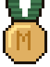{ width="36" .pixel } | **1,000 arrows** | Shoot 1,000 arrows | Pelt by the rug |
| 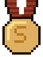{ width="36" .pixel } | **Ten sessions** | Finish 10 sessions | Banner in the hall |
| { width="36" .pixel } | **New record** | Beat your best score on a round | Medal |
| 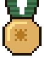{ width="36" .pixel } | **Explorer** | Shoot field, 3D or para archery | Feathered hat |
| 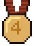{ width="36" .pixel } | **Four weeks** | Shoot four weeks in a row | Owl companion |

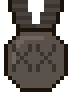{ width="36" .pixel } A medal not earned yet stays grey. The mark on each medal (numbers, Roman numerals) reads the same in English and French.

- **Personal bests** for each round (distance, face and number of arrows). Each one puts a cup on the trophy shelf, and the plaques light up as badges come in. Tap a record to open its session.
- A new level or badge is announced with a **fanfare and a banner**, once. Beating a personal best on a round you've shot before sounds the **war horn**.
- It's all worked out from your sessions: delete a session and what it earned goes with it.
- **Reset experience and badges** (*Remettre à zéro l’expérience et les insignes*), at the bottom of the trophies, starts again at level 1 with no badges, after asking. Your sessions, scores and personal bests stay; from then on, what you shoot earns experience and badges again, and the trophies say since when. To erase sessions too, see [Storage and backup](backup.md#erase-data).

## This week's challenge

With [training goals](normal.md#training-goals) set, the trophy wall shows **this week's challenge** (*Défi de la semaine*): the arrows to shoot this week, with a gold bar, and the average per arrow to reach. The first time you meet the arrows goal in a week, the hall plays a **fanfare** with a **Challenge met!** banner. Goals earn no experience, so changing one never rewrites your progress.

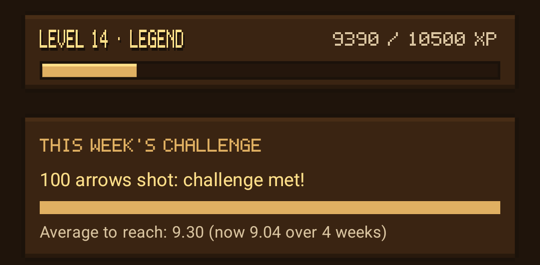{ .shot width="320" }

## Rewards

What you earn by shooting unlocks **rewards**, listed at the trophy wall. Nothing is bought, and every other outfit is free from the start.

| Reward | How to earn it |
|--------|----------------|
| **Gold circlet**, at the mirror | Reach level 3 |
| **Gold cloak**, at the mirror | Reach level 5 |
| **Royal purple tunic**, at the mirror | Reach level 8 |
| **Quiver**, at the mirror | Earn the badge *First end* |
| **A painted target in the hall**, on the left wall | Earn the badge *First X* |
| **Laurel wreath**, at the mirror | Earn the badge *Perfect end* |
| **Silver cloak**, at the mirror | Earn the badge *Ten X* |
| **Crossed arrows in the hall**, above the mirror | Earn the badge *100 arrows* |
| **A pelt by the rug** | Earn the badge *1,000 arrows* |
| **A banner in the hall**, on the left wall | Earn the badge *Ten sessions* |
| **Medal**, at the mirror | Earn the badge *New record* |
| **Feathered hat**, at the mirror | Earn the badge *Explorer* |
| **Owl**, a companion at the mirror | Earn the badge *Four weeks* |

<figure markdown>
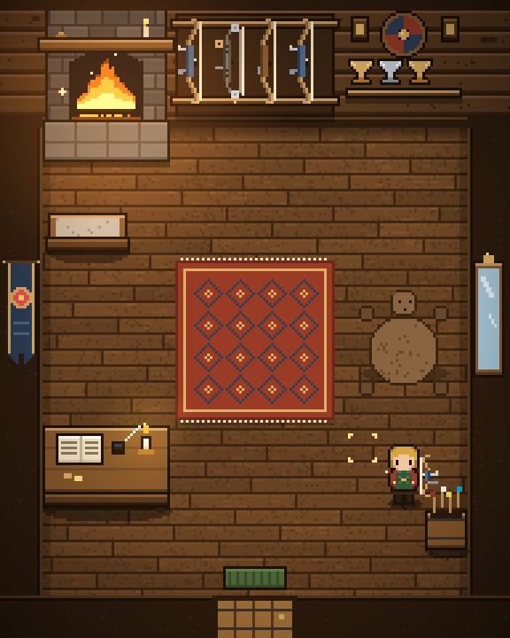{ .shot }
<figcaption>Every decoration, earned.</figcaption>
</figure>
<figure markdown>
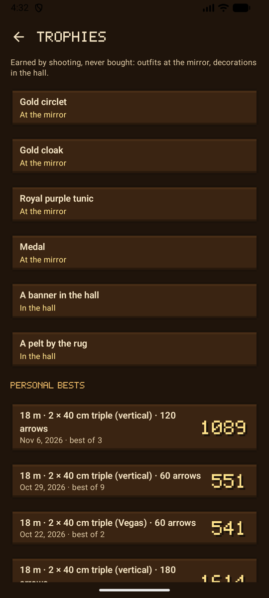{ .shot }
<figcaption><b>Rewards</b>, at the trophy wall.</figcaption>
</figure>
<figure markdown>
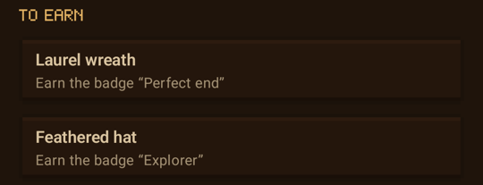{ .shot }
<figcaption><b>To earn</b>, at the mirror.</figcaption>
</figure>

Outfits still to earn wait at the bottom of the mirror under **To earn** (*À gagner*); once earned, they appear with the others, and **Surprise me** can pick them. After a reset, a reward you're wearing stays on.

## Seasons

The range follows the calendar: snow and evergreens in winter (December to February), blossom and wildflowers in spring, green in summer, and red and gold trees with falling leaves in autumn (September to November).

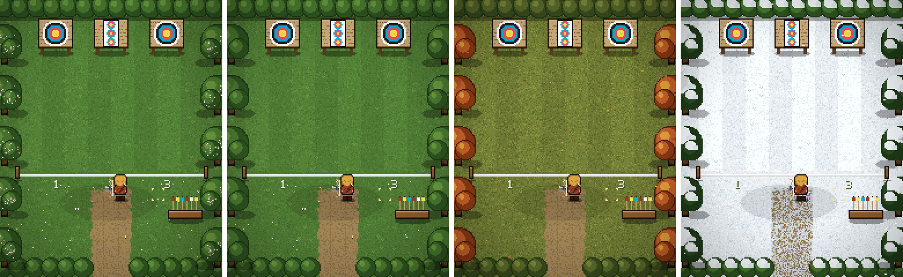

## Sound and music

Footsteps on the wooden floor and on the grass, a small blip when you choose a place, a chime when it opens, the creak of the door, the crackle of the fire in the hall, wind and birds on the range, and a quiet lute tune. All of it was made for Ullr.

- Sound plays at the phone's **media** volume, like other games: silent and vibrate mute calls and notifications, not games.
- The **speaker button** at the top of the game turns the sound off and on. **Settings → Appearance and game → Game sound** and **Music** turn them off separately.
- Sound stops as soon as the app is in the background.

## Every screen in the game look

In game mode, every screen wears the game's style: dark wood and gold, pixel letters for titles, buttons and big scores, and each score in its ring's colour.

<figure markdown>
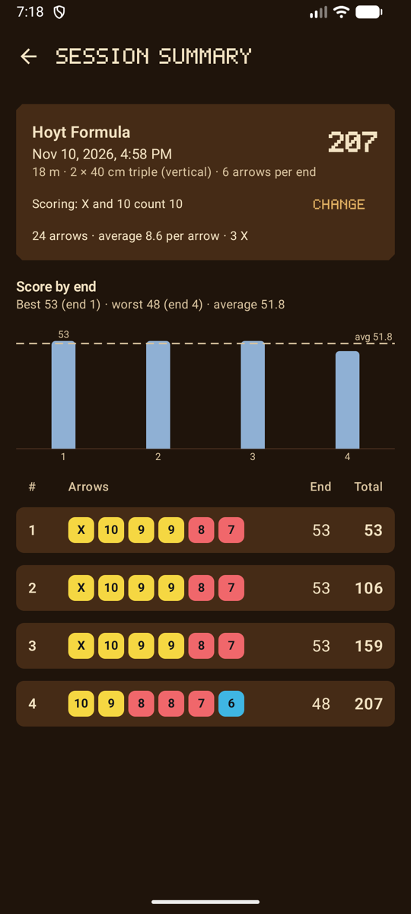{ .shot }
<figcaption>A session summary</figcaption>
</figure>
<figure markdown>
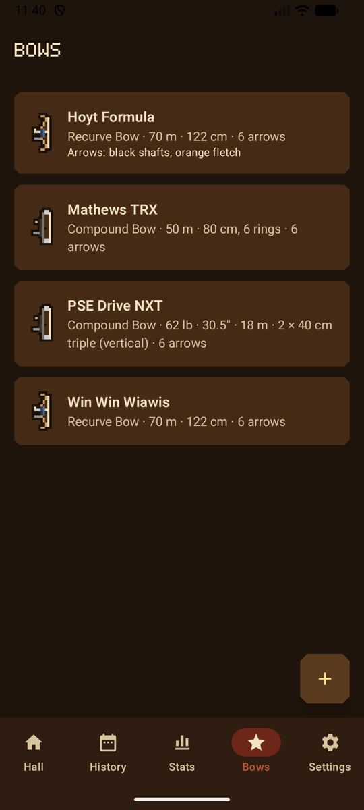{ .shot }
<figcaption>Your bows</figcaption>
</figure>
<figure markdown>
{ .shot }
<figcaption>Settings, grouped by topic</figcaption>
</figure>

## Privacy

Game mode sends nothing. How your archer looks, your companion and your sound settings are kept on the phone with the other settings. The pictures are drawn by the app and the sounds are part of it: nothing is downloaded, and no permission is added.

## What's next

Game mode is a preview. See the [roadmap](roadmap.md) for what's coming.
