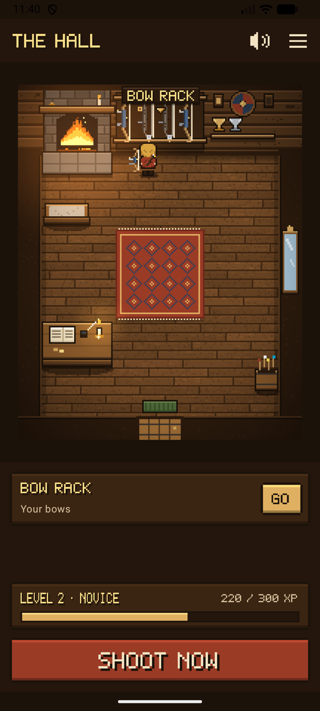
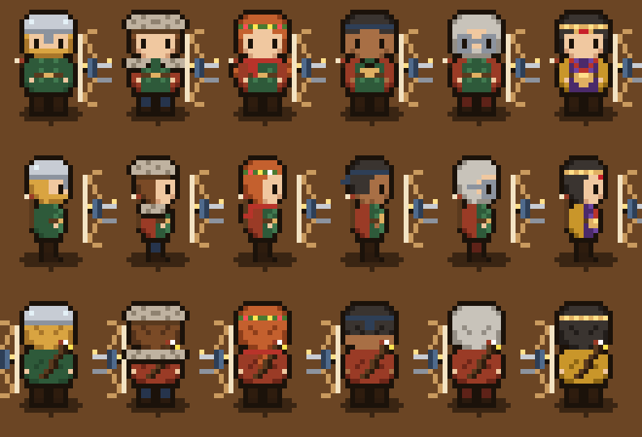
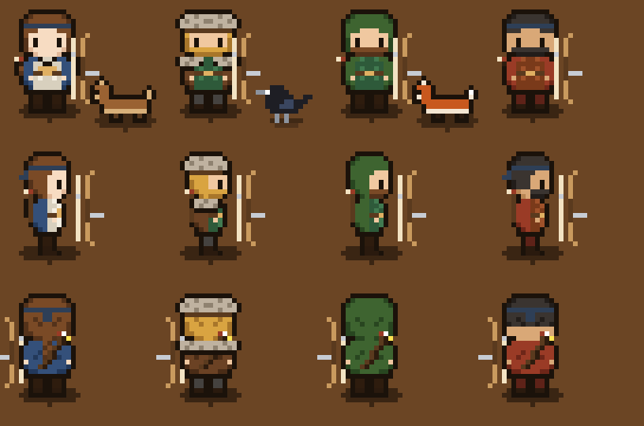
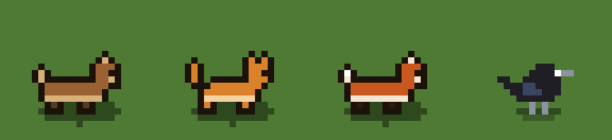
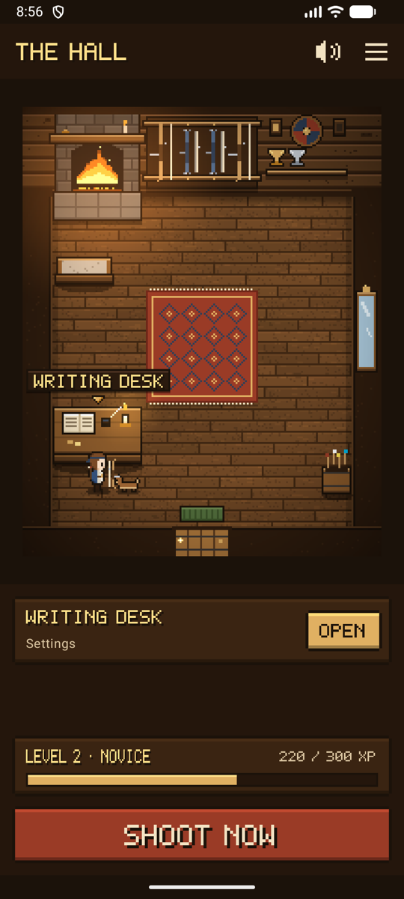
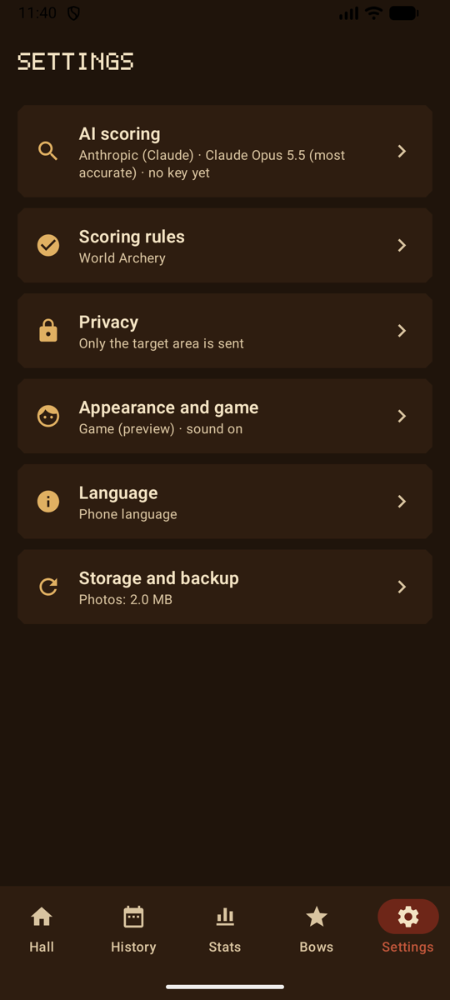

# Game mode

Ullr has a second way to use it: **the same app, as a small pixel-art video game.** Your archer walks around a Norse hall and an archery range, and each place opens a screen. Your bows, sessions and scores are exactly the same as in the normal mode, and the scoring screens work the same way.

Turn it on in **Settings → Appearance and game → Game (preview)** (*Réglages → Apparence et jeu → Jeu (aperçu)*). **Normal** switches back at any time; nothing is lost either way.

<figure markdown>
{ .shot }
<figcaption><b>The hall.</b> Tap a place and your archer walks there.</figcaption>
</figure>
<figure markdown>
{ .shot }
<figcaption><b>The range.</b> The shooting line starts a session.</figcaption>
</figure>
<figure markdown>
{ .shot }
<figcaption><b>A companion</b> follows you around.</figcaption>
</figure>

## Getting around

- **Tap a place:** your archer walks there by the shortest way, around the furniture, then the place opens. Its name shows above it and in the panel at the bottom, with **Go** or **Open**.
- **Tap the floor** to just walk there.
- **Places** (☰, top right) lists every place in both rooms and opens it straight away, without walking. Handy when you're in a hurry, and easy to use with a screen reader.
- **Shoot now** (*Tirer maintenant*), at the bottom, goes straight to the camera for your session in progress, or to a new session. The game never slows you down at the range.
- **Back** from any screen returns you to the game, where your archer was standing.

| In the hall | Opens |
|-------------|-------|
| **Bow rack** (your own bows hang on it, each drawn as its type: barebow, recurve with sight and stabilizer, compound with cams; your archer holds the same type) | Your bows |
| **Trophy wall** | Your trophies: level, badges and personal bests |
| **Writing desk** | Settings |
| **Mirror** | Your archer |
| **Hearth** | Your statistics, "by the fire" |
| **Door** | The range |

| On the range | Opens |
|--------------|-------|
| **Shooting line** | A new session, or the one in progress |
| **Targets** | The session in progress (while one is open, arrows show in the targets) |
| **Arrow stand** | The end waiting for your check. A **!** shows over the stand when one is waiting. |
| **Path home** | The hall |

## Your archer

Walk to the **mirror** to dress your archer. The preview stays at the top while you scroll through the choices, and every change is saved at once.

<figure markdown>
{ .shot }
<figcaption><b>The mirror.</b> Pick, and see it at once.</figcaption>
</figure>
<figure markdown>
{ width="300" .pixel }
<figcaption><b>Outfits</b>, drawn from every side.</figcaption>
</figure>

| Choice | Options |
|--------|---------|
| Skin | Five tones |
| Hair | Long, short, braids or a hood, in five colours |
| Beard | With or without |
| Tunic, cloak, trousers | Five colours each, and no cloak if you prefer |
| Headwear | Helmet, fur hat, flower crown, headband |
| Accessory | Fur mantle, scarf, hammer amulet, glasses |

**Surprise me** (*Au hasard*) picks a random look. Your archer holds the type of your first bow: barebow, recurve or compound.

**Legendary archers.** At the top of the mirror, four ready-made archers set the whole look and companion in one tap: **Artemis**, Greek goddess of the hunt, with her hound; **Ullr**, Norse god of archery and winter, in furs, with a raven; **Robin Hood** in Lincoln green, with a fox; and **Hou Yi**, the Chinese archer who shot down nine suns. Change any piece after.

{ width="420" .pixel }

## Companions

Choose a companion at the mirror: a **dog**, a **cat**, a **fox**, or a **raven** (and one more to discover). It follows the path your archer walked, about a step behind, so it never cuts through the furniture, and sits beside you when you stop. The dog, cat and fox trot and wag their tails, and the raven hops.

{ width="420" .pixel }

## Levels, badges and trophies

Only real shooting earns anything: **10 experience** for each confirmed end, **30** for each finished session and **50** for each badge. Nothing to buy, and nothing for just opening the app. Your level and its bar show at the bottom of the game, with a title that grows from **Novice** to **Archer**, **Marksman**, **Master archer** and **Legend**.

<figure markdown>
{ .shot }
<figcaption><b>Trophies</b>, at the trophy wall.</figcaption>
</figure>
<figure markdown>
{ .shot }
<figcaption>Your level, and a cup for each record.</figcaption>
</figure>

- **Ten badges** for real milestones: your first end, your first X, a perfect end, ten X in one session, 100 and 1,000 arrows, ten sessions, a new personal best, trying field, 3D or para archery, and four weeks in a row.
- **Personal bests** for each round (distance, face and number of arrows). Each one puts a cup on the trophy shelf, and the plaques light up as badges come in. Tap a record to open its session.
- A new level or badge is announced with a **horn and a banner**, once.
- It's all worked out from your sessions: delete a session and what it earned goes with it.

## Sound and music

Footsteps on the wooden floor and on the grass, a small blip when you choose a place, a chime when it opens, the creak of the door, the crackle of the fire in the hall, wind and birds on the range, and a quiet lute tune. All of it was made for Ullr.

- Sound plays at the phone's **media** volume, like other games: silent and vibrate mute calls and notifications, not games.
- The **speaker button** at the top of the game turns the sound off and on. **Settings → Appearance and game → Game sound** and **Music** turn them off separately.
- Sound stops as soon as the app is in the background.

## Every screen in the game look

In game mode, every screen wears the game's style: dark wood and gold, pixel letters for titles, buttons and big scores, and each score in its ring's colour.

<figure markdown>
{ .shot }
<figcaption>A session summary</figcaption>
</figure>
<figure markdown>
{ .shot }
<figcaption>Your bows</figcaption>
</figure>
<figure markdown>
{ .shot }
<figcaption>Settings, grouped by topic</figcaption>
</figure>

## Privacy

Game mode sends nothing. How your archer looks, your companion and your sound settings are kept on the phone with the other settings. The pictures are drawn by the app and the sounds are part of it: nothing is downloaded, and no permission is added.

## What's next

Game mode is a preview. Coming: outfits unlocked by levels and badges. See the [roadmap](roadmap.md).
