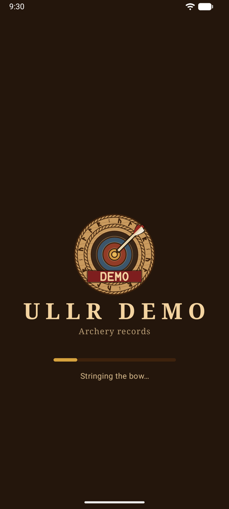
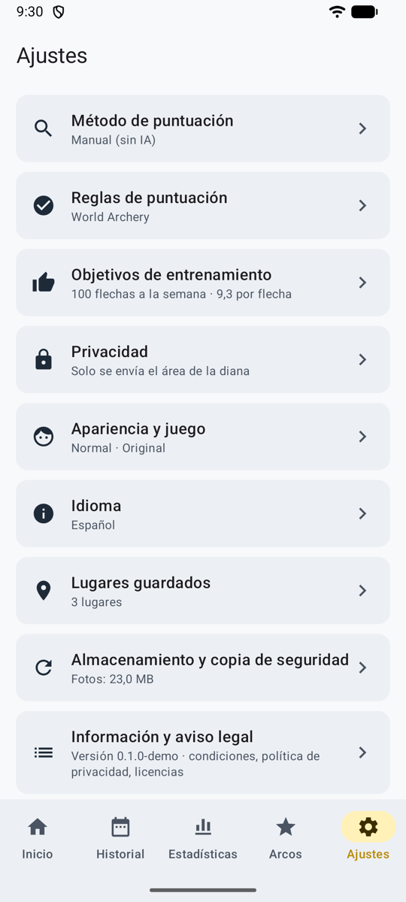
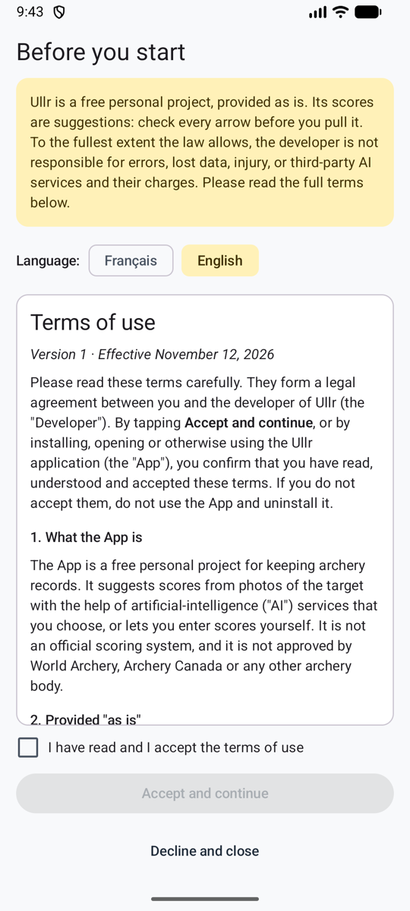

# Primeros pasos { #getting-started }

De abrir la app a tu primera tanda confirmada, en pocos pasos. Cada paso lleva a su propia página. Los nombres de los botones son los de la app en español, por ejemplo **Empezar sesión**.

<figure markdown>
{ .shot }
<figcaption>La pantalla de carga</figcaption>
</figure>
<figure markdown>
{ .shot }
<figcaption>Ajustes, una página por tema</figcaption>
</figure>

## 0. Acepta las condiciones de uso { #0-accept-the-terms-of-use }

{ .shot width="220" align=right }

La primera vez que abres Ullr, te muestra sus [condiciones de uso](terms.md) en inglés, francés, alemán y español, con enlaces a su [política de privacidad](privacy-policy.md) y a sus [licencias de código abierto](licences.md). Marca **He leído y acepto las condiciones de uso, y he leído la política de privacidad** y toca **Aceptar y continuar**. En resumen: Ullr es gratuito y se ofrece tal cual, sus puntuaciones son sugerencias que debes revisar y, en la medida máxima que permita la ley, su desarrollador no se hace responsable de errores, pérdida de datos, lesiones ni servicios de IA de terceros. **Rechazar y cerrar** cierra la app. Puedes volver a leer los tres en **Ajustes → Información y aviso legal**. Cuando cambian las condiciones o la política de privacidad, Ullr te lo vuelve a preguntar.

## 1. Elige un modo { #1-pick-a-mode }

La app se abre en [modo normal](normal.md): pestañas y pantallas. Si prefieres pasear a un arquero por un salón en pixel art, activa el [modo juego](game.md) en **Ajustes → Apariencia y juego**. Puedes volver al modo normal cuando quieras.

La app sigue el idioma de tu teléfono (inglés, francés, alemán o español). En Android 13 y posteriores también puedes elegirlo en **Ajustes → Idioma**.

## 2. Elige cómo se puntúan las tandas { #2-choose-how-ends-are-scored }

**Ajustes → Método de puntuación**:

| Método | Necesitas | Página |
|--------|----------|------|
| **Tu propia clave de API** (automático) | Una clave de un servicio de IA | [Tu propia clave de API](scoring-api.md) |
| **Compartir con tu app de IA** | Una app de IA en tu teléfono | [Compartir con tu app de IA](scoring-share.md) |
| **Manual** (sin IA) | Nada | [Puntuación manual](scoring-manual.md) |

¿No lo tienes claro? Empieza con **Manual**: funciona desde el principio y puedes cambiar de método más adelante. Las sesiones anteriores se quedan como están.

## 3. Añade un arco { #3-add-a-bow }

**Arcos → Añadir arco**: un nombre, el tipo de arco y los valores predeterminados para las sesiones nuevas. Consulta [Arcos](bows.md).

## 4. Tira una sesión { #4-shoot-a-session }

Toca **Empezar sesión**, completa el lugar, el arco, la distancia y la diana, tira tu primera tanda y luego fotografía la diana. Consulta [Sesiones](sessions.md).

## 5. Revisa y confirma la tanda { #5-check-and-confirm-the-end }

Revisa las flechas marcadas con un círculo (o coloca tus flechas, en la puntuación manual) y luego toca **Confirmar · tirar la siguiente tanda**. Consulta [Revisar las flechas](review.md).

!!! warning "Revisa antes de sacar las flechas"
    Las flechas clavadas en la diana son la prueba. Si puntúas más tarde a partir de la foto, amplía las flechas marcadas con un círculo.

## Nada se elimina sin preguntar { #nothing-is-removed-without-asking }

Quitar un arco, una clave o una flecha, borrar una tanda, descartar una sesión, cambiar la dirección de un servicio (lo que elimina su clave), liberar espacio, restaurar una exportación, reiniciar la experiencia y las insignias, y borrar los datos: todo esto pide confirmación antes (para borrar los datos también tienes que escribir **BORRAR**), en modo normal y en modo juego. **Conservar** cancela.

## Consejos para hacer buenas fotos { #tips-for-good-photos }

- Ponte justo delante de la diana, no en ángulo.
- Encuadra la diana entera, o todas las dianas de papel, con un poco de margen alrededor.
- Evita las sombras fuertes y los reflejos, y mantén el teléfono quieto.
- En un parapeto con muchas flechas, una descripción precisa de las flechas en tu arco ayuda (colores del emplumado y del culatín).
- Dos triples dianas en una foto hacen que cada spot se vea pequeño. Si las flechas en la línea salen mal a menudo, acércate más.

## Preguntas { #questions }

**La tanda dice «sin puntuar».** Ábrela para ver por qué:

- *Sin clave de API:* añade la clave del servicio elegido en **Ajustes → Método de puntuación**.
- *Sin configurar:* un servicio compatible con OpenAI también necesita su dirección y su modelo.
- *Clave rechazada:* la clave se ha borrado o está mal escrita. Revísala en Ajustes.
- *Servicio no disponible:* la app lo ha intentado tres veces. Toca **Reintentar** más tarde.
- *Sin crédito:* añade crédito en ese servicio, o sube su límite, y vuelve a intentarlo.
- *Respuesta no válida:* vuelve a intentarlo, compártela con tu app de IA o puntúa a mano.

**Sin cobertura en el campo de tiro.** Sigue tirando. Las fotos se guardan y se puntúan cuando el teléfono vuelve a tener conexión. Con la puntuación manual, no hace falta la red para nada.

**Se ha contado la flecha de otro arquero.** Quítala, y añade o mejora la descripción de las flechas en tu arco.

**La IA no ha visto una flecha** (un Robin Hood, por ejemplo). Activa **O toca la foto donde está**, toca donde está la flecha y elige su zona.

**La app se cerró durante una sesión.** No se pierde nada. La sesión aparece en Inicio con **Reanudar**, y las tandas pendientes de puntuar vuelven a la cola.

**¿Cuánto espacio ocupan las fotos?** Unos 0,6–1,2 MB por tanda. **Ajustes → Almacenamiento y copia de seguridad** muestra el total. Consulta [Almacenamiento y copia de seguridad](backup.md).
