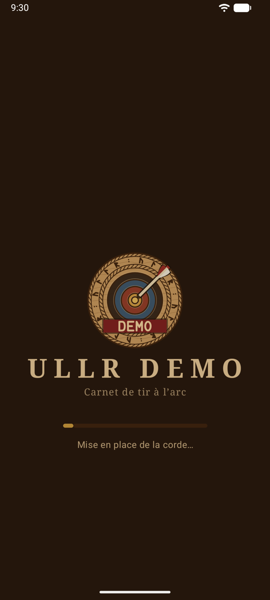
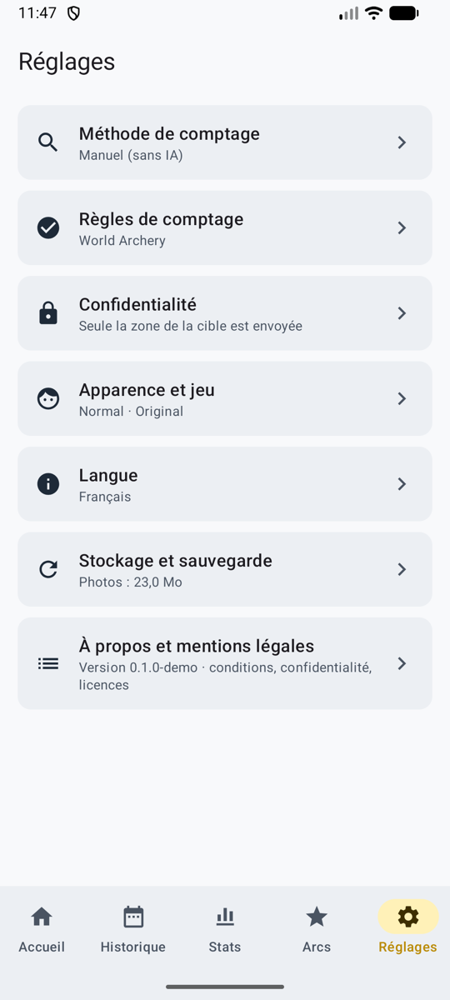
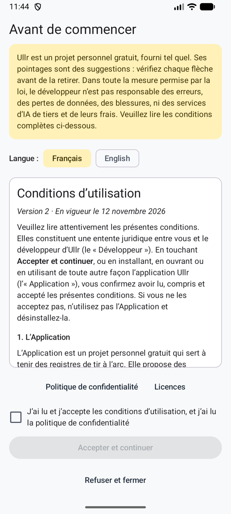

# Pour commencer

De l’ouverture de l’application à votre première volée validée, en quelques étapes. Chaque étape mène à sa propre page. Les noms des boutons sont ceux de l’application en français, par exemple **Commencer une séance**.

<figure markdown>
{ .shot }
<figcaption>L’écran de chargement</figcaption>
</figure>
<figure markdown>
{ .shot }
<figcaption>Les réglages, une page par thème</figcaption>
</figure>

## 0. Accepter les conditions d’utilisation

{ .shot width="220" align=right }

À la première ouverture, Ullr affiche ses [conditions d’utilisation](terms.md) en français et en anglais, avec des liens vers sa [politique de confidentialité](privacy-policy.md) et ses [licences de logiciels libres](licences.md). Cochez **J’ai lu et j’accepte les conditions d’utilisation, et j’ai lu la politique de confidentialité** et touchez **Accepter et continuer**. En bref : Ullr est gratuit et fourni tel quel, ses pointages sont des suggestions à vérifier, et dans toute la mesure permise par la loi, son développeur n’est pas responsable des erreurs, des pertes de données, des blessures ni des services d’IA de tiers. **Refuser et fermer** ferme l’application. Vous pouvez relire les trois dans **Réglages → À propos et mentions légales**. Si les conditions ou la politique de confidentialité changent, Ullr vous les redemande.

## 1. Choisir un mode

L’application s’ouvre en [mode normal](normal.md) : des onglets et des écrans. Si vous préférez promener un archer dans une maison en pixel art, activez le [mode jeu](game.md) dans **Réglages → Apparence et jeu**. Vous pouvez revenir en arrière à tout moment.

L’application suit la langue de votre téléphone (français ou anglais). Sur Android 13 et plus récent, vous pouvez aussi la choisir dans **Réglages → Langue**.

## 2. Choisir comment les volées sont comptées

**Réglages → Méthode de comptage** :

| Méthode | Il vous faut | Page |
|---------|--------------|------|
| **Votre propre clé API (automatique)** | Une clé d’un service d’IA | [Votre propre clé API](scoring-api.md) |
| **Partager avec votre application d’IA** | Une application d’IA sur votre téléphone | [Partager avec votre application d’IA](scoring-share.md) |
| **Manuel (sans IA)** | Rien | [Comptage manuel](scoring-manual.md) |

Vous hésitez ? Commencez par **Manuel (sans IA)** : ça fonctionne tout de suite, et vous pourrez changer de méthode plus tard. Les séances passées restent telles quelles.

## 3. Ajouter un arc

**Arcs → Ajouter un arc** : un nom, le type d’arc, et les valeurs par défaut des nouvelles séances. Voir [Arcs](bows.md).

## 4. Tirer une séance

Touchez **Commencer une séance**, indiquez le lieu, l’arc, la distance et le blason, tirez votre première volée, puis photographiez la cible. Voir [Séances](sessions.md).

## 5. Vérifier et valider la volée

Vérifiez les flèches entourées (ou placez vos flèches, en comptage manuel), puis touchez **Valider · volée suivante**. Voir [Vérifier les flèches](review.md).

!!! warning "Vérifiez avant de retirer vos flèches"
    Les flèches dans la cible font foi. Si vous comptez plus tard depuis la photo, zoomez sur les flèches entourées.

## Rien n’est supprimé sans votre accord

Retirer un arc, une clé ou une flèche, supprimer une volée ou une séance, changer l’adresse d’un service (ce qui supprime sa clé), libérer de l’espace, restaurer un export, remettre à zéro l’expérience et les insignes, et effacer les données demandent tous une confirmation (effacer les données demande aussi de taper **EFFACER**), en mode normal comme en mode jeu. **Garder** annule.

## Conseils pour de bonnes photos

- Placez-vous bien en face de la cible, pas de biais.
- Cadrez tout le blason, ou tous les blasons, avec un peu de marge autour.
- Évitez les ombres fortes et les reflets, et tenez le téléphone stable.
- Sur une butte chargée, une description précise des flèches de votre arc aide (couleur des plumes et des encoches).
- Deux trispots sur une photo, c’est autant de petits spots. Si les flèches sur la ligne sont souvent mal comptées, approchez-vous.

## Questions

**La volée indique « non comptée ».** Ouvrez-la pour savoir pourquoi :

- *Pas de clé API :* ajoutez la clé du service choisi dans **Réglages → Méthode de comptage**.
- *Pas configuré :* un service compatible OpenAI demande aussi son adresse et son modèle.
- *Clé refusée :* la clé a été supprimée ou mal tapée. Vérifiez-la dans les réglages.
- *Service indisponible :* l’application a réessayé trois fois. Touchez **Réessayer** plus tard.
- *Plus de crédit :* ajoutez du crédit chez le service, ou relevez sa limite, puis réessayez.
- *Réponse inutilisable :* réessayez, partagez plutôt avec votre application d’IA, ou saisissez la volée à la main.

**Pas de réseau au pas de tir.** Continuez à tirer. Les photos sont enregistrées et comptées dès le retour du réseau. En comptage manuel, rien n’a besoin du réseau.

**La flèche d’un autre archer a été comptée.** Retirez-la, et ajoutez ou précisez la description des flèches de votre arc.

**L’IA a raté une flèche** (une flèche plantée dans une autre, par exemple). Activez **Ou touchez la photo à son emplacement**, touchez l’endroit de la flèche, puis choisissez sa zone.

**L’application s’est fermée pendant une séance.** Rien n’est perdu. La séance apparaît dans l’onglet **Accueil** avec **Reprendre**, et les volées en attente de comptage sont remises en file.

**Quelle place prennent les photos ?** Environ 0,6 à 1,2 Mo par volée. **Réglages → Stockage et sauvegarde** affiche le total. Voir [Stockage et sauvegarde](backup.md).
