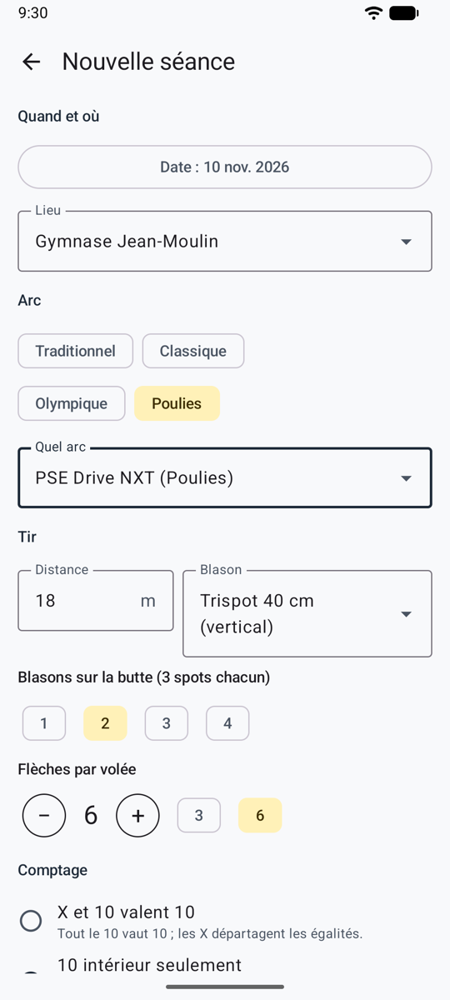

# Guide d'utilisation

Comment utiliser Ullr, du premier arc à la fin d'une séance. Les noms des boutons sont ceux de l'application en français.

## Premiers pas

1. Ouvrez l'application. Après un court écran de chargement, vous arrivez au **Tableau de bord**.
2. Ajoutez un arc : **Ajouter un arc**. Voir [Vos arcs](#vos-arcs).
3. Choisissez comment les volées sont comptées, dans les **Réglages**. Voir la section suivante.

L'application suit la langue de votre téléphone (français ou anglais). Sur Android 13 et plus, vous pouvez aussi la choisir dans **Réglages → Langue**.

## Choisir la méthode de comptage

**Réglages → Méthode de comptage** :

| Méthode | Il vous faut | Fonctionnement |
|---------|--------------|----------------|
| **API d’un service d’IA (automatique)** | Une clé API Anthropic, OpenAI ou Google | Chaque photo est comptée en arrière-plan. La volée est prête à vérifier quelques secondes plus tard. |
| **Application Claude (copier-coller)** | L'application Claude sur votre téléphone | Vous partagez la photo et un texte avec l'application Claude, puis vous collez sa réponse. Pas de clé. |
| **Saisir à la main** | Rien | Possible sur chaque volée, avec n'importe quelle méthode. |

### Choisir le service d'IA

{ .shot width="240" }

Avec la méthode API, **Réglages → Service d’IA** propose :

| Service | Modèles | Remarques |
|---------|---------|-----------|
| **Anthropic (Claude)** | Opus 5.5 (par défaut), Sonnet 5.5 | Recommandé : les consignes ont été conçues et testées avec Claude. |
| **OpenAI** | GPT-6.1 Sol (par défaut), GPT-6 Astra (le plus puissant, environ 5 fois plus cher) | Pas encore testé sur de vraies photos de cible. |
| **Google (Gemini)** | Gemini 4 Carbon (par défaut), Gemini 3.8 Flash (plus rapide, moins cher) | Pas encore testé sur de vraies photos de cible. Utilisez une clé d'un projet avec la facturation activée (voir [Confidentialité](privacy.md)). |

Chaque service garde sa propre clé : vous pouvez changer de service et revenir sans retaper de clé.

!!! note "Un abonnement Claude Pro ou Max"
    Ullr ne peut pas se connecter avec un abonnement Claude : Anthropic n'autorise ces connexions que dans ses propres applications. La méthode **Application Claude (copier-coller)** est la façon autorisée de compter avec votre abonnement.

### Obtenir et enregistrer une clé API

- **Anthropic :** créez une clé dans la console Anthropic (console.anthropic.com → API keys). Elle commence par `sk-ant-`.
- **OpenAI :** créez une clé sur platform.openai.com → API keys. Elle commence par `sk-`.
- **Google Gemini :** créez une clé dans Google AI Studio (aistudio.google.com → Get API key), dans un projet avec la facturation activée. Elle commence par `AIza`.

Puis, dans Ullr : **Réglages → Clé API** du service, collez la clé, **Enregistrer la clé**, puis **Vérifier la clé**. L'application vous dit si la clé fonctionne.

!!! tip "Protégez votre clé"
    Créez une clé réservée à Ullr et fixez une limite de dépenses mensuelle auprès du service. Si vous perdez le téléphone, supprimez la clé chez le service : personne ne pourra dépenser plus que la limite.

La clé est chiffrée sur le téléphone. Elle n'est plus jamais affichée, et **Supprimer la clé** l'efface.

**Coût :** vous payez le service directement, une requête par volée. Estimations, en attendant de les mesurer sur de vraies photos :

| Modèle | Par volée | Séance de 30 volées |
|--------|-----------|---------------------|
| Claude Opus 5.5 (par défaut) | environ 0,05–0,10 $ US | environ 1,50–3,00 $ US |
| Claude Sonnet 5.5 | environ 0,03–0,05 $ US | environ 0,75–1,50 $ US |
| GPT-6.1 Sol | environ 0,02–0,05 $ US | environ 0,60–1,50 $ US |
| GPT-6 Astra | environ 0,10–0,25 $ US | environ 3–7,50 $ US |
| Gemini 4 Carbon | environ 0,02–0,05 $ US | environ 0,60–1,50 $ US |
| Gemini 3.8 Flash | environ 0,01–0,02 $ US | environ 0,30–0,60 $ US |

## Tirer une séance

<figure markdown>
{ .shot }
<figcaption>Nouvelle séance</figcaption>
</figure>
<figure markdown>
{ .shot }
<figcaption>La feuille de marque de la séance</figcaption>
</figure>

1. Sur le tableau de bord, touchez **Commencer une séance**.
2. Remplissez la séance :
    - **Lieu** : tapez-en un nouveau, ou choisissez-en un déjà utilisé.
    - **Date** : maintenant, par défaut.
    - **Type d'arc** et **arc**. Les valeurs par défaut de l'arc remplissent le reste.
    - **Distance**, **blason**, **blasons sur la butte** (pour les trispots : combien il y en a sur la butte, par exemple 2 blasons = 6 spots) et **flèches par volée** (n'importe quel nombre, souvent 3 ou 6).
    - **Comptage** : la règle, proposée d'après les réglages et le type d'arc. Voir [Règles de comptage](#regles-de-comptage).

    Tout ce que vous choisissez ici est expliqué à l'IA avec chaque photo : le blason et ses zones, le nombre de spots, le nombre de flèches à chercher, et ce que vaut chaque zone selon votre règle.

3. Tirez votre volée, allez à la cible et touchez **Prendre la photo**. Placez-vous face à la cible et cadrez le blason dans le cercle. Vous pouvez aussi choisir une photo dans votre galerie.
4. La volée apparaît dans la feuille de marque avec son état :

| État | Signification |
|------|---------------|
| en attente de comptage | Pas encore de réseau, ou en file d'attente. Le comptage démarre tout seul au retour du réseau. |
| comptage en cours… | L'IA lit la photo. |
| à vérifier | Ouvrez-la et validez. |
| non comptée | Un problème est survenu. Touchez pour réessayer, saisir à la main ou utiliser l'application Claude. |

Pas besoin d'attendre : tirez la volée suivante pendant que la précédente est comptée.

### Avec l'application Claude (copier-coller)

Sur l'écran de vérification de la volée :

1. Touchez **Partager avec Claude**. La photo part vers l'application Claude, et le texte est copié.
2. Dans l'application Claude, collez le texte et envoyez-le.
3. Copiez **toute** la réponse de Claude, revenez dans Ullr, collez-la et touchez **Utiliser cette réponse**.

Si la réponse est illisible, l'application dit pourquoi. Demandez à Claude de répondre à nouveau avec le même texte.

## Vérifier une volée

<figure markdown>
{ .shot }
<figcaption>Deux flèches à vérifier</figcaption>
</figure>
<figure markdown>
{ .shot }
<figcaption>Choisir la bonne zone</figcaption>
</figure>

Chaque flèche porte un repère blanc avec sa zone. Écartez deux doigts pour zoomer, faites glisser pour vous déplacer, touchez deux fois pour revenir.

- **Cercle orange :** vérifiez cette flèche. Elle est près d'une ligne, l'IA n'était pas sûre, ou deux flèches sont dans le même spot d'un trispot.
- **Touchez une flèche** pour la sélectionner, puis touchez la bonne zone. Le deuxième choix de l'IA est mis en évidence.
- **Ajouter une flèche** : touchez le bouton, puis l'endroit de la flèche sur la photo.
- **Retirer cette flèche** : pour la flèche d'un autre archer, ou une flèche comptée deux fois.
- Un bandeau vous prévient quand le nombre de flèches trouvées n'est pas le nombre tiré, ou quand la photo pose problème (reflet, flou, blason coupé).

Touchez ensuite **Valider · volée suivante** pour revenir directement à l'appareil photo, ou **Valider et revenir à la séance**.

!!! warning "Vérifiez avant de retirer vos flèches"
    Les flèches dans la cible font foi. Si vous comptez plus tard depuis la photo, zoomez sur les flèches entourées.

**Trispots :** selon les règles World Archery, une seule flèche par spot compte. Quand deux flèches sont dans le même spot, l'application les entoure et l'explique, mais ne change aucun score : mettez vous-même la flèche en trop à M si votre épreuve applique cette règle.

## Terminer une séance et revoir l'historique

- **Écran de séance** : la feuille de marque (volée par volée, cumul), le graphique **Score par volée** avec la ligne de moyenne, la meilleure et la moins bonne volée.
- **Changez la règle de comptage** d'une séance à tout moment. Tous ses totaux sont recalculés.
- **Terminer**. Les volées non validées ne comptent pas tant que vous ne les validez pas, ce que vous pouvez encore faire plus tard.
- **Tableau de bord :** séances, moyenne par flèche, meilleur total, nombre de X et séances récentes. Une séance en cours apparaît avec **Reprendre**.
- **Historique :** toutes les séances terminées, par mois, filtrées par arc.

### Règles de comptage

| Règle | Points |
|-------|--------|
| X et 10 valent 10 | Tout le 10 vaut 10. Les X départagent les égalités. Arc classique et arc nu World Archery, la plupart des clubs. |
| 10 intérieur seulement | Seul le petit cercle intérieur vaut 10 ; le reste du jaune vaut 9. Arc à poulies World Archery ; USA Archery et Tir à l'arc Canada suivent World Archery. |
| X vaut 11 | Le X vaut 11. Certains tournois américains, comme le Lancaster Classic. |

**Règle de la ligne (toutes les règles) :** une flèche qui touche la ligne entre deux zones prend la zone la plus haute. Une flèche dans le 8 qui touche la ligne du 9 vaut 9.

**Réglages → Règle de comptage par défaut** fixe la règle des nouvelles séances : **World Archery** (10 intérieur pour l'arc à poulies, X = 10 pour les autres arcs ; par défaut), **X = 10 pour tous les arcs**, ou **X = 11 pour l'arc à poulies**.

## Vos arcs

L'onglet **Arcs** liste vos arcs.

- **Ajouter un arc :** nom et type d'arc. Pour un arc à poulies, vous pouvez partir d'une marque et d'un modèle du catalogue (PSE, Hoyt, Mathews, Bowtech). Il remplit le nom, montre les caractéristiques du modèle, et vous prévient si votre allonge sort de sa plage.
- **Puissance** (lb) et **allonge** (pouces). Les deux acceptent une virgule ou un point.
- **Description des flèches**, par exemple « tubes noirs, plumes orange ». Elle est envoyée avec la photo pour que l'IA ignore les flèches des autres archers sur la même butte.
- **Valeurs par défaut :** blason, blasons sur la butte, distance et flèches par volée, pour remplir les nouvelles séances.

Modifier un arc plus tard ne change pas les séances passées.

## Conseils pour de bonnes photos

- Placez-vous bien en face de la cible, pas de biais.
- Cadrez tout le blason, ou tous les blasons, avec un peu de marge autour.
- Évitez les ombres fortes et les reflets, et tenez le téléphone stable.
- Sur une butte chargée, une description précise des flèches aide (couleur des plumes et des encoches).
- Deux trispots sur une photo, c'est autant de petits spots. Si les flèches sur la ligne sont souvent mal comptées, approchez-vous.

## Questions

**La volée indique « non comptée ».** Ouvrez-la pour savoir pourquoi :

- *Pas de clé API :* ajoutez-en une dans les réglages, ou passez à l'application Claude.
- *Clé refusée :* la clé a été supprimée ou mal tapée. Vérifiez-la dans les réglages.
- *Service indisponible :* l'application a réessayé trois fois. Touchez **Réessayer** plus tard.
- *Plus de crédit :* ajoutez du crédit chez le service, ou relevez sa limite, puis réessayez.
- *Réponse inutilisable :* réessayez, ou saisissez la volée à la main.

**Pas de réseau au pas de tir.** Continuez à tirer. Les photos sont enregistrées et comptées dès le retour du réseau. Vous pouvez aussi saisir à la main tout de suite.

**La flèche d'un autre archer a été comptée.** Retirez-la, et ajoutez ou précisez la description des flèches de votre arc.

**L'IA a raté une flèche** (une flèche dans une autre, par exemple). Touchez **Ajouter une flèche**, puis l'endroit où elle est.

**L'application s'est fermée pendant une séance.** Rien n'est perdu. La séance apparaît au tableau de bord avec **Reprendre**, et les volées en attente sont remises en file.

**Quelle place prennent les photos ?** Environ 0,6 à 1,2 Mo par volée. **Réglages → Stockage** affiche le total.
