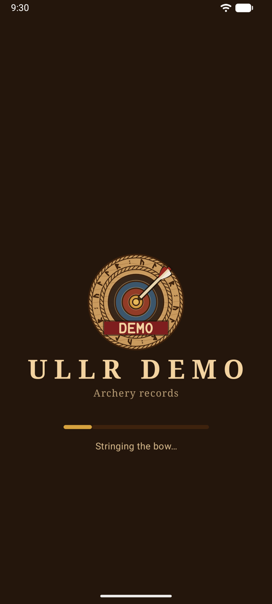
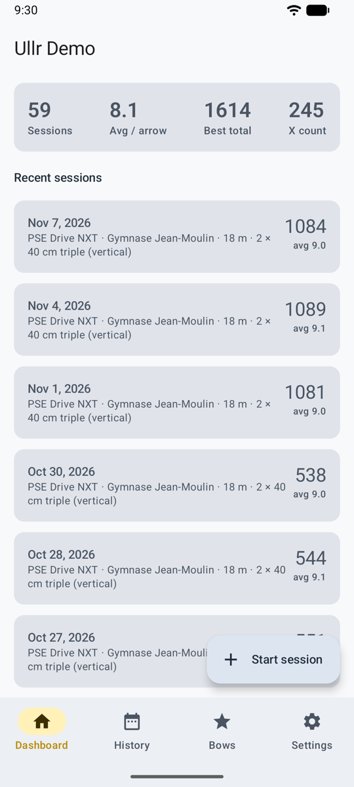
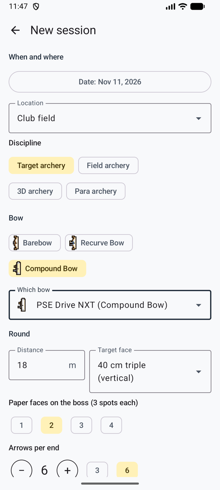
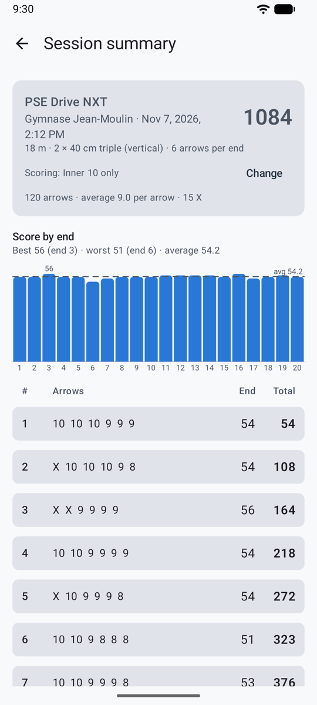
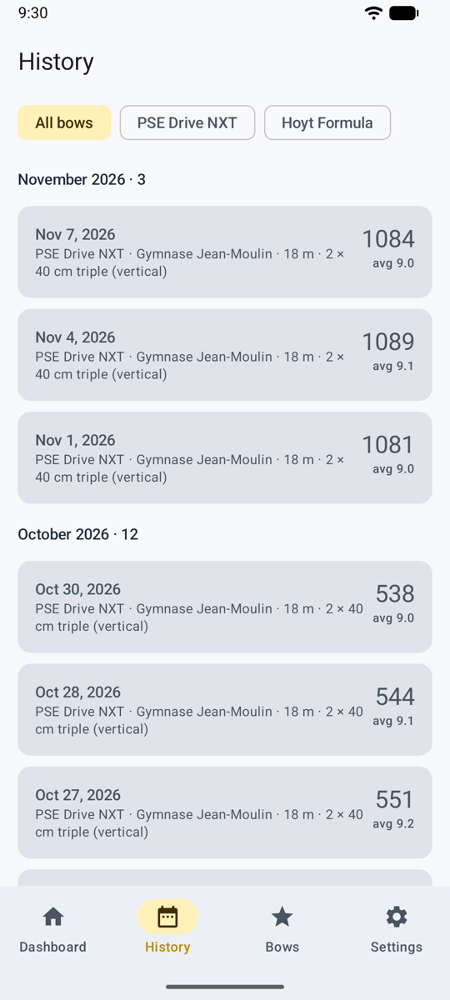
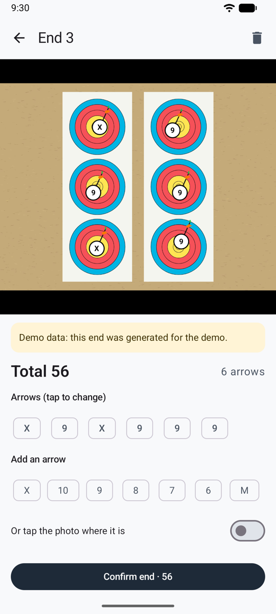
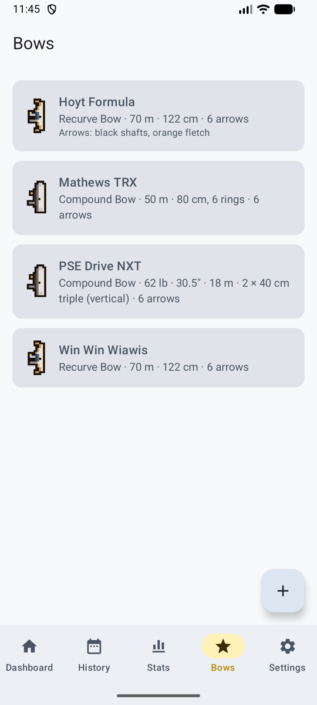
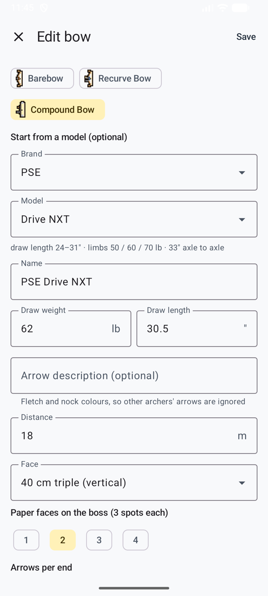

# User guide

How to use Ullr, from the first bow to the end of a session. Button names are in English, with the French label in brackets: **Start session** (*Commencer une séance*).

## First steps

<figure markdown>
{ .shot }
<figcaption>The loading screen</figcaption>
</figure>
<figure markdown>
{ .shot }
<figcaption>The Dashboard</figcaption>
</figure>

1. Open the app. After a short loading screen you see the **Dashboard** (*Tableau de bord*).
2. Add a bow: **Add bow** (*Ajouter un arc*). See [Bows](#bows).
3. Choose how ends are scored, in **Settings** (*Réglages*). See the next section.

The app follows your phone's language (English or French). On Android 13 and later you can also choose it in **Settings → Language** (*Langue*).

## Choose how ends are scored

**Settings → Scoring method** (*Méthode de comptage*):

| Method | You need | How it works |
|--------|----------|--------------|
| **AI service API (automatic)** (*API d’un service d’IA*) | An API key for the AI service of your choice (Anthropic, Google or OpenAI) | Each photo is scored in the background. The end is ready to check a few seconds later. |
| **Score by hand** | Nothing | Available on every end, with any method. |

### Choose the AI service

{ .shot width="240" }

With the API method, **Settings → AI service** (*Service d’IA*) offers:

| Service | Models |
|---------|--------|
| **Anthropic (Claude)** | Opus 5.5 (default), Sonnet 5.5 (cheaper) |
| **Google (Gemini)** | Gemini 4 Carbon (default), Gemini 3.8 Flash (faster, cheaper). Use a key from a project with billing turned on (see [Privacy](privacy.md)). |
| **OpenAI** | GPT-6.1 Sol (default), GPT-6 Astra (most capable, about 5 times the price) |

Each service keeps its own key, so you can switch and come back without typing a key again.

### Get and save an API key

- **Anthropic:** create a key in the Anthropic Console (console.anthropic.com → API keys). It starts with `sk-ant-`.
- **OpenAI:** create a key at platform.openai.com → API keys. It starts with `sk-`.
- **Google Gemini:** create a key in Google AI Studio (aistudio.google.com → Get API key), in a project with billing turned on. It starts with `AIza`.

Then, in Ullr: **Settings → API key** for that service, paste the key, **Save key** (*Enregistrer la clé*), and **Check key** (*Vérifier la clé*). The app tells you whether the key works.

!!! tip "Protect your key"
    Create a key just for Ullr, and set a low monthly spending limit with the service. If the phone is lost, delete the key there, and nobody can spend more than the limit.

The key is stored encrypted on the phone. It is never shown again, and **Remove key** (*Supprimer la clé*) deletes it.

**Cost:** you pay the service directly, one request per end. Rough estimates until they are measured on real photos:

| Model | Per end | 30-end session |
|-------|---------|----------------|
| Claude Opus 5.5 | about $0.05–0.10 | about $1.50–3.00 |
| Claude Sonnet 5.5 | about $0.03–0.05 | about $0.75–1.50 |
| GPT-6.1 Sol | about $0.02–0.05 | about $0.60–1.50 |
| GPT-6 Astra | about $0.10–0.25 | about $3–7.50 |
| Gemini 4 Carbon | about $0.02–0.05 | about $0.60–1.50 |
| Gemini 3.8 Flash | about $0.01–0.02 | about $0.30–0.60 |

## Shoot a session

<figure markdown>
{ .shot }
<figcaption>New session</figcaption>
</figure>
<figure markdown>
{ .shot }
<figcaption>The session's scoresheet</figcaption>
</figure>

1. On the Dashboard, tap **Start session** (*Commencer une séance*).
2. Fill in the session:
    - **Place** (*Lieu*): type a new one, or pick one you used before.
    - **Date**: now by default.
    - **Bow type** and **bow**. The bow's defaults fill in the rest.
    - **Distance**, **target face**, **paper faces** (for 3-spot faces: how many are on the boss, for example 2 faces = 6 spots), and **arrows per end** (any number, often 3 or 6).
    - **Scoring rule**: set from Settings and the bow type. See [Scoring rules](#scoring-rules).

3. Shoot your end, walk to the target and tap **Take photo** (*Prendre la photo*). Stand in front of the target and fit the face in the circle on screen. You can also pick a photo from your gallery.
4. The end appears in the scoresheet with its status:

| Status | Meaning |
|--------|---------|
| waiting to score (*en attente de comptage*) | No network yet, or queued. It starts by itself when the network comes back. |
| scoring… (*comptage en cours…*) | The AI is reading the photo. |
| ready to check (*à vérifier*) | Open it and confirm. |
| not scored (*non comptée*) | Something went wrong. Tap to retry or score by hand. |

You don't have to wait: shoot the next end while the previous one is being scored.

## Review an end

<figure markdown>
{ .shot }
<figcaption>Two arrows to check</figcaption>
</figure>
<figure markdown>
{ .shot }
<figcaption>Choosing the right ring</figcaption>
</figure>

Each arrow has a white marker with its ring. Pinch to zoom, drag to move, double-tap to reset.

- **Amber circle:** check this arrow. It's near a line, the AI wasn't confident, or two arrows are in the same spot of a 3-spot face.
- **Tap an arrow** to select it, then tap the right ring. The AI's second choice is highlighted.
- **Add an arrow** (*Ajouter une flèche*): tap the button, then tap where the arrow is on the photo.
- **Remove this arrow** (*Retirer cette flèche*): for another archer's arrow, or one counted twice.
- A banner warns you when the number of arrows found isn't the number shot, or when the photo has problems (glare, blur, face cut off).

Then tap **Confirm · shoot next end** (*Valider · volée suivante*) to go straight back to the camera, or **Confirm and back to session**.

!!! warning "Check before you pull your arrows"
    The arrows in the target are the proof. If you score from the photo later, zoom in on the circled arrows.

**3-spot faces:** under World Archery rules, only one arrow per spot counts. When two arrows are in the same spot, the app circles them and explains, but doesn't change any score: set the extra one to M yourself if your round uses that rule.

## Finish a session and look back

<figure markdown>
{ .shot }
<figcaption>History, filtered by bow</figcaption>
</figure>
<figure markdown>
{ .shot }
<figcaption>A past end, with its photo</figcaption>
</figure>

- **Session screen** (*Séance*): the scoresheet (end by end, running total), the **Score by end** chart with the average line, and the best and worst ends.
- **Change the scoring rule** of a session at any time. All its totals are recalculated.
- **Finish** (*Terminer*). Ends that aren't confirmed don't count until you confirm them, which you can still do later.
- **Dashboard:** sessions, average per arrow, best total, X count and recent sessions. A session in progress shows with **Resume** (*Reprendre*).
- **History** (*Historique*): every finished session, by month, filtered by bow.

### Scoring rules

| Rule | Points |
|------|--------|
| X and 10 count 10 (*X et 10 valent 10*) | The whole 10 ring scores 10. Xs are counted for ties. World Archery recurve and barebow, most clubs. |
| Inner 10 only (*10 intérieur seulement*) | Only the small inner ring scores 10; the rest of the gold scores 9. World Archery compound; USA Archery and Archery Canada follow World Archery. |
| X counts 11 (*X vaut 11*) | The X ring scores 11. Some US tournaments, such as the Lancaster Classic. |

**Line rule (all rules):** an arrow that touches the line between two zones scores the higher zone. An arrow in the 8 that touches the 8/9 line is a 9.

**Settings → Default scoring rule** sets the rule new sessions start with: **World Archery** (inner 10 for compound, X = 10 for other bows; the default), **X = 10 for all bows**, or **X = 11 for compound**.

## Bows

<figure markdown>
{ .shot }
<figcaption>Your bows</figcaption>
</figure>
<figure markdown>
{ .shot }
<figcaption>Starting from the catalog</figcaption>
</figure>

The **Bows** tab (*Arcs*) lists your bows.

- **Add a bow:** name and bow type. For a compound, you can start from a brand and model in the built-in catalog (PSE, Hoyt, Mathews, Bowtech). It fills in the name, shows the model's specs, and warns you if your draw length is outside the model's range.
- **Draw weight** (lb) and **draw length** (inches). Both accept a comma or a dot.
- **Arrow description**, for example "black shafts, orange fletching". It's sent with the photo so the AI ignores other archers' arrows on the same boss.
- **Defaults:** target face, paper faces, distance and arrows per end, used to fill in new sessions.

Changing a bow later doesn't change past sessions.

## Tips for good photos

- Stand straight in front of the target, not at an angle.
- Get the whole face, or all the paper faces, in the frame, with a little space around them.
- Avoid strong shadows and glare, and keep the phone steady.
- On a busy boss, a precise arrow description helps (fletching and nock colours).
- Two 3-spot faces in one photo make each spot small. If line-cutters are often wrong, get closer.

## Questions

**The end says "not scored".** Open it to see why:

- *No API key:* add the chosen service's key in Settings.
- *Key refused:* the key was deleted or mistyped. Check it in Settings.
- *Service unavailable:* the app retried three times. Tap **Retry** (*Réessayer*) later.
- *No credit left:* add credit with that service, or raise its limit, then retry.
- *Bad answer:* retry, or score by hand.

**No signal at the range.** Keep shooting. Photos are saved and scored when the phone is back online. You can also score by hand straight away.

**Another archer's arrow was counted.** Remove it, and add or improve the arrow description on your bow.

**The AI missed an arrow** (a Robin Hood, for example). Tap **Add an arrow**, then tap where it is.

**The app was closed during a session.** Nothing is lost. The session shows on the Dashboard with **Resume**, and ends waiting to be scored are queued again.

**How much space do photos take?** About 0.6–1.2 MB per end. **Settings → Storage** shows the total.
