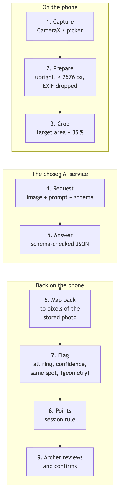

# Cómo funciona { #how-it-works }

De una foto de la diana a una puntuación confirmada, en cinco pasos. La IA lee la diana. Ullr decide qué marcar con un círculo, aplica tu regla de puntuación y guarda el registro. Tú confirmas cada tanda.

{ width="250" align=right }

## 1. Tú haces la foto { #1-you-take-the-photo }

Después de la tanda, fotografías la diana desde delante, encajándola en el círculo de la pantalla. Antes que nada, Ullr guarda la foto en el teléfono:

- girada hacia el lado correcto y redimensionada (una foto de teléfono es mucho más grande de lo necesario);
- **sin sus datos ocultos**: sin ubicación, sin modelo de teléfono, sin fecha;
- con una copia pequeña para las listas.

Por defecto, la copia que se va a enviar también se **recorta al área de la diana**, así las personas o cosas que haya alrededor de la diana se quedan en tu teléfono.

## 2. La foto va a la IA, con instrucciones { #2-the-photo-goes-to-the-ai-with-instructions }

Ullr envía una solicitud al servicio de IA que elegiste. Contiene:

| Parte | Qué dice |
|------|--------------|
| **La foto** | La diana recortada. |
| **Cómo leer una diana** | Lo mismo para cada tanda. Encuentra las flechas clavadas en la diana, no agujeros antiguos ni flechas de otros arqueros. Da el punto donde cada varilla entra en la diana, no el culatín. Aplica la regla de la línea: una varilla que toca una línea puntúa la zona más alta. Indica cuándo una flecha está cerca de una línea, y cuán seguro estás. |
| **Tu configuración** | Se construye a partir de la sesión: la diana y sus zonas, cuántas dianas de papel y spots (2 triples dianas = 6 spots), cuántas flechas buscar, tu regla de puntuación con lo que vale cada zona, y la descripción de tus flechas. |
| **El formato de la respuesta** | Una lista fija de campos, para que la respuesta siempre se pueda leer. |

## 3. La IA responde { #3-the-ai-answers }

Para cada flecha, la IA da:

- su posición en la foto;
- su **zona** (X, 10 … 1, o M);
- una **segunda zona** si la flecha está sobre una línea o cerca de ella;
- cuán **segura** está.

Indica la zona tal como está dibujada, no los puntos. Es a propósito: Ullr convierte las zonas en puntos con tu regla, así puedes cambiar la regla de una sesión más tarde y todos los totales se vuelven a calcular, sin preguntar otra vez a la IA.

## 4. Ullr marca con un círculo lo que debes revisar { #4-ullr-circles-what-you-should-check }

<figure markdown>
{ .shot }
<figcaption>Dos flechas marcadas para revisar</figcaption>
</figure>

Una flecha se marca con un círculo ámbar cuando:

- la IA dio una segunda zona (está cerca de una línea);
- su confianza es baja;
- en una triple diana, hay dos flechas en el mismo spot.

Un aviso también te advierte cuando el número de flechas encontradas no es el número tirado, cuando no se ha encontrado ninguna diana, o cuando la foto tiene problemas (reflejos, desenfoque, diana cortada).

¿Por qué varias señales? La confianza de una IA no siempre acierta. El caso peligroso es una flecha mal puntuada con total seguridad. Preguntar aparte «¿está cerca de una línea?» detecta muchos de esos casos.

## 5. Tú confirmas { #5-you-confirm }

<figure markdown>
{ .shot }
<figcaption>Elige la zona correcta y luego confirma</figcaption>
</figure>

Corriges cualquier flecha marcada con un toque, añades una flecha que falte o quitas la de otro arquero, y confirmas. Solo entonces cuenta la tanda. Cada tanda conserva su foto, así que siempre puedes volver a revisarla.

## Tres formas de puntuar { #three-ways-to-score }

<figure markdown>
{ .shot }
<figcaption>Elegir el método en Ajustes</figcaption>
</figure>

| Método | Cómo |
|--------|-----|
| **[Tu propia clave de API](scoring-api.md)** | Automático, en segundo plano. Anthropic (Claude), Google (Gemini), OpenAI, o cualquier servicio compatible con OpenAI en la dirección que indiques. |
| **[Compartir con tu app de IA](scoring-share.md)** | Sin clave: comparte la foto y el prompt con la app de IA de tu teléfono y pega su respuesta. |
| **[Manual](scoring-manual.md)** | Sin IA: toca cada flecha en la foto y elige su zona. No se envía nada. |
| **A mano** | Siempre es posible, en cualquier tanda, sea cual sea el método. |

Todas las IA reciben exactamente las mismas instrucciones. Elige lo que prefieras y cámbialo cuando quieras. Consulta [Tres formas de puntuar](scoring.md).

## En el campo de tiro { #at-the-range }

En un campo de tiro a menudo no hay cobertura. Ullr guarda primero cada foto, y la puntuación automática espera a la red. Empieza sola cuando el teléfono vuelve a tener conexión. Si necesitas la puntuación ya, introdúcela a mano, o usa la [puntuación manual](scoring-manual.md), que nunca necesita la red. Cerrar la app no hace perder nada.

## Fiabilidad { #reliability }

No hay garantía de fiabilidad. La precisión de la puntuación depende mucho de la calidad de la foto, del ángulo desde el que se hizo y del modelo de IA que elegiste. En cualquier momento, la IA puede equivocarse. Por eso las flechas dudosas se marcan con un círculo, y por eso confirmas cada tanda: revisa siempre tus flechas en la diana antes de sacarlas.
