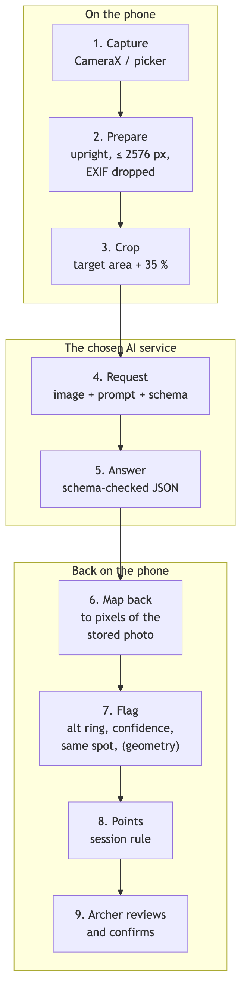
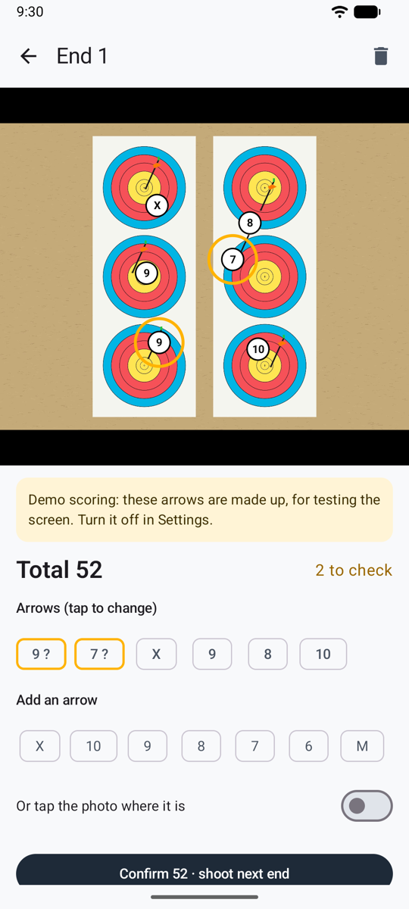
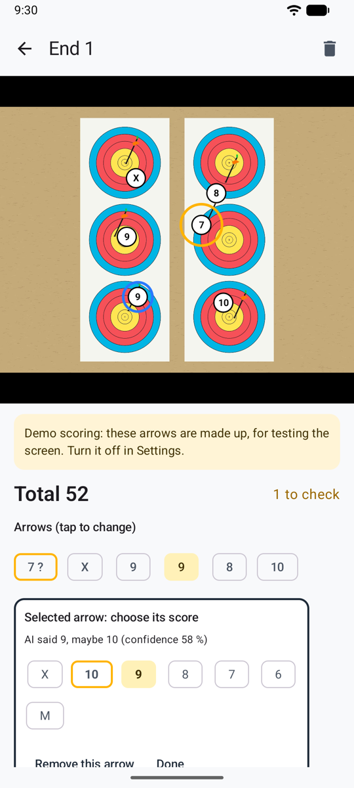

# How it works

From a photo of the target to a confirmed score, in five steps. The AI reads the target. Ullr decides what to circle, applies your scoring rule, and keeps the record. You confirm every end.

{ width="250" align=right }

## 1. You take the photo

After the end, you photograph the target from in front, fitting the face in the circle on screen. Before anything else, Ullr saves the photo on the phone:

- turned the right way up, and resized (a phone photo is far larger than needed);
- **with its hidden data removed**: no location, no phone model, no date;
- with a small copy for the lists.

By default, the copy that will be sent is also **trimmed to the target area**, so people or things around the target stay on your phone.

## 2. The photo goes to the AI, with instructions

Ullr sends one request to the AI service you chose. It contains:

| Part | What it says |
|------|--------------|
| **The photo** | The trimmed target. |
| **How to read a target** | The same for every end. Find the arrows stuck in the face, not old holes or other archers' arrows. Give the point where each shaft enters the face, not the nock. Apply the line rule: a shaft touching a line scores the higher zone. Say when an arrow is close to a line, and how sure you are. |
| **Your setup** | Built from the session: the face and its rings, how many paper faces and spots (2 triple faces = 6 spots), how many arrows to look for, your scoring rule with what each ring is worth, and your arrow description. |
| **The answer format** | A fixed list of fields, so the answer can always be read. |

## 3. The AI answers

For each arrow, the AI gives:

- its position on the photo;
- its **ring** (X, 10 … 1, or M);
- a **second ring** if the arrow is on or near a line;
- how **confident** it is.

It reports the ring as drawn, not points. That's on purpose: Ullr turns rings into points with your rule, so you can change a session's rule later and every total is recalculated, without asking the AI again.

## 4. Ullr circles what you should check

<figure markdown>
{ .shot }
<figcaption>Two arrows circled to check</figcaption>
</figure>

An arrow is circled in amber when:

- the AI gave a second ring (it's near a line);
- its confidence is low;
- on a 3-spot face, two arrows are in the same spot.

A banner also warns you when the number of arrows found isn't the number shot, when no target was found, or when the photo has problems (glare, blur, face cut off).

Why several signals? An AI's confidence isn't always right. The dangerous case is an arrow scored wrong with confidence. Asking "is it near a line?" separately catches many of those.

## 5. You confirm

<figure markdown>
{ .shot }
<figcaption>Pick the right ring, then confirm</figcaption>
</figure>

You fix any circled arrow with one tap, add a missed arrow or remove another archer's, and confirm. Only then does the end count. Each end keeps its photo, so you can always check it again.

## Choice of AI

<figure markdown>
{ .shot }
<figcaption>Choosing the AI in Settings</figcaption>
</figure>

| Service | How | Notes |
|---------|-----|-------|
| **Anthropic Claude** | Your own API key | Recommended. |
| **OpenAI** | Your own API key | Same instructions. Not yet tested on real target photos. |
| **Google Gemini** | Your own API key | Same instructions. Not yet tested on real target photos. |
| **Claude app** | Copy and paste, no key | Uses your own Claude account or subscription. |
| **By hand** | Nothing | Always possible, on any end. |

## At the range

There's often no signal at a range. Ullr saves every photo first, and scoring waits for the network. It starts by itself when the phone is back online. If you need the score now, enter it by hand. Closing the app loses nothing.

## Reliability

There is no guarantee of reliability. How accurate the scoring is depends a lot on the quality of the photo, the angle it was taken from, and the AI model you chose. At any time, the AI can make mistakes. That's why uncertain arrows are circled, and why you confirm every end: always check your arrows in the target before you pull them.
