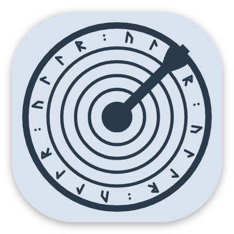
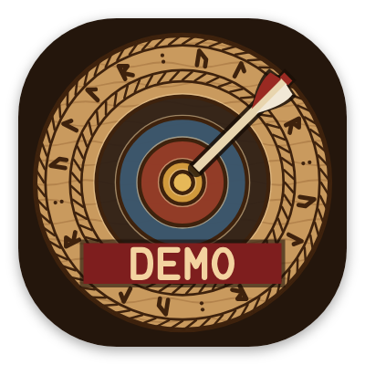

# Das App-Symbol { #the-app-icon }

Eine Scheibe, im nordischen Stil in Holz geschnitzt, für eine App, die nach dem nordischen Gott des Bogenschießens benannt ist. Es brauchte drei Anläufe.

## Wie es entstand { #how-it-evolved }

<figure markdown>
{ width="180" }
<figcaption><b>1. Die erste Scheibe.</b> Klar, aber das hätte jede beliebige Bogensport-App sein können.</figcaption>
</figure>
<figure markdown>
{ width="180" }
<figcaption><b>2. Ein Wikingerschild.</b> „Mach es wikingerhafter“ ergab einen Schild. Abgelehnt: Es musste eine Scheibe sein.</figcaption>
</figure>
<figure markdown>
{ width="180" }
<figcaption><b>3. Die geschnitzte Scheibe.</b> Die erste Idee, neu umgesetzt als nordische Holzschnitzerei. Gewählt.</figcaption>
</figure>

## Das endgültige Symbol { #the-final-icon }

- **Ringe**, als Rillen geschnitten und mit alten Pigmenten bemalt: Ocker, roter Ocker, Waidblau, Rußschwarz und blankes Holz.
- **Runen:** ein Band, das ULLR im jüngeren Futhark schreibt, ᚢᛚᛚᚱ, zwischen zwei gedrehten Kordelrändern.
- **Der Pfeil** nahe der Mitte, schräg wie ein echter Treffer.
- **Dunkles Holz** dahinter. Der Startbildschirm nutzt dieselbe Farbe, sodass sich das Öffnen der App wie ein einziges, durchgehendes Bild anfühlt.

## Varianten { #variants }

<figure markdown>
{ width="180" }
<figcaption><b>Designsymbol.</b> Einfarbig, von Android 13+ passend zu deinem Hintergrundbild eingefärbt.</figcaption>
</figure>
<figure markdown>
{ width="180" }
<figcaption><b>Ullr Demo.</b> Ein DEMO-Banner, damit sie nicht mit der echten App verwechselt werden kann.</figcaption>
</figure>

Das Symbol wird von einem kleinen Programm gezeichnet statt von Hand, sodass jede Größe, vom Launcher bis zum Play Store, aus derselben Zeichnung stammt.
