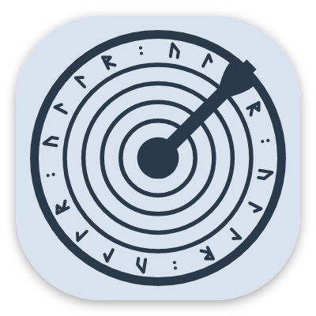
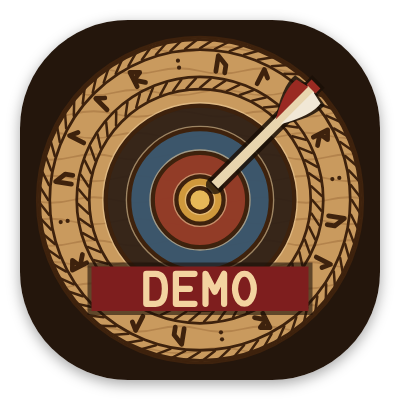

# El icono de la app { #the-app-icon }

Una diana de tiro con arco tallada en madera, al estilo nórdico, para una app que lleva el nombre del dios nórdico del tiro con arco. Hicieron falta tres intentos.

## Cómo evolucionó { #how-it-evolved }

<figure markdown>
{ width="180" }
<figcaption><b>1. La primera diana.</b> Clara, pero podría ser la de cualquier app de tiro con arco.</figcaption>
</figure>
<figure markdown>
{ width="180" }
<figcaption><b>2. Un escudo vikingo.</b> «Hazlo más vikingo» dio un escudo. Descartado: tenía que ser una diana.</figcaption>
</figure>
<figure markdown>
{ width="180" }
<figcaption><b>3. La diana tallada.</b> La primera idea, rehecha como talla nórdica en madera. La elegida.</figcaption>
</figure>

## El icono final { #the-final-icon }

- **Zonas** cortadas como surcos y pintadas con pigmentos antiguos: ocre, ocre rojo, azul glasto, negro de hollín y madera desnuda.
- **Runas:** una banda que forma ULLR en futhark joven, ᚢᛚᛚᚱ, entre dos bordes de cuerda trenzada.
- **La flecha**, cerca del centro, inclinada como un impacto real.
- **Madera oscura** detrás. La pantalla de arranque usa el mismo color, así que al abrir la app parece una sola imagen continua.

## Variantes { #variants }

<figure markdown>
{ width="180" }
<figcaption><b>Icono temático.</b> Un solo color, teñido por Android 13+ para combinar con tu fondo de pantalla.</figcaption>
</figure>
<figure markdown>
{ width="180" }
<figcaption><b>Ullr Demo.</b> Una banda DEMO, para que no se confunda con la app real.</figcaption>
</figure>

El icono lo dibuja un pequeño programa y no se hace a mano, así que todos los tamaños, del lanzador a la Play Store, salen del mismo dibujo.
