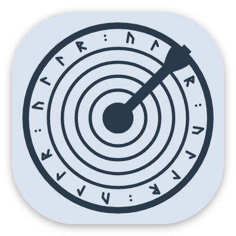
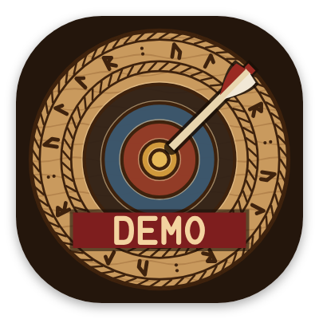

# L'icône

Une cible de tir à l'arc sculptée dans le bois, à la manière nordique, pour une application qui porte le nom du dieu nordique du tir à l'arc. Il a fallu trois essais.

## Son évolution

<figure markdown>
{ width="180" }
<figcaption><b>1. La première cible.</b> Claire, mais elle aurait pu être celle de n'importe quelle application de tir à l'arc.</figcaption>
</figure>
<figure markdown>
{ width="180" }
<figcaption><b>2. Un bouclier viking.</b> « Plus viking » a donné un bouclier. Refusé : il fallait une cible.</figcaption>
</figure>
<figure markdown>
{ width="180" }
<figcaption><b>3. La cible sculptée.</b> La première idée, refaite en bois sculpté nordique. Retenue.</figcaption>
</figure>

## L'icône finale

- **Les anneaux** sont creusés et peints avec des pigments anciens : ocre, ocre rouge, bleu de guède, noir de suie et bois nu.
- **Les runes :** une bande qui écrit ULLR en futhark récent, ᚢᛚᛚᚱ, entre deux bordures de corde torsadée.
- **La flèche** près du centre, inclinée comme une vraie flèche plantée.
- **Un fond de bois sombre.** L'écran de lancement utilise la même couleur : l'ouverture de l'application semble ne faire qu'une seule image.

## Les variantes

<figure markdown>
{ width="180" }
<figcaption><b>Icône thématique.</b> Une seule couleur, teintée par Android 13 et plus selon votre fond d'écran.</figcaption>
</figure>
<figure markdown>
{ width="180" }
<figcaption><b>Ullr Demo.</b> Un bandeau DEMO, pour ne pas la confondre avec la vraie application.</figcaption>
</figure>

L'icône est dessinée par un petit programme plutôt qu'à la main : toutes les tailles, du lanceur jusqu'au Play Store, viennent du même dessin.
