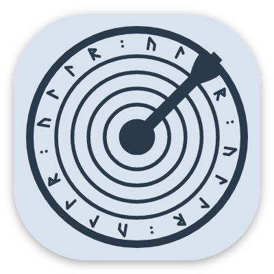
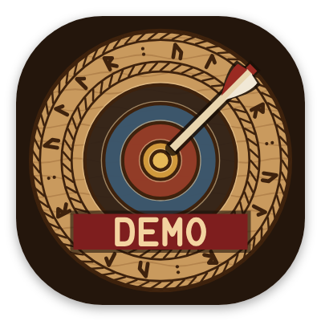

# The app icon

An archery target carved in wood, Norse style, for an app named after the Norse god of archery. It took three tries.

## How it evolved

<figure markdown>
{ width="180" }
<figcaption><b>1. The first target.</b> Clear, but it could be any archery app.</figcaption>
</figure>
<figure markdown>
{ width="180" }
<figcaption><b>2. A Viking shield.</b> "Make it look more Viking" gave a shield. Rejected: it had to be a target.</figcaption>
</figure>
<figure markdown>
{ width="180" }
<figcaption><b>3. The carved target.</b> The first idea, redone as Norse wood carving. Chosen.</figcaption>
</figure>

## The final icon

- **Rings** cut as grooves and painted in old pigments: ochre, red ochre, woad blue, soot black and bare wood.
- **Runes:** a band spelling ULLR in Younger Futhark, ᚢᛚᛚᚱ, between two twisted-rope borders.
- **The arrow** near the centre, angled like a real hit.
- **Dark wood** behind it. The launch screen uses the same colour, so opening the app feels like one continuous image.

## Variants

<figure markdown>
{ width="180" }
<figcaption><b>Themed icon.</b> One colour, tinted by Android 13+ to match your wallpaper.</figcaption>
</figure>
<figure markdown>
{ width="180" }
<figcaption><b>Ullr Demo.</b> A DEMO banner, so it can't be confused with the real app.</figcaption>
</figure>

The icon is drawn by a small program rather than by hand, so every size, from the launcher to the Play Store, comes from the same drawing.
