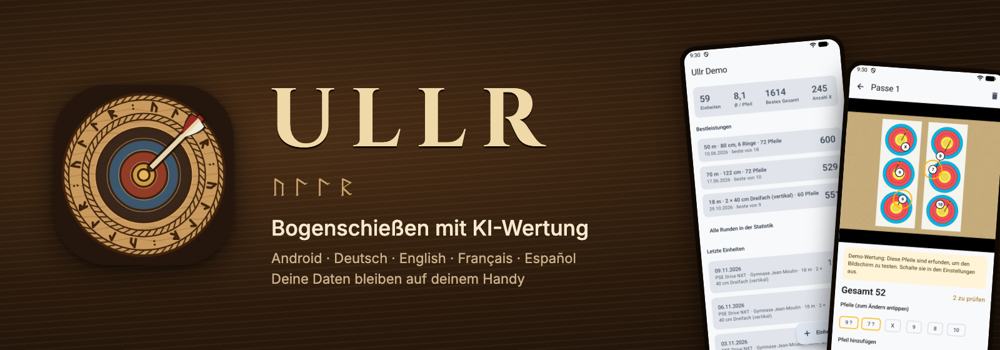
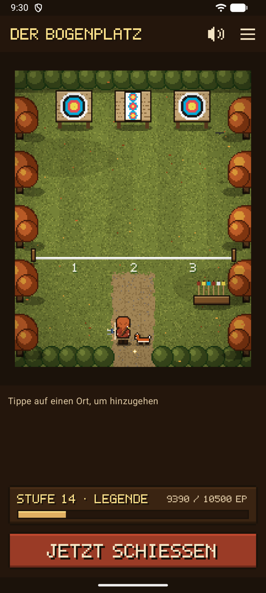
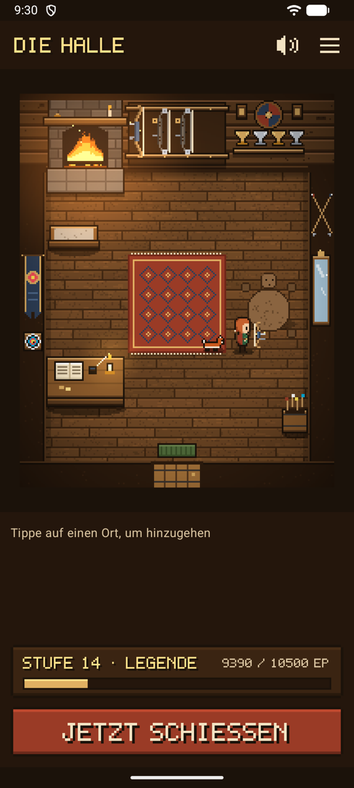
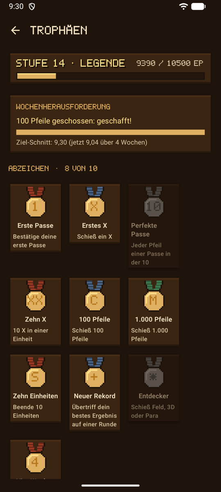
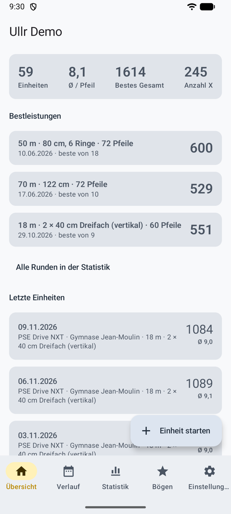
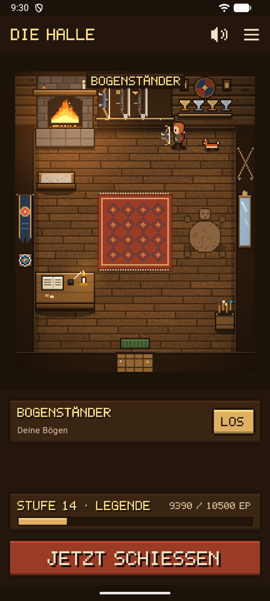

# Ullr { #ullr }

**Dein Schießzettel, für dich geführt.** Nach jeder Passe machst du ein Foto der Scheibe. Eine KI findet deine Pfeile, wertet sie und kreist die ein, bei denen sie sich nicht sicher ist. Oder du lässt die KI weg und tippst deine Pfeile selbst auf dem Foto an. Jede Einheit wird mit ihren Fotos auf deinem Handy gespeichert.

*Benannt nach Ullr, dem nordischen Gott des Bogenschießens.*

## Oder spiel es wie ein Spiel { #game-band }

Schalte den **Spielmodus** ein, und Ullr wird zu einem kleinen Pixel-Art-Videospiel. Deine Figur läuft durch eine nordische Halle und über einen Bogenplatz: Der **Bogenständer** öffnet deine Bögen, die **Schießlinie** startet eine Einheit, die **Feuerstelle** zeigt deine Statistik. Dieselben Daten, dieselbe Wertung: Nur echtes Schießen bringt etwas ein.

<figure markdown>
{ .shot }
<figcaption><b>Geh zum Bogenplatz</b> und schieß</figcaption>
</figure>
<figure markdown>
{ .shot }
<figcaption><b>Kleide deine Figur ein</b>, wähle einen Begleiter</figcaption>
</figure>
<figure markdown>
{ .shot }
<figcaption><b>Stufen, Abzeichen</b>, eine Wochenherausforderung</figcaption>
</figure>

{ .pixel width="360" }

Kleidung und Hallenschmuck zum Verdienen, eine Eule für vier Wochen am Stück, ein Kriegshorn für eine persönliche Bestleistung, der Bogenplatz in vier Jahreszeiten, Musik und Klänge eigens für Ullr.

[Den Spielmodus entdecken](game.md){ .md-button .md-button--primary }

## Zwei Arten, es zu nutzen { #two-ways-to-use-it }

Dieselben Daten, dieselbe Wertung: Nimm, was dir gefällt, und wechsle jederzeit unter **Einstellungen → Aussehen und Spiel**.

-   :material-view-dashboard-outline: **Normalmodus**

    ---

    { .shot width="200" }

    Eine übersichtliche App mit Tabs: Übersicht, Verlauf, Bögen, Statistik und Einstellungen. Schnell am Bogenplatz.

    [Normalmodus](normal.md)

-   :material-gamepad-variant-outline: **Spielmodus**

    ---

    { .shot width="200" }

    Wer will sich schon durch Textmenüs klicken? Lauf mit deiner Figur durch eine nordische Halle und über einen Bogenplatz: Der Bogenständer öffnet deine Bögen, die Schießlinie startet eine Einheit. Pixel-Art, Musik, ein Begleiter.

    [Spielmodus](game.md)

## Drei Arten zu werten { #three-ways-to-score }

-   :material-key-outline: **Dein eigener API-Schlüssel**

    ---

    Automatisch. Jedes Foto wird im Hintergrund von dem KI-Dienst deiner Wahl gewertet, mit deinem eigenen Schlüssel: einem der großen Dienste oder einem beliebigen OpenAI-kompatiblen Dienst unter der Adresse, die du angibst.

    [Dein eigener API-Schlüssel](scoring-api.md)

-   :material-share-variant-outline: **Mit deiner KI-App teilen**

    ---

    Kein Schlüssel. Teile das Foto und eine fertige Anweisung mit der KI-App, die schon auf deinem Handy ist, und füge dann ihre Antwort ein.

    [Mit deiner KI-App teilen](scoring-share.md)

-   :material-gesture-tap: **Von Hand**

    ---

    Keine KI, nichts wird gesendet. Tippe jeden Pfeil auf dem Foto an und wähle seinen Ring, oder lass das Foto weg und tippe die Ergebnisse an.

    [Wertung von Hand](scoring-manual.md)

[Die drei vergleichen](scoring.md){ .md-button }

## Funktionen { #features }

-   :material-camera-outline: **[Einheiten](sessions.md)**

    ---

    Ort, Disziplin, Bogen, Entfernung, Auflage und Pfeile pro Passe. Ein Foto pro Passe, auch ohne Empfang. Persönliche Bestleistungen pro Runde und eine Zusammenfassung zum Teilen.

-   :material-target: **[Pfeile prüfen](review.md)**

    ---

    Unsichere Pfeile sind bernsteinfarben eingekreist. Tippe einen an, wähle den richtigen Ring. Die Linienregel gilt.

-   :material-scale-balance: **[Wertungsregeln](rules.md)**

    ---

    X = 10, nur Innenzehn oder X = 11, pro Einheit. Änderst du sie später, wird jedes Ergebnis neu berechnet.

-   :material-bow-arrow: **[Bögen](bows.md)**

    ---

    All deine Bögen, gezeichnet nach ihrem Typ, mit einem Katalog aktueller Compoundbögen.

-   :material-chart-bar: **[Statistik](stats.md)**

    ---

    Jede Einheit mit ihren Fotos, ein Diagramm der Ergebnisse pro Passe, Trends, Gleichmäßigkeit, wo deine Pfeile gruppieren, und eine Heatmap pro Spot, nach Entfernung und Auflage.

-   :material-archive-outline: **[Speicher und Sicherung](backup.md)**

    ---

    In eine Datei exportieren, auf einem neuen Handy wiederherstellen, Platz von alten Fotos freigeben.

-   :material-palette-outline: **[Aussehen und Sprache](look.md)**

    ---

    Drei Designs, darunter eines für grelles Sonnenlicht. Englisch, Französisch, Deutsch und Spanisch.

-   :material-shield-lock-outline: **[Datenschutz](privacy.md)**

    ---

    Die Daten bleiben auf dem Handy. Kein Konto, keine Werbung, kein Tracking. Nichts wird gelöscht, ohne zu fragen.

[Alle Bildschirmfotos](screenshots.md){ .md-button } [So funktioniert es](how-it-works.md){ .md-button } [Erste Schritte](guide.md){ .md-button .md-button--primary }

## Stand { #status }

Ullr ist ein Pro-bono-Projekt von Ashencroft Studio und wird aktiv entwickelt. Es läuft ab Android 8. **Es ist noch nicht bei Google Play.** In der [Roadmap](roadmap.md) steht, was fertig ist und was als Nächstes kommt. Wer Ullr nutzt, akzeptiert seine [Nutzungsbedingungen](terms.md): Es wird bereitgestellt, wie es ist. Seine [Datenschutzerklärung](privacy-policy.md) erklärt, was auf deinem Handy bleibt und was gesendet wird.
