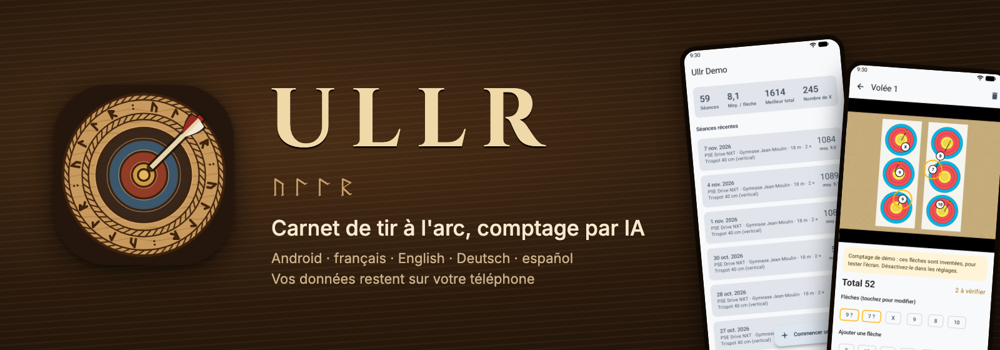
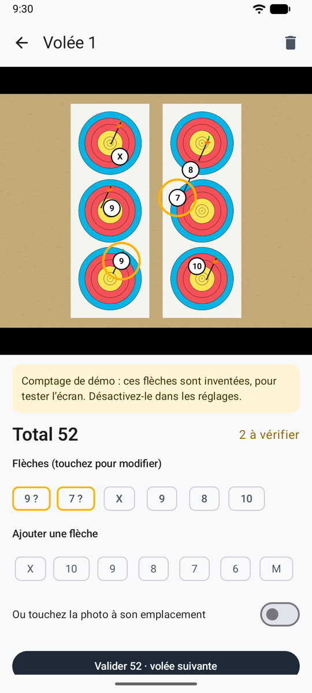
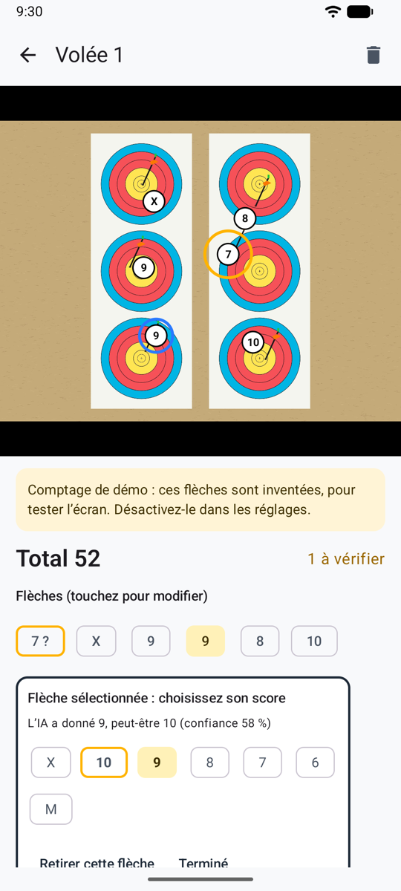
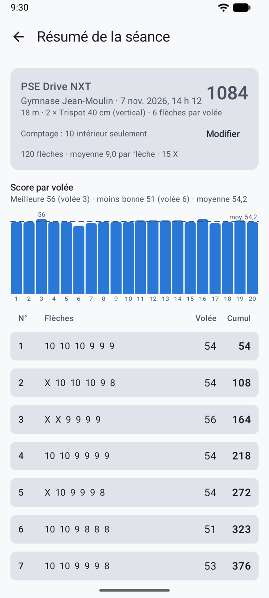
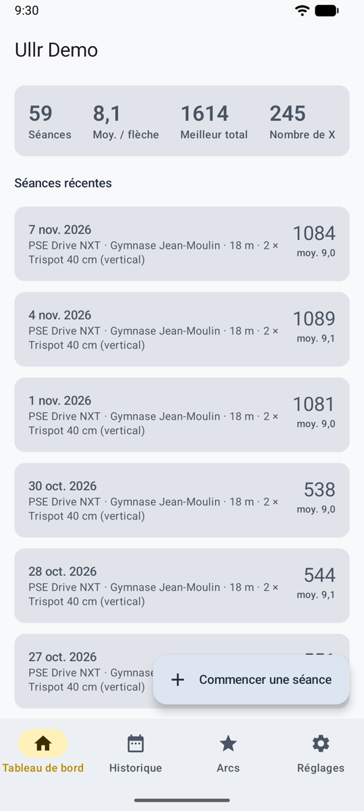
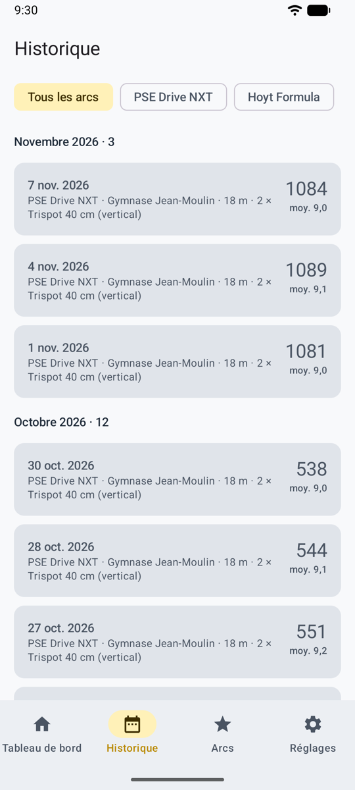
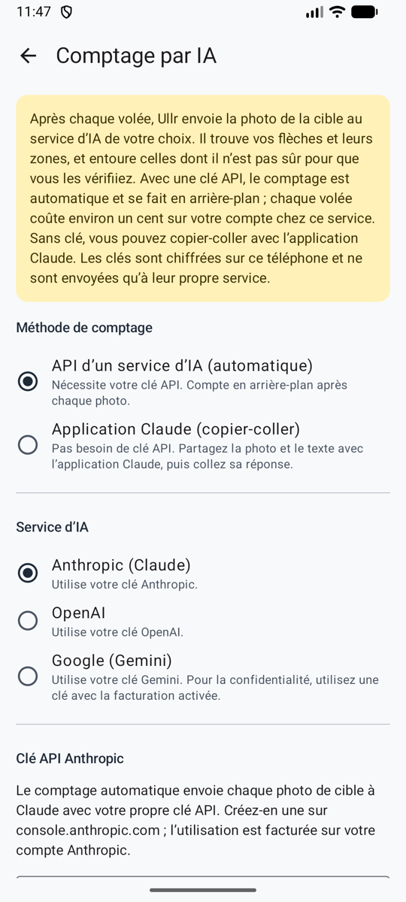
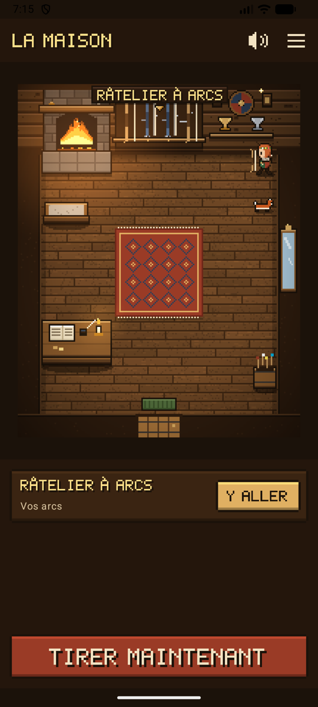
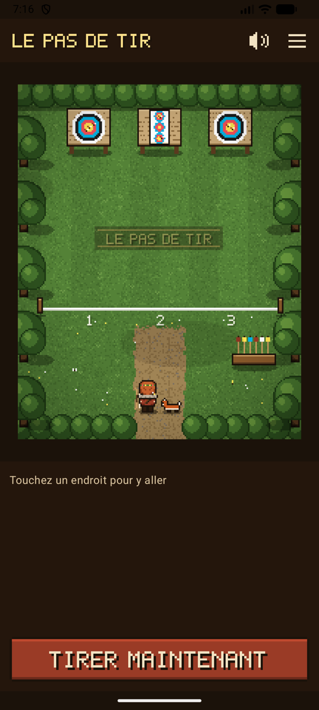
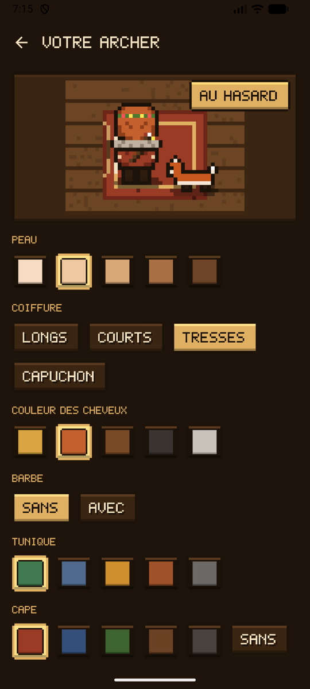

# Ullr

**Votre feuille de marque, tenue pour vous.** Après chaque volée, photographiez la cible. Une IA trouve vos flèches et les compte, et entoure celles dont elle doute. Vous les vérifiez avant de retirer vos flèches, et chaque séance est enregistrée sur votre téléphone avec ses photos.

*Du nom d'Ullr, le dieu nordique du tir à l'arc.*

-   :material-camera-outline: **Une photo, un score**

    ---

    Une photo par volée. Chaque flèche reçoit sa zone, du X au M, sur tous les blasons World Archery, y compris deux trispots à la fois.

-   :material-target: **Les flèches incertaines entourées**

    ---

    Les flèches proches d'une ligne sont entourées en orange. Touchez-en une, choisissez la bonne zone, validez. La règle de la ligne s'applique : une flèche qui touche la ligne du 9 vaut 9.

-   :material-chart-bar: **Votre historique**

    ---

    Tableau de bord, toutes vos séances, feuille de marque, graphique des volées, et des **statistiques** : tendance, volume, zones, régularité et groupement de vos flèches. Chaque volée garde sa photo.

-   :material-gamepad-variant-outline: **Ou jouez-le comme un jeu**

    ---

    Un mode jeu, au choix : promenez votre archer dans une maison nordique et sur un pas de tir, habillez-le au miroir, choisissez un compagnon. Pixel art, musique et sons. [Mode jeu](game.md)

-   :material-shield-lock-outline: **Votre téléphone, vos données**

    ---

    L'historique reste sur le téléphone. Seule la photo de la cible est envoyée, et seulement pour être comptée. Pas de compte, pas de publicité, pas de pistage.

## En images

<figure markdown>
{ .shot }
<figcaption>Deux flèches à vérifier, entourées en orange</figcaption>
</figure>
<figure markdown>
{ .shot }
<figcaption>Une touche pour choisir la bonne zone</figcaption>
</figure>
<figure markdown>
{ .shot }
<figcaption>Résumé de la séance et feuille de marque</figcaption>
</figure>
<figure markdown>
{ .shot }
<figcaption>Tableau de bord</figcaption>
</figure>
<figure markdown>
{ .shot }
<figcaption>Toutes vos séances passées</figcaption>
</figure>
<figure markdown>
{ .shot }
<figcaption>Le choix de l'IA</figcaption>
</figure>

[Toutes les captures](screenshots.md){ .md-button } [Comment ça marche](how-it-works.md){ .md-button }

## Jouez-le comme un jeu

Activez le **mode jeu** dans les réglages et Ullr devient un petit jeu en pixel art : touchez le râtelier, le mur des trophées ou la ligne de tir, et votre archer s’y rend pour ouvrir vos arcs, votre historique ou une séance. Le même carnet, le même comptage.

<figure markdown>
{ .shot }
<figcaption>La maison</figcaption>
</figure>
<figure markdown>
{ .shot }
<figcaption>Le pas de tir, avec un compagnon</figcaption>
</figure>
<figure markdown>
{ .shot }
<figcaption>Habillez votre archer</figcaption>
</figure>

[Mode jeu](game.md){ .md-button }

## Ce que fait Ullr

| | |
|---|---|
| **Toutes vos séances** | Lieu, date, discipline (tir sur cible, en campagne, 3D ou para-tir à l’arc), type d'arc (arc nu, recourbé ou à poulies) et arc, distance, blason, nombre de blasons sur la butte, n'importe quel nombre de flèches par volée. |
| **Votre règle de comptage** | X = 10, 10 intérieur seulement (arc à poulies World Archery) ou X = 11, choisie pour chaque séance, avec une valeur par défaut dans les réglages. Changez-la plus tard : tous les totaux sont recalculés. |
| **Le service d'IA de votre choix** | Anthropic (Claude), Google (Gemini) ou OpenAI, avec votre propre clé API. Les trois reçoivent les mêmes consignes. |
| **Pensé pour le pas de tir** | Pas de réseau ? Les photos sont enregistrées et comptées dès que le téléphone est de nouveau en ligne. Vous pouvez toujours saisir une volée à la main. |
| **Vos arcs** | Plusieurs arcs, avec un catalogue d'arcs à poulies actuels (PSE, Hoyt, Mathews, Bowtech), puissance et allonge. |
| **Français et anglais** | Toute l'application suit la langue de votre téléphone. |
| **Votre style** | Trois thèmes (Original, Jour de tir pour le plein soleil, Tir de nuit pour l’intérieur), ou le style du jeu. |
| **Mode jeu** | Au choix : l’application en jeu en pixel art, avec votre archer, un compagnon, de la musique et des sons. [En savoir plus](game.md) |

## Où en est le projet

Ullr est un projet personnel, en développement actif. Il fonctionne sur Android 8 et plus récent. **Il n'est pas encore sur Google Play.** La [feuille de route](roadmap.md) montre ce qui est fait et ce qui vient.
