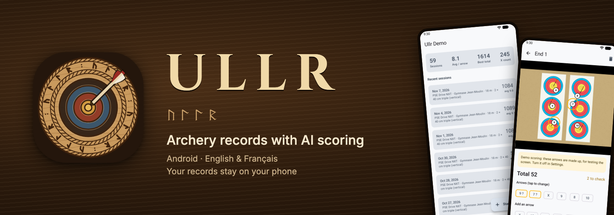
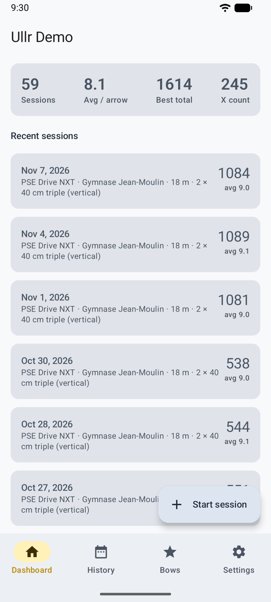
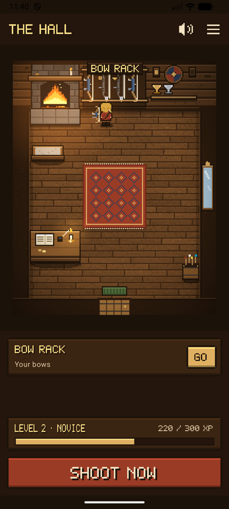

# Ullr

**Your archery scoresheet, kept for you.** After each end, take a photo of the target. An AI finds your arrows and scores them, and circles the ones it isn't sure about. Or skip the AI and tap your arrows on the photo yourself. Every session is saved on your phone with its photos.

*Named after Ullr, the Norse god of archery.*

## Two ways to use it

Same records, same scoring: pick the one you like, and switch at any time in **Settings → Appearance and game**.

-   :material-view-dashboard-outline: **Normal mode**

    ---

    { .shot width="200" }

    A clear app with tabs: Dashboard, History, Bows, Stats and Settings. Quick at the range.

    [Normal mode](normal.md)

-   :material-gamepad-variant-outline: **Game mode**

    ---

    { .shot width="200" }

    Who wants to find their way through text menus? Walk your archer around a Norse hall and a range: the bow rack opens your bows, the shooting line starts a session. Pixel art, music, a companion.

    [Game mode](game.md)

## Three ways to score

-   :material-key-outline: **Your own API key**

    ---

    Automatic. Each photo is scored in the background by the AI service you choose, with your own key: a major service, or any OpenAI-compatible service at the address you give.

    [Your own API key](scoring-api.md)

-   :material-share-variant-outline: **Share with your AI app**

    ---

    No key. Share the photo and a ready-made prompt with the AI app already on your phone, then paste its answer back.

    [Share with your AI app](scoring-share.md)

-   :material-gesture-tap: **Manual**

    ---

    No AI, nothing sent. Tap each arrow on the photo and pick its ring, or skip the photo and tap the scores.

    [Manual scoring](scoring-manual.md)

[Compare the three](scoring.md){ .md-button }

## Features

-   :material-camera-outline: **[Sessions](sessions.md)**

    ---

    Place, discipline, bow, distance, face and arrows per end. One photo per end, even with no signal.

-   :material-target: **[Checking arrows](review.md)**

    ---

    Uncertain arrows circled in amber. Tap one, pick the right ring. The line rule applies.

-   :material-scale-balance: **[Scoring rules](rules.md)**

    ---

    X = 10, inner 10 only or X = 11, per session. Change it later and every total is recalculated.

-   :material-bow-arrow: **[Bows](bows.md)**

    ---

    All your bows, drawn as their type, with a catalog of current compound bows.

-   :material-chart-bar: **[History and statistics](stats.md)**

    ---

    Every session with its photos, a score-by-end chart, trends, consistency and where your arrows group.

-   :material-archive-outline: **[Storage and backup](backup.md)**

    ---

    Export to one file, restore on a new phone, free up space from old photos.

-   :material-palette-outline: **[Look and language](look.md)**

    ---

    Three themes, including one for bright sunlight. English and French.

-   :material-shield-lock-outline: **[Privacy](privacy.md)**

    ---

    Records stay on the phone. No account, no ads, no tracking. Nothing is removed without asking.

[All screenshots](screenshots.md){ .md-button } [How it works](how-it-works.md){ .md-button } [Getting started](guide.md){ .md-button .md-button--primary }

## Status

Ullr is a personal project, in active development. It runs on Android 8 and later. **It isn't on Google Play yet.** See the [roadmap](roadmap.md) for what's done and what's next. Using Ullr means accepting its [terms of use](terms.md): it is provided as is.
