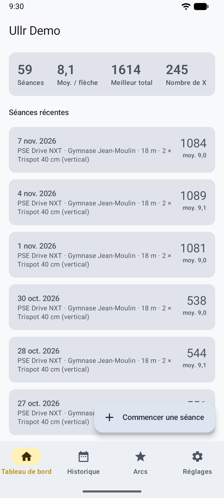
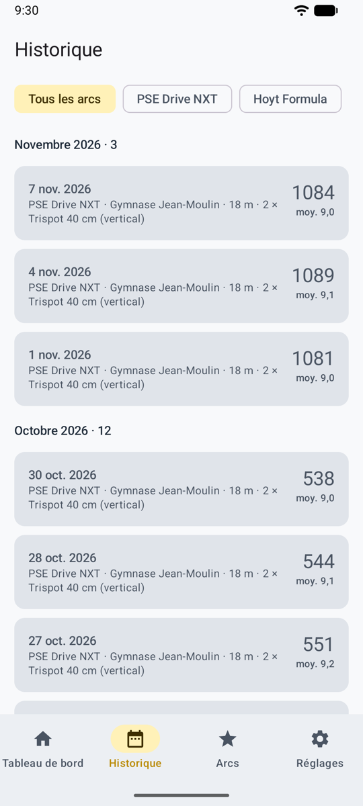
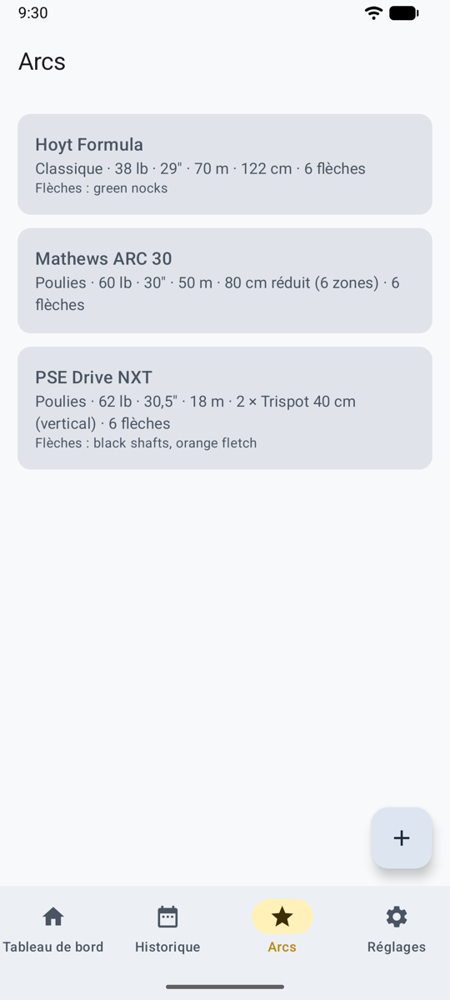

# Mode normal

L’application telle que vous l’attendez : une barre d’onglets en bas, et les écrans qui s’ouvrent à partir d’elle. C’est le moyen le plus rapide de s’y retrouver au pas de tir, et c’est ainsi qu’Ullr s’ouvre la première fois.

<figure markdown>
{ .shot }
<figcaption><b>Accueil.</b> Vos chiffres et vos séances récentes.</figcaption>
</figure>
<figure markdown>
{ .shot }
<figcaption><b>Historique.</b> Toutes les séances terminées.</figcaption>
</figure>
<figure markdown>
{ .shot }
<figcaption><b>Arcs.</b> Vos arcs et leurs valeurs par défaut.</figcaption>
</figure>

## Les onglets

| Onglet | Ce qu’on y trouve |
|--------|-------------------|
| **Accueil** | Séances, moyenne par flèche, meilleur total, nombre de X et séances récentes. Une séance en cours apparaît en haut avec **Reprendre**. **Commencer une séance** est le bouton rond. |
| **Historique** | Toutes les séances terminées, par mois, filtrées par arc. Voir [Historique et statistiques](stats.md). |
| **Arcs** | Vos arcs. Voir [Arcs](bows.md). |
| **Stats** | Tendances, zones, régularité et groupement de vos flèches. Voir [Historique et statistiques](stats.md). |
| **Réglages** | Une entrée par page, chacune avec ce qui est choisi en ce moment. |

## Réglages

Chaque page des réglages commence par une courte explication, puis ses choix.

| Page | Ce que vous réglez |
|------|--------------------|
| **Méthode de comptage** | Votre propre clé API, le partage avec votre application d’IA, ou le comptage manuel. Voir [Trois façons de compter](scoring.md). |
| **Règles de comptage** | La règle de départ des nouvelles séances. Voir [Règles de comptage](rules.md). |
| **Confidentialité** | N’envoyer que la zone de la cible, et ce qui est envoyé. Voir [Confidentialité](privacy.md). |
| **Apparence et jeu** | Mode normal ou jeu, le thème, les sons du jeu et la musique. Voir [Apparence et langue](look.md). |
| **Langue** | Français, anglais, ou la langue du téléphone (Android 13 et plus récent). |
| **Lieux enregistrés** | Renommer, fusionner ou supprimer les lieux de vos séances. Voir [Lieux enregistrés](sessions.md#lieux-enregistres). |
| **Stockage et sauvegarde** | Espace utilisé, exporter, restaurer, libérer de l’espace. Voir [Stockage et sauvegarde](backup.md). |
| **À propos et mentions légales** | La version, les [conditions d’utilisation](terms.md), la [politique de confidentialité](privacy-policy.md) et les [licences de logiciels libres](licences.md). |

## Passer au mode jeu

**Réglages → Apparence et jeu → Jeu (aperçu)**. Tout ce que vous avez enregistré se retrouve aussi dans le jeu, et **Normal** vous ramène. Voir [Mode jeu](game.md).
