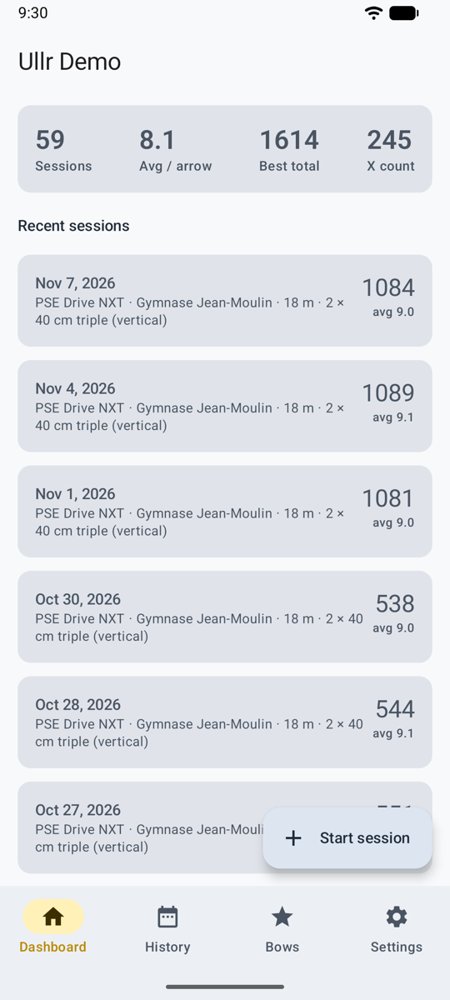
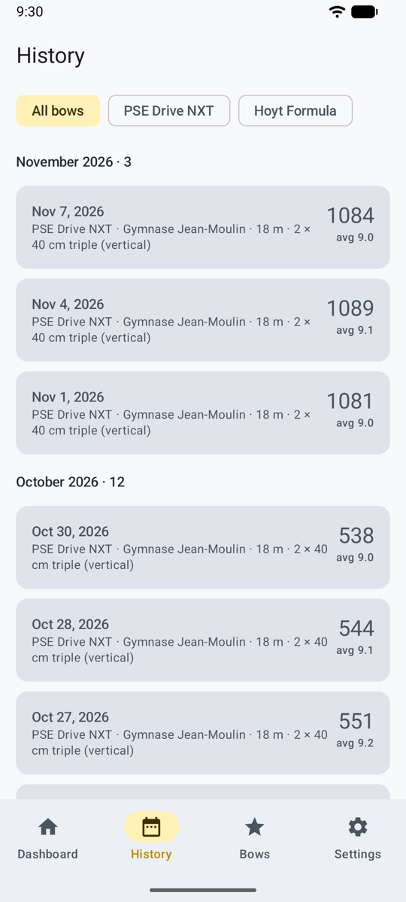
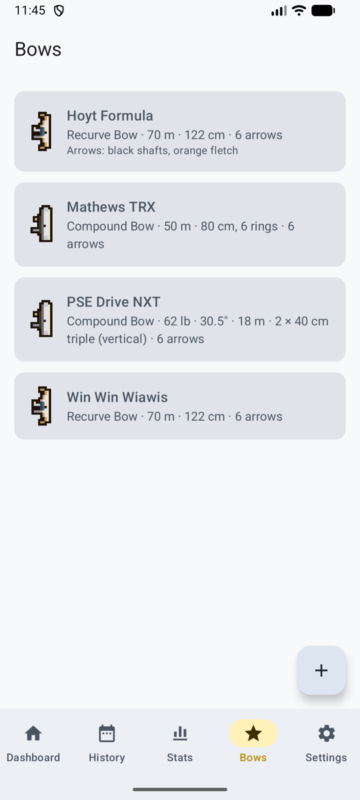

# Normal mode

The app as you'd expect it: a tab bar at the bottom, and screens that open from it. It's the quickest way around at the range, and it's how Ullr opens the first time.

<figure markdown>
{ .shot }
<figcaption><b>Dashboard.</b> Your numbers and recent sessions.</figcaption>
</figure>
<figure markdown>
{ .shot }
<figcaption><b>History.</b> Every finished session.</figcaption>
</figure>
<figure markdown>
{ .shot }
<figcaption><b>Bows.</b> Your bows and their defaults.</figcaption>
</figure>

## The tabs

| Tab | What's there |
|-----|--------------|
| **Dashboard** (*Accueil*) | Sessions, average per arrow, best total, X count and recent sessions. A session in progress shows at the top with **Resume** (*Reprendre*). **Start session** (*Commencer une séance*) is the round button. |
| **History** (*Historique*) | Every finished session, by month, filtered by bow. See [History and statistics](stats.md). |
| **Bows** (*Arcs*) | Your bows. See [Bows](bows.md). |
| **Stats** | Trends, rings, consistency and where your arrows group. See [History and statistics](stats.md). |
| **Settings** (*Réglages*) | One entry per page, each showing what is chosen now. |

## Settings

Each Settings page starts with a short explanation, then its choices.

| Page | What you set |
|------|--------------|
| **Scoring method** (*Méthode de comptage*) | Your own API key, sharing with your AI app, or manual. See [Three ways to score](scoring.md). |
| **Scoring rules** (*Règles de comptage*) | The rule new sessions start with. See [Scoring rules](rules.md). |
| **Privacy** (*Confidentialité*) | Send only the target area, and what is sent. See [Privacy](privacy.md). |
| **Appearance and game** (*Apparence et jeu*) | Normal or game mode, the theme, game sound and music. See [Look and language](look.md). |
| **Language** (*Langue*) | English, French, or the phone's language (Android 13 and later). |
| **Saved places** (*Lieux enregistrés*) | Rename, merge or delete the places of your sessions. See [Saved places](sessions.md#saved-places). |
| **Storage and backup** (*Stockage et sauvegarde*) | Space used, export, restore, free up space. See [Storage and backup](backup.md). |
| **About and legal** (*À propos et mentions légales*) | The version, the [terms of use](terms.md), the [privacy policy](privacy-policy.md) and the [open-source licences](licences.md). |

## Switching to game mode

**Settings → Appearance and game → Game (preview)** (*Jeu (aperçu)*). Everything you've recorded is there in the game too, and **Normal** brings you back. See [Game mode](game.md).
