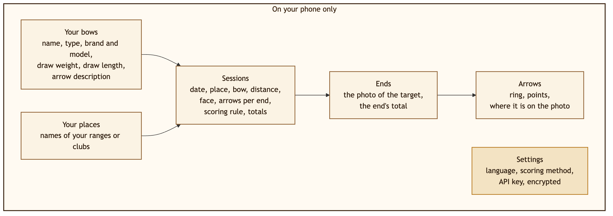
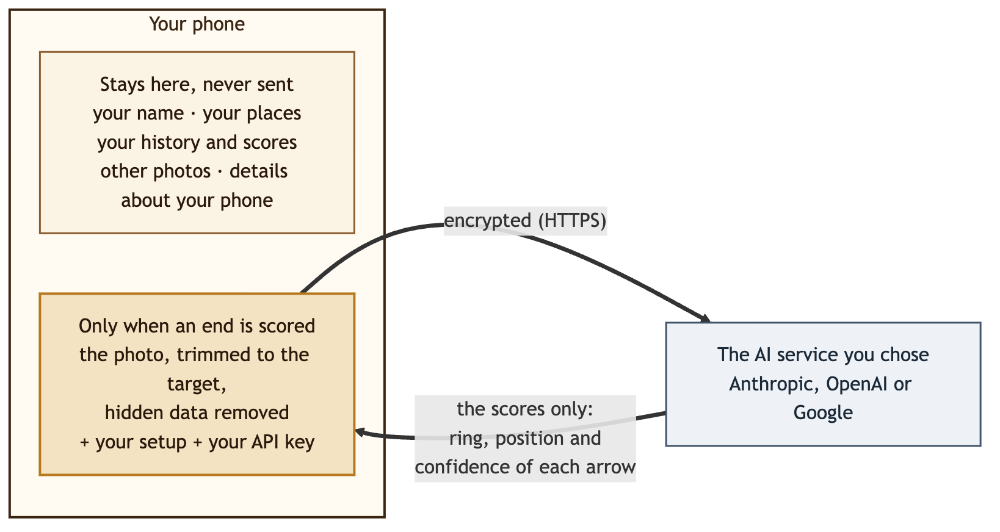
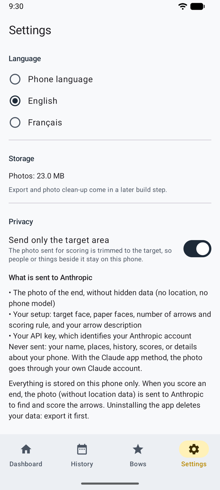

# Datenschutz { #privacy }

Die Kurzfassung: **Deine Daten bleiben auf deinem Handy.** Nur das Foto der Scheibe verlässt es, und nur zur Wertung, durch den KI-Dienst deiner Wahl. Mit der [Wertung von Hand](scoring-manual.md) verlässt es gar nichts.

Diese Seite erklärt es in einfachen Worten. Der formelle Text ist die [Datenschutzerklärung](privacy-policy.md), auch in der App unter **Einstellungen → Info und Rechtliches**.

## Was Ullr speichert, und wo { #what-ullr-keeps-and-where }

Das ist alles: deine Bögen und Orte, deine Einheiten, jede Passe mit ihrem Foto und jeder Pfeil. Nichts über dich als Person, kein Konto, keine Kontakte. All das liegt im privaten Speicher von Ullr auf dem Handy.

- Andere Apps können es nicht lesen, und die Fotos sind nicht in deiner Galerie.
- Nichts geht automatisch in eine Cloud-Sicherung oder auf ein neues Handy.
- Es gibt kein Konto, keine Werbung, keine Analyse und kein Tracking.
- **Wenn du die App deinstallierst, wird alles gelöscht**, also exportiere vorher: **Einstellungen → Speicher und Sicherung** speichert alles in eine Datei, die du behältst, und stellt es auf demselben oder einem neuen Handy wieder her. API-Schlüssel und Adressen von Diensten kommen nie in einen Export.

## Was gesendet wird, und wann { #what-is-sent-and-when }

{ width="560" }

Nur wenn eine Passe mit einem KI-Dienst gewertet wird, über eine verschlüsselte Verbindung, und nur an diesen Dienst:

- **das Foto der Passe**, ohne versteckte Daten (kein Standort, kein Handymodell) und standardmäßig auf den Scheibenbereich zugeschnitten;
- **deine Angaben**: Auflage, Auflagen auf der Scheibe, Pfeilzahl und Wertungsregel sowie deine Pfeilbeschreibung;
- **dein API-Schlüssel**, der dein Konto bei diesem Dienst ausweist.

**Nie gesendet:** dein Name, deine Orte, dein Verlauf, deine Ergebnisse oder Angaben zu deinem Handy. Die technischen Angaben, die Apps meist über das Handy senden (Android-Version, Prozessor), werden durch „unbekannt“ ersetzt.

{ .shot width="240" }

Die Einstellungen zeigen dieselbe Liste unter **Was an … gesendet wird**, für den Dienst, den du gewählt hast.

### Bei jeder Wertungsmethode { #with-each-scoring-method }

| Methode | Was das Handy verlässt |
|--------|-----------------------|
| [Dein eigener API-Schlüssel](scoring-api.md) | Das Foto, deine Angaben und dein Schlüssel, von Ullr nur an diesen Dienst gesendet. Bei einem OpenAI-kompatiblen Dienst an die Adresse, die du angegeben hast. |
| [Mit deiner KI-App teilen](scoring-share.md) | Dasselbe Foto und die Anweisung, **von dir** mit der App geteilt, die du wählst. Kein Schlüssel. Es läuft über dein eigenes Konto in dieser App, nach deren Bedingungen. |
| [Von Hand](scoring-manual.md) | Nichts: kein Foto, kein Ergebnis, kein Schlüssel. |

**Wenn du eine Einheit teilst**, geht ihre Zusammenfassung (und, wenn du willst, ein Bild des Schießzettels) nur an die App, die du wählst, wenn du auf [Teilen](sessions.md#share-a-session) tippst. Nie die Fotos deiner Passen.

## Was jeder Dienst damit macht { #what-each-service-does-with-it }

| Dienst | Zum Trainieren von KI genutzt? | Aufbewahrt |
|---------|-------------------|------|
| **Anthropic** | Nein | Nach den kommerziellen Bedingungen von Anthropic |
| **OpenAI** | Nein, außer du stimmst in deinem Konto zu | Ullr bittet OpenAI, die Anfrage nicht zu speichern. Sicherheitsprotokolle werden bis zu 30 Tage aufbewahrt. |
| **Google Gemini**, mit aktivierter Abrechnung | Nein | Für begrenzte Zeit protokolliert, um Missbrauch zu erkennen |
| **Google Gemini**, kostenlose Stufe | **Ja**: kann genutzt werden, um die Produkte von Google zu verbessern, und von menschlichen Prüfern gelesen werden | Nicht angegeben |
| **Ein OpenAI-kompatibler Dienst** oder **deine KI-App** | Hängt von diesem Dienst ab: Prüf seine Bedingungen | Hängt von diesem Dienst ab |

!!! warning "Gemini: Nimm einen Schlüssel mit aktivierter Abrechnung"
    In der kostenlosen Stufe von Google können deine Scheibenfotos von Google genutzt und von Prüfern gesehen werden. Nimm einen Schlüssel aus einem Google-Cloud-Projekt mit aktivierter Abrechnung. Ullr kann das nicht für dich prüfen.

## Dein API-Schlüssel { #your-api-key }

- Er wird verschlüsselt auf dem Handy gespeichert, nie wieder angezeigt und nie in einen Export aufgenommen.
- Er wird nur an den Dienst gesendet, zu dem er gehört, an die Adresse, für die er gespeichert wurde. Wenn du die Adresse eines Dienstes änderst, wird sein Schlüssel gelöscht, nachdem Ullr gefragt hat.
- **Schlüssel entfernen** in den Einstellungen löscht ihn.

Erstelle einen Schlüssel nur für Ullr und leg beim Dienst ein Ausgabenlimit fest. Wenn du dein Handy verlierst, lösch den Schlüssel dort.

## Spielmodus { #game-mode }

Der Spielmodus sendet nichts. Das Aussehen deiner Figur, dein Begleiter und deine Toneinstellungen bleiben mit den anderen Einstellungen auf dem Handy. Die Bilder und Klänge gehören zur App: Nichts wird heruntergeladen, und keine Berechtigung kommt hinzu.

## Berechtigungen { #permissions }

| Berechtigung | Wozu |
|------------|-----|
| Kamera | Um die Scheibe zu fotografieren, beim ersten Mal erfragt |
| Internet | Für die automatische Wertung mit einem KI-Dienst (bei der Wertung von Hand nicht genutzt) |

Keine Berechtigungen für Standort, Kontakte, Mikrofon oder Speicher. Zum Importieren eines Fotos dient die Fotoauswahl von Android, die Ullr nur das Foto gibt, das du wählst.

Mehr dazu, wie deine Daten geschützt sind: [Sicherheit](security.md).
