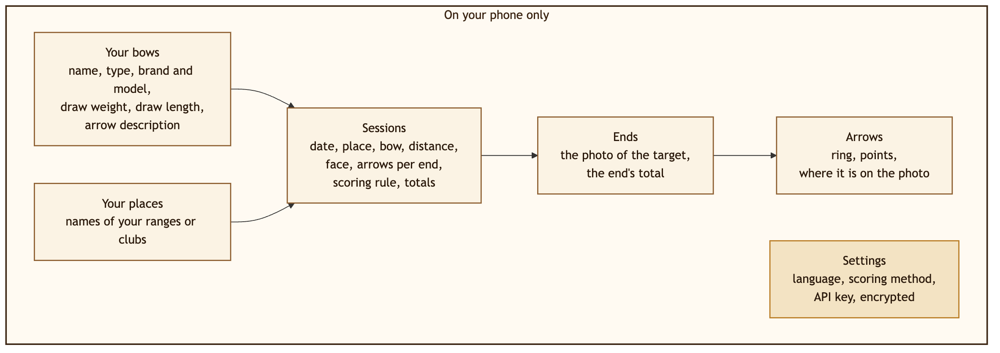
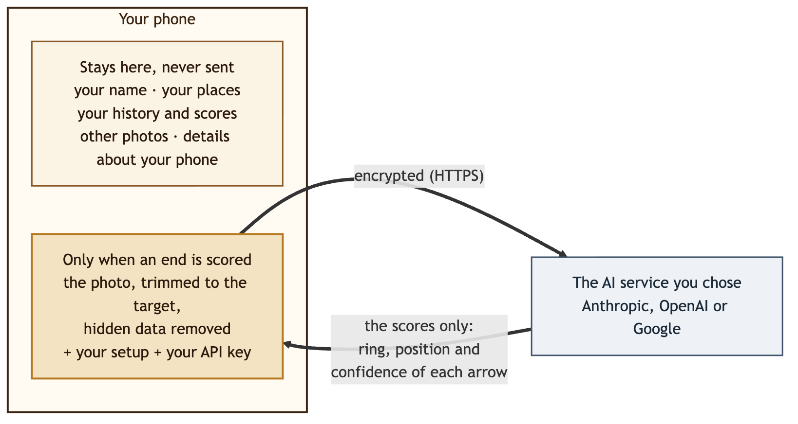
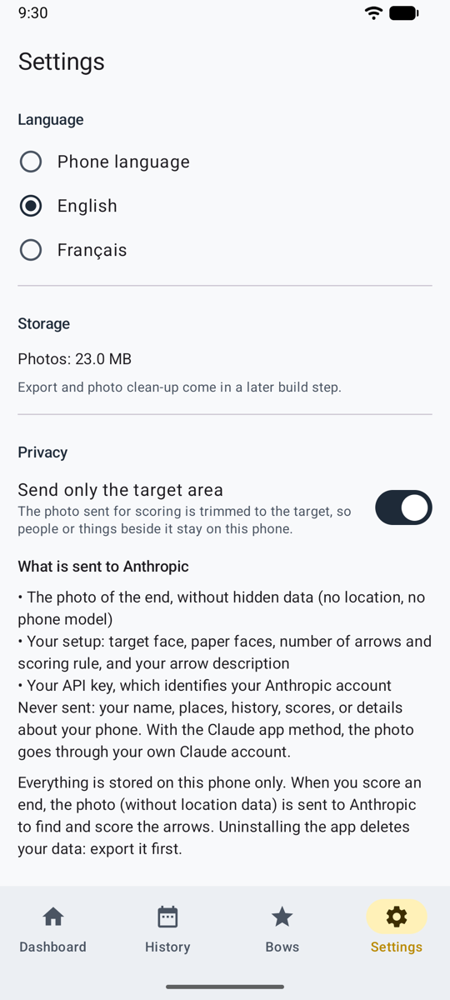

# Privacidad { #privacy }

En pocas palabras: **tus registros se quedan en tu teléfono.** Solo sale de él la foto de la diana, y solo para puntuarla, hacia el servicio de IA que elegiste. Con la [puntuación manual](scoring-manual.md), no sale nada.

Esta página lo explica con palabras sencillas. El texto formal es la [política de privacidad](privacy-policy.md), también en la app en **Ajustes → Información y aviso legal**.

## Qué guarda Ullr, y dónde { #what-ullr-keeps-and-where }

Eso es todo: tus arcos y lugares, tus sesiones, cada tanda con su foto y cada flecha. Nada sobre ti como persona, ninguna cuenta, ningún contacto. Todo se guarda en el almacenamiento privado de Ullr en el teléfono.

- Otras apps no pueden leerlo, y las fotos no están en tu galería.
- Nada va automáticamente a una copia de seguridad en la nube ni a un teléfono nuevo.
- No hay cuenta, ni publicidad, ni analítica, ni seguimiento.
- **Desinstalar la app lo borra todo**, así que exporta antes: **Ajustes → Almacenamiento y copia de seguridad** guarda todo en un archivo que conservas, y lo restaura en el mismo teléfono o en uno nuevo. Las claves de API y las direcciones de los servicios nunca se incluyen en una exportación.

## Qué se envía, y cuándo { #what-is-sent-and-when }

{ width="560" }

Solo cuando una tanda se puntúa con un servicio de IA, mediante una conexión cifrada, y solo a ese servicio:

- **la foto de la tanda**, sin datos ocultos (sin ubicación, sin modelo de teléfono) y, por defecto, recortada al área de la diana;
- **tu configuración**: diana, dianas de papel, número de flechas y regla de puntuación, y la descripción de tus flechas;
- **tu clave de API**, que identifica tu cuenta en ese servicio.

**Nunca se envía:** tu nombre, tus lugares, tu historial, tus puntuaciones ni datos sobre tu teléfono. La información técnica que las apps suelen enviar sobre el teléfono (versión de Android, procesador) se sustituye por «desconocido».

{ .shot width="240" }

Ajustes muestra la misma lista, en **Qué se envía a …**, para el servicio que elegiste.

### Con cada método de puntuación { #with-each-scoring-method }

| Método | Qué sale del teléfono |
|--------|-----------------------|
| [Tu propia clave de API](scoring-api.md) | La foto, tu configuración y tu clave, enviadas por Ullr solo a ese servicio. En un servicio compatible con OpenAI, a la dirección que indicaste. |
| [Compartir con tu app de IA](scoring-share.md) | La misma foto y el prompt, compartidos **por ti** con la app que elijas. Sin clave. Pasa por tu propia cuenta en esa app, según sus condiciones. |
| [Manual](scoring-manual.md) | Nada: ni foto, ni puntuación, ni clave. |

**Compartir una sesión** envía su resumen (y, si lo eliges, una imagen de la hoja de puntuación) solo a la app que elijas, cuando tocas [Compartir](sessions.md#share-a-session). Nunca las fotos de tus tandas.

## Qué hace cada servicio con ello { #what-each-service-does-with-it }

| Servicio | ¿Se usa para entrenar IA? | Se conserva |
|---------|-------------------|------|
| **Anthropic** | No | Según las condiciones comerciales de Anthropic |
| **OpenAI** | No, salvo que lo aceptes en tu cuenta | Ullr pide a OpenAI que no guarde la solicitud. Los registros de seguridad se conservan hasta 30 días. |
| **Google Gemini**, con facturación | No | Se registra durante un tiempo limitado para detectar abusos |
| **Google Gemini**, nivel gratuito | **Sí**: puede usarse para mejorar los productos de Google, y revisores humanos pueden leerlo | No se indica |
| **Un servicio compatible con OpenAI**, o **tu app de IA** | Depende de ese servicio: consulta sus condiciones | Depende de ese servicio |

!!! warning "Gemini: usa una clave con facturación"
    En el nivel gratuito de Google, tus fotos de dianas pueden ser usadas por Google y vistas por revisores. Usa una clave de un proyecto de Google Cloud con la facturación activada. Ullr no puede comprobarlo por ti.

## Tu clave de API { #your-api-key }

- Se guarda cifrada en el teléfono, nunca se vuelve a mostrar y nunca se incluye en una exportación.
- Solo se envía al servicio al que pertenece, a la dirección para la que se guardó. Cambiar la dirección de un servicio borra su clave, después de preguntarte.
- **Eliminar la clave**, en Ajustes, la borra.

Crea una clave solo para Ullr y pon un límite de gasto en el servicio. Si pierdes el teléfono, borra la clave allí.

## Modo juego { #game-mode }

El modo juego no envía nada. El aspecto de tu arquero, tu compañero y tus ajustes de sonido se quedan en el teléfono con los demás ajustes. Las imágenes y los sonidos forman parte de la app: no se descarga nada y no se añade ningún permiso.

## Permisos { #permissions }

| Permiso | Para qué |
|------------|-----|
| Cámara | Para fotografiar la diana; se pide la primera vez |
| Internet | Para la puntuación automática con un servicio de IA (no se usa en la puntuación manual) |

Ningún permiso de ubicación, contactos, micrófono ni almacenamiento. Importar una foto usa el selector de fotos de Android, que solo le da a Ullr la foto que eliges.

Más sobre cómo se protegen tus datos: [Seguridad](security.md).
