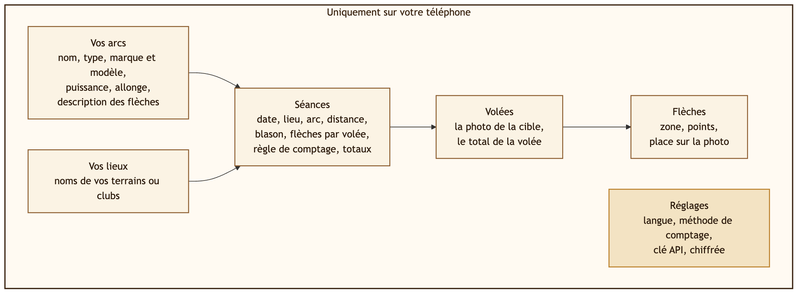
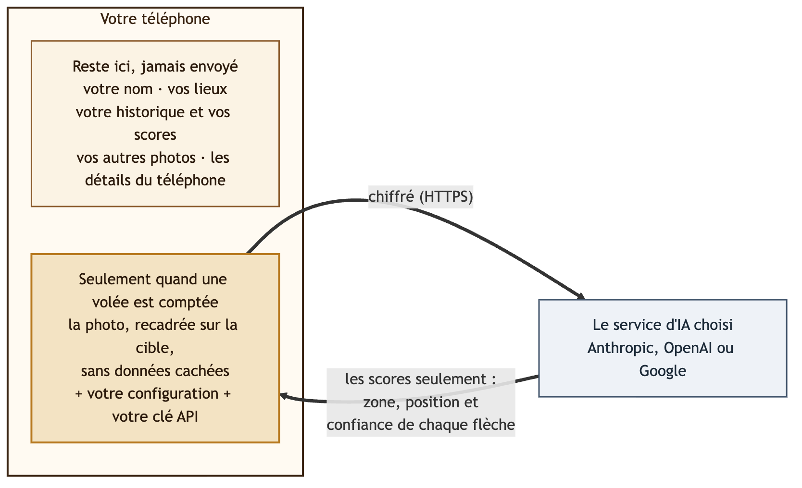
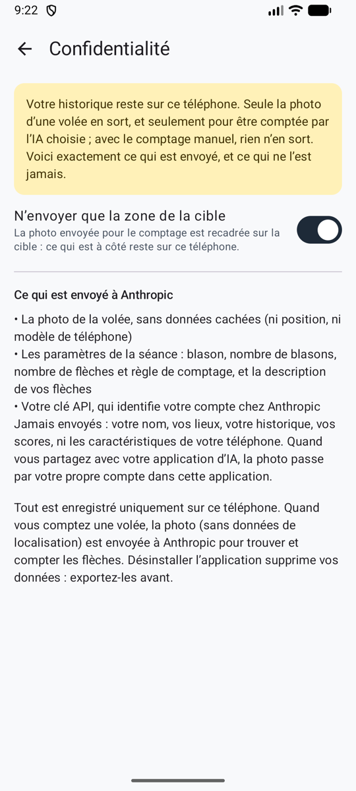

# Confidentialité

En bref : **votre historique reste sur votre téléphone.** Seule la photo de la cible en sort, et seulement pour être comptée, par le service d'IA que vous avez choisi.

## Ce qu'Ullr garde, et où

C'est tout : vos arcs et vos lieux, vos séances, chaque volée avec sa photo, et chaque flèche. Rien sur vous en tant que personne, pas de compte, pas de contacts. Tout est gardé dans l'espace privé d'Ullr sur le téléphone.

- Les autres applications ne peuvent pas les lire, et les photos ne sont pas dans votre galerie.
- Rien ne part automatiquement vers une sauvegarde en ligne ou un nouveau téléphone.
- Pas de compte, pas de publicité, pas de statistiques d'utilisation, pas de pistage.
- **Désinstaller l'application efface tout.** L'export arrive bientôt (voir la [feuille de route](roadmap.md)) : d'ici là, gardez l'application installée.

## Ce qui est envoyé, et quand

{ width="560" }

Seulement quand une volée est comptée par un service d'IA, par une connexion chiffrée, à ce service seulement :

- **la photo de la volée**, sans données cachées (ni position, ni modèle de téléphone) et, par défaut, recadrée sur la zone de la cible ;
- **les paramètres de la séance** : blason, nombre de blasons, nombre de flèches et règle de comptage, et la description de vos flèches ;
- **votre clé API**, qui identifie votre compte chez ce service.

**Jamais envoyés :** votre nom, vos lieux, votre historique, vos scores, ni les caractéristiques de votre téléphone. Les informations techniques que les applications envoient d'habitude sur le téléphone (version d'Android, processeur) sont remplacées par « unknown » (inconnu).

{ .shot width="240" }

Les réglages affichent la même liste, sous **Ce qui est envoyé à …**, pour le service choisi.

## Ce que chaque service en fait

| Service | Sert à entraîner une IA ? | Conservation |
|---------|---------------------------|--------------|
| **Anthropic** | Non | Selon les conditions commerciales d'Anthropic |
| **OpenAI** | Non, sauf si vous l'acceptez sur votre compte | Ullr demande à OpenAI de ne pas garder la requête. Journaux de sécurité gardés jusqu'à 30 jours. |
| **Google Gemini**, facturation activée | Non | Journalisé pendant une durée limitée pour détecter les abus |
| **Google Gemini**, offre gratuite | **Oui** : peut servir à améliorer les produits de Google, et être lu par des personnes | Non précisé |

!!! warning "Gemini : utilisez une clé avec la facturation activée"
    Avec l'offre gratuite de Google, vos photos de cible peuvent être utilisées par Google et vues par des examinateurs. Utilisez une clé d'un projet Google Cloud avec la facturation activée. Ullr ne peut pas le vérifier à votre place.

## Votre clé API

- Elle est chiffrée sur le téléphone, n'est plus jamais affichée, et n'est jamais mise dans un export.
- Elle n'est envoyée qu'au service auquel elle appartient.
- **Supprimer la clé**, dans les réglages, l'efface.

Créez une clé réservée à Ullr et fixez une limite de dépenses chez le service. Si vous perdez votre téléphone, supprimez la clé chez le service.

## Autorisations

| Autorisation | Pourquoi |
|--------------|----------|
| Appareil photo | Pour photographier la cible, demandée la première fois |
| Internet | Pour le comptage par un service d'IA |

Aucune autorisation de position, de contacts, de micro ou de stockage. L'import d'une photo passe par le sélecteur de photos d'Android, qui ne donne à Ullr que la photo que vous choisissez.

Pour en savoir plus sur la protection de vos données : [Sécurité](security.md).
