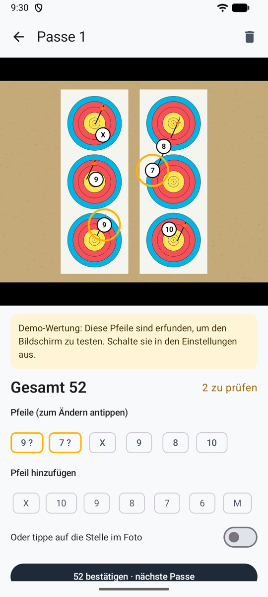
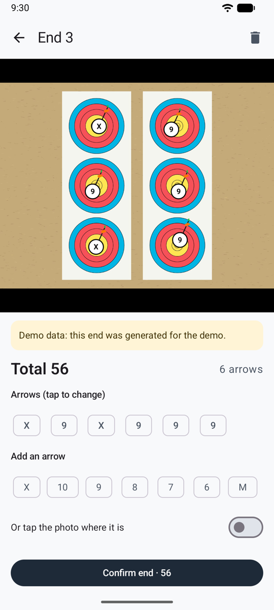

# Pfeile prüfen { #checking-arrows }

Bevor eine Passe zählt, prüfst du sie: das Ergebnis der KI bei der [automatischen](scoring-api.md) oder der [geteilten](scoring-share.md) Methode, oder die Pfeile, die du bei der [Wertung von Hand](scoring-manual.md) gesetzt hast. Mach das an der Scheibe, bevor du deine Pfeile ziehst.

<figure markdown>
{ .shot }
<figcaption><b>Zwei Pfeile zu prüfen</b></figcaption>
</figure>
<figure markdown>
{ .shot }
<figcaption><b>Den richtigen Ring wählen</b></figcaption>
</figure>
<figure markdown>
{ .shot }
<figcaption><b>Eine frühere Passe</b>, mit ihrem Foto</figcaption>
</figure>

## Im Foto { #on-the-photo }

Jeder Pfeil hat eine weiße Markierung mit seinem Ring. Wo Pfeile dicht beieinander stecken, werden ihre Markierungen kleiner, damit sie sich nicht verdecken; zoomst du hinein, werden sie wieder größer. Zieh die Finger auseinander zum Zoomen, zieh mit einem Finger zum Verschieben und tipp zweimal zum Zurücksetzen.

- **Bernsteinfarbener Kreis:** Prüf diesen Pfeil. Er liegt nahe an einer Linie, die KI war sich nicht sicher, zwei Pfeile stecken im selben Spot einer Dreifach-Auflage, oder du hast ihn gesetzt und noch keinen Ring gewählt (**?**).
- **Tipp auf einen Pfeil**, um ihn auszuwählen, und dann auf den richtigen Ring. Die zweite Wahl der KI ist hervorgehoben, mit ihrer Sicherheit.
- **Pfeil hinzufügen**: Tipp auf seinen Ring, oder schalte **Oder tippe auf die Stelle im Foto** ein, tipp auf die Stelle und wähl dann seinen Ring.
- **Diesen Pfeil entfernen**: für den Pfeil eines anderen Schützen oder einen doppelt gezählten. Die App fragt vorher nach.
- Ein Hinweis warnt dich, wenn die Zahl der gefundenen Pfeile nicht der Zahl der geschossenen entspricht oder wenn das Foto Probleme hat (Spiegelung, Unschärfe, abgeschnittene Auflage).

Tipp dann auf **Bestätigen · nächste Passe**, um direkt zur Kamera zurückzukehren, oder auf **Bestätigen und zurück zur Einheit**. Der Papierkorb löscht die Passe, nach einer Rückfrage.

!!! warning "Prüfen, bevor du deine Pfeile ziehst"
    Die Pfeile in der Scheibe sind der Beweis. Wenn du später anhand des Fotos wertest, zoom an die eingekreisten Pfeile heran.

## Die Linienregel { #the-line-rule }

Ein Pfeil, der die Linie zwischen zwei Zonen berührt, zählt die höhere Zone: Ein Pfeil in der 8, der die Linie 8/9 berührt, ist eine 9. Die KI meldet den Ring jedes Pfeils nach dieser Regel und kreist die ein, die zu knapp für eine sichere Entscheidung sind.

## Dreifach-Auflagen { #3-spot-faces }

Nach den Regeln von World Archery zählt nur ein Pfeil pro Spot. Wenn zwei Pfeile im selben Spot stecken, kreist die App sie ein und erklärt es, ändert aber kein Ergebnis: Setz den überzähligen selbst auf M, wenn deine Runde diese Regel anwendet.
