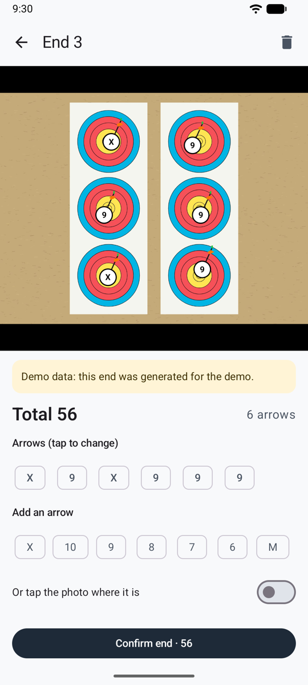

# Revisar las flechas { #checking-arrows }

Antes de que una tanda cuente, la revisas: el resultado de la IA con los métodos [automático](scoring-api.md) o [compartido](scoring-share.md), o las flechas que colocaste con la [puntuación manual](scoring-manual.md). Hazlo en la diana, antes de sacar tus flechas.

<figure markdown>
{ .shot }
<figcaption><b>Dos flechas por revisar</b></figcaption>
</figure>
<figure markdown>
{ .shot }
<figcaption><b>Elegir la zona correcta</b></figcaption>
</figure>
<figure markdown>
{ .shot }
<figcaption><b>Una tanda pasada</b>, con su foto</figcaption>
</figure>

## En la foto { #on-the-photo }

Cada flecha tiene un marcador blanco con su zona. Donde las flechas están juntas, sus marcadores se hacen más pequeños para no taparse entre sí; amplía y vuelven a crecer. Pellizca para ampliar, arrastra para moverte, toca dos veces para restablecer.

- **Círculo ámbar:** revisa esta flecha. Está cerca de una línea, la IA no estaba segura, hay dos flechas en el mismo spot de una triple diana, o la colocaste tú y aún no has elegido su zona (**?**).
- **Toca una flecha** para seleccionarla y luego toca la zona correcta. La segunda opción de la IA aparece resaltada, con su confianza.
- **Añadir una flecha**: toca su zona, o activa **O toca la foto donde está**, toca donde está y luego elige su zona.
- **Quitar esta flecha**: para la flecha de otro arquero, o una contada dos veces. La app pregunta antes.
- Un aviso te advierte cuando el número de flechas encontradas no coincide con el de flechas tiradas, o cuando la foto tiene problemas (reflejos, desenfoque, diana cortada).

Luego toca **Confirmar · tirar la siguiente tanda** para volver directamente a la cámara, o **Confirmar y volver a la sesión**. El botón de la papelera elimina la tanda, tras preguntar.

!!! warning "Revisa antes de sacar tus flechas"
    Las flechas clavadas en la diana son la prueba. Si puntúas desde la foto más tarde, amplía las flechas rodeadas.

## La regla de la línea { #the-line-rule }

Una flecha que toca la línea entre dos zonas puntúa la zona más alta: una flecha en el 8 que toca la línea 8/9 es un 9. La IA indica la zona de cada flecha de esta manera, y rodea las que están demasiado justas para decidir.

## Triples dianas { #3-spot-faces }

Según las reglas de World Archery, solo cuenta una flecha por spot. Cuando hay dos flechas en el mismo spot, la app las rodea y lo explica, pero no cambia ninguna puntuación: pon tú mismo la de más a M si tu tirada usa esa regla.
