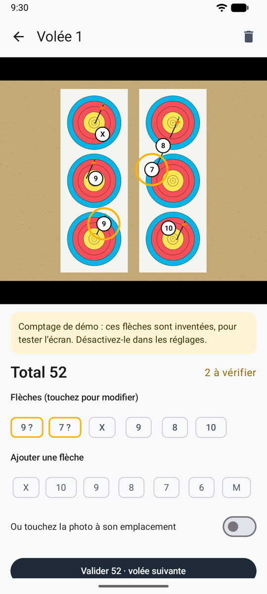
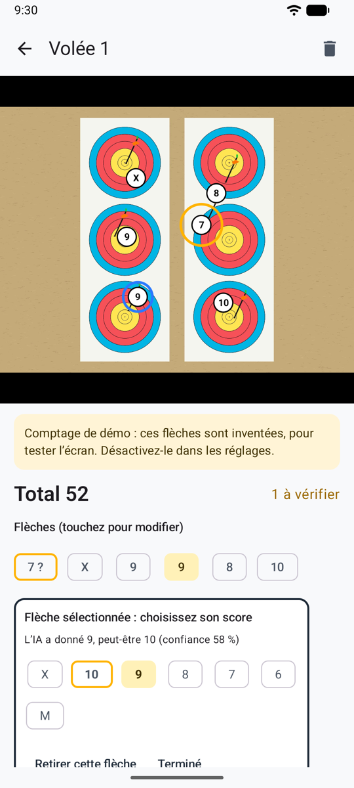
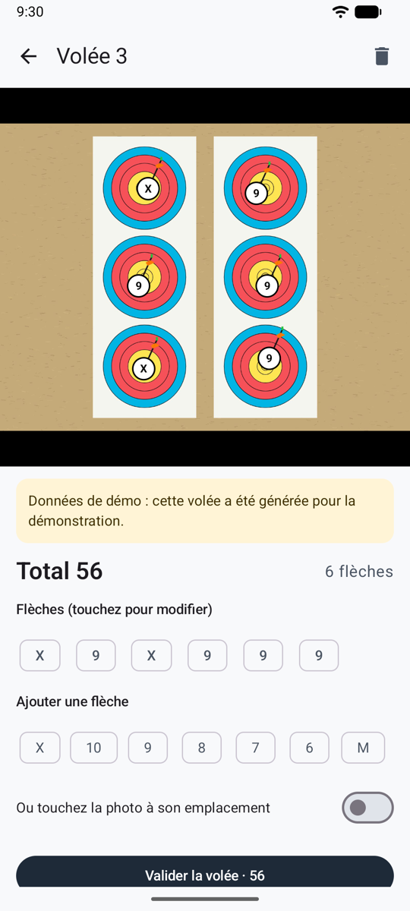

# Vérifier les flèches

Avant qu’une volée compte, vous la vérifiez : le résultat de l’IA avec la méthode [automatique](scoring-api.md) ou [par partage](scoring-share.md), ou les flèches que vous avez placées en [comptage manuel](scoring-manual.md). Faites-le à la cible, avant de retirer vos flèches.

<figure markdown>
{ .shot }
<figcaption><b>Deux flèches à vérifier</b></figcaption>
</figure>
<figure markdown>
{ .shot }
<figcaption><b>Choisir la bonne zone</b></figcaption>
</figure>
<figure markdown>
{ .shot }
<figcaption><b>Une volée passée</b>, avec sa photo</figcaption>
</figure>

## Sur la photo

Chaque flèche porte un repère blanc avec sa zone. Là où les flèches sont proches, leurs repères rapetissent pour ne pas se cacher; zoomez et ils reprennent leur taille. Écartez deux doigts pour zoomer, faites glisser pour vous déplacer, touchez deux fois pour revenir.

- **Cercle orange :** vérifiez cette flèche. Elle est près d’une ligne, l’IA n’était pas sûre, deux flèches sont dans le même spot d’un trispot, ou vous l’avez placée sans encore choisir sa zone (**?**).
- **Touchez une flèche** pour la sélectionner, puis touchez la bonne zone. Le deuxième choix de l’IA est mis en évidence, avec sa confiance.
- **Ajouter une flèche** : touchez sa zone, ou activez **Ou touchez la photo à son emplacement**, touchez l’endroit de la flèche, puis choisissez sa zone.
- **Retirer cette flèche** : pour la flèche d’un autre archer, ou une flèche comptée deux fois. L’application demande d’abord confirmation.
- Un bandeau vous prévient quand le nombre de flèches trouvées n’est pas le nombre tiré, ou quand la photo pose problème (reflet, flou, blason coupé).

Touchez ensuite **Valider · volée suivante** pour revenir directement à l’appareil photo, ou **Valider et revenir à la séance**. Le bouton corbeille supprime la volée, après confirmation.

!!! warning "Vérifiez avant de retirer vos flèches"
    Les flèches dans la cible font foi. Si vous comptez plus tard depuis la photo, zoomez sur les flèches entourées.

## La règle de la ligne

Une flèche qui touche la ligne entre deux zones prend la zone la plus haute : une flèche dans le 8 qui touche la ligne entre le 8 et le 9 vaut 9. L’IA donne la zone de chaque flèche selon cette règle, et entoure celles qui sont trop justes pour trancher.

## Les trispots

Selon les règles World Archery, une seule flèche par spot compte. Quand deux flèches sont dans le même spot, l’application les entoure et l’explique, mais ne change aucun score : mettez vous-même la flèche en trop à M si votre épreuve applique cette règle.
