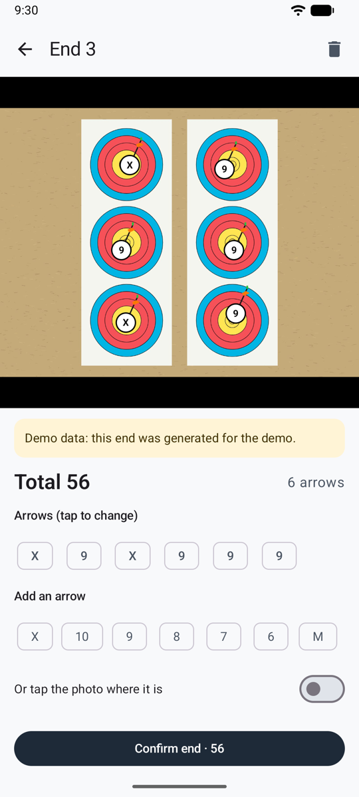

# Checking arrows

Before an end counts, you check it: the AI's result with the [automatic](scoring-api.md) or [shared](scoring-share.md) methods, or the arrows you placed in [manual scoring](scoring-manual.md). Do it at the target, before you pull your arrows.

<figure markdown>
{ .shot }
<figcaption><b>Two arrows to check</b></figcaption>
</figure>
<figure markdown>
{ .shot }
<figcaption><b>Choosing the right ring</b></figcaption>
</figure>
<figure markdown>
{ .shot }
<figcaption><b>A past end</b>, with its photo</figcaption>
</figure>

## On the photo

Each arrow has a white marker with its ring. Where arrows are close together, their markers get smaller so they don't hide each other; zoom in and they grow back. Pinch to zoom, drag to move, double-tap to reset.

- **Amber circle:** check this arrow. It's near a line, the AI wasn't confident, two arrows are in the same spot of a 3-spot face, or you placed it and haven't picked its ring yet (**?**).
- **Tap an arrow** to select it, then tap the right ring. The AI's second choice is highlighted, with its confidence.
- **Add an arrow** (*Ajouter une flèche*): tap its ring, or turn on **Or tap the photo where it is** (*Ou touchez la photo à son emplacement*), tap where it is, then pick its ring.
- **Remove this arrow** (*Retirer cette flèche*): for another archer's arrow, or one counted twice. The app asks first.
- A banner warns you when the number of arrows found isn't the number shot, or when the photo has problems (glare, blur, face cut off).

Then tap **Confirm · shoot next end** (*Valider · volée suivante*) to go straight back to the camera, or **Confirm and back to session** (*Valider et revenir à la séance*). The trash button deletes the end, after asking.

!!! warning "Check before you pull your arrows"
    The arrows in the target are the proof. If you score from the photo later, zoom in on the circled arrows.

## The line rule

An arrow that touches the line between two zones scores the higher zone: an arrow in the 8 that touches the 8/9 line is a 9. The AI reports each arrow's ring this way, and circles the ones too close to call.

## 3-spot faces

Under World Archery rules, only one arrow per spot counts. When two arrows are in the same spot, the app circles them and explains, but doesn't change any score: set the extra one to M yourself if your round uses that rule.

## Reporting a scoring problem

If the AI got an end wrong in a way worth telling someone about, tap **Report a scoring problem** under the arrows. Write what went wrong if you like, and tick **Attach the photo** to add the copy that was sent to the AI service. Ullr writes the email: the face, distance and rule, the AI model, and each arrow as the AI scored it and as it is now, never your bows, places or dates. Your email app opens with no recipient, so you choose who gets it: a coach, your club, or the developer.
