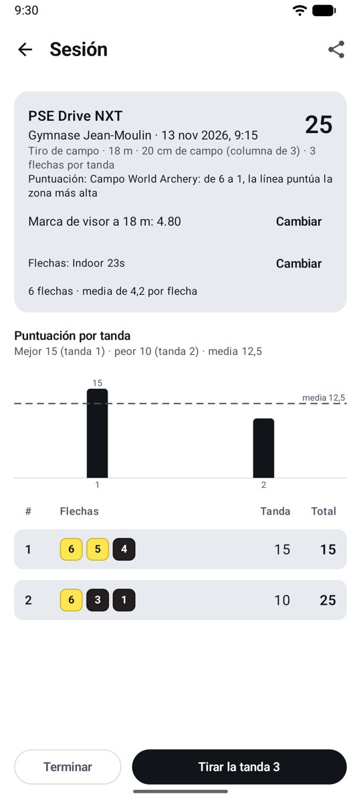
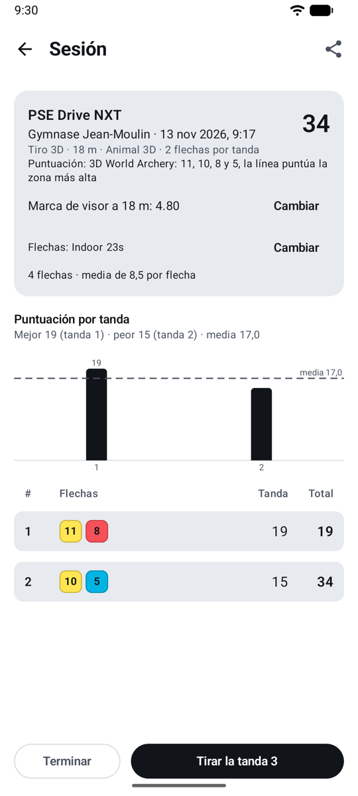

# Reglas de puntuación { #scoring-rules }

La regla convierte las zonas en puntos. Cada flecha guarda la zona en la que impactó, así que puedes cambiar la regla de una sesión más tarde y todos los totales se recalculan.

| Regla | Puntos |
|------|--------|
| **X y 10 valen 10** | Toda la zona del 10 vale 10. Las X se cuentan para los desempates. Recurvo y arco desnudo de World Archery, la mayoría de los clubes. |
| **Solo el 10 interior** | Solo la pequeña zona interior vale 10; el resto del amarillo vale 9. Compuesto de World Archery; USA Archery y Archery Canada siguen a World Archery. |
| **La X vale 11** | La zona de la X vale 11. Algunos torneos de EE. UU., como el Lancaster Classic. |

**Regla de la línea (todas las reglas):** una flecha que toca la línea entre dos zonas puntúa la zona más alta. Una flecha en el 8 que toca la línea 8/9 es un 9.

## La regla predeterminada para las sesiones nuevas { #the-default-for-new-sessions }

**Ajustes → Reglas de puntuación** fija la regla con la que empiezan las sesiones nuevas:

- **World Archery** (la predeterminada): 10 interior para compuesto, X = 10 para los demás arcos.
- **X = 10 para todos los arcos**.
- **X = 11 para compuesto**, X = 10 para los demás arcos.

## Para una sola sesión { #for-one-session }

En el formulario de sesión nueva, o más tarde en la pantalla de la sesión con **Cambiar**: por ejemplo en una competición con su propia regla. Los totales de la sesión se recalculan al momento.

## Campo y 3D { #field-and-3d }

Las dianas de campo y los animales 3D se puntúan tal como están dibujados, como dicen las reglas de World Archery (Libro 2, art. 8.2.1.2 y 8.2.2.1; Libro 4, art. 22.2): no hay regla que elegir, y una sesión con ellos muestra su puntuación en lugar de **Cambiar**.

<figure markdown>
{ .shot }
<figcaption><b>Campo</b>: de 6 a 1</figcaption>
</figure>
<figure markdown>
{ .shot }
<figcaption><b>3D</b>: 11, 10, 8 y 5</figcaption>
</figure>

| | Zonas y puntos | Dianas |
|-|------------------|-------|
| **Campo** | Un centro amarillo: el pequeño círculo interior vale **6**, el resto del amarillo **5**; luego cuatro zonas negras (o verde azulado) que valen **4, 3, 2, 1**. Sin X. | Dianas de 80, 60 y 40 cm, y de 20 cm en una columna de tres (una flecha por diana). Los desempates cuentan los 6, luego los 5. |
| **3D** | **11** es el pequeño círculo en el centro del 10; **10** el círculo mayor dentro de la zona vital; **8** el resto de la zona vital; **5** el resto del cuerpo. Un cuerno o una pezuña es un fallo; la cola o las alas de un ave cuentan. | Un animal. Los desempates cuentan los 11, luego los 10. |

**Regla de la línea:** como en las dianas de tiro a diana, una flecha que toca una línea divisoria, o el contorno de la zona puntuable de un animal 3D, puntúa la zona más alta.

Elige **Tiro de campo** o **Tiro 3D** como disciplina al empezar una sesión: la lista de dianas muestra entonces solo las dianas de campo, o el animal 3D, con 3 flechas por diana en campo y 2 en 3D (puedes cambiarlo).

