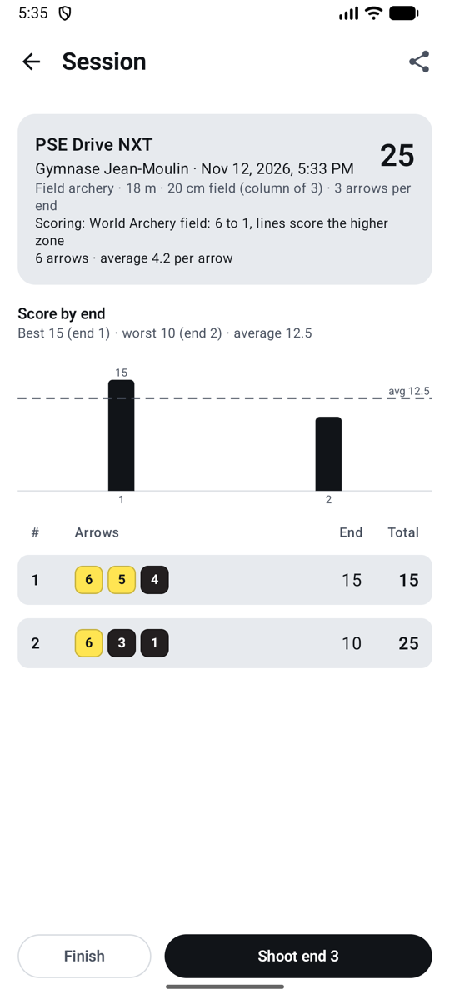
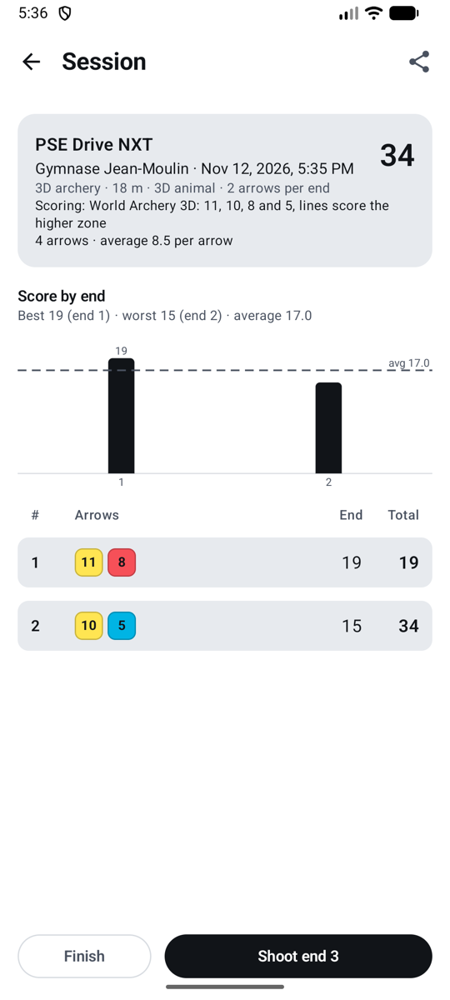

# Scoring rules

The rule turns rings into points. Each arrow keeps the ring it hit, so you can change a session's rule later and every total is recalculated.

| Rule | Points |
|------|--------|
| **X and 10 count 10** (*X et 10 valent 10*) | The whole 10 ring scores 10. Xs are counted for ties. World Archery recurve and barebow, most clubs. |
| **Inner 10 only** (*10 intérieur seulement*) | Only the small inner ring scores 10; the rest of the gold scores 9. World Archery compound; USA Archery and Archery Canada follow World Archery. |
| **X counts 11** (*X vaut 11*) | The X ring scores 11. Some US tournaments, such as the Lancaster Classic. |

**Line rule (all rules):** an arrow that touches the line between two zones scores the higher zone. An arrow in the 8 that touches the 8/9 line is a 9.

## The default for new sessions

**Settings → Scoring rules** (*Réglages → Règles de comptage*) sets the rule new sessions start with:

- **World Archery** (the default): inner 10 for compound, X = 10 for other bows.
- **X = 10 for all bows**.
- **X = 11 for compound**, X = 10 for other bows.

## For one session

On the new session form, or later on the session screen with **Change** (*Modifier*): for example in a competition with its own rule. The session's totals are recalculated at once.

## Field and 3D

Field faces and 3D animals are scored as drawn, as World Archery's rules say (Book 2, art. 8.2.1.2 and 8.2.2.1; Book 4, art. 22.2): there is no rule to choose, and a session on them shows its scoring instead of **Change**.

<figure markdown>
{ .shot }
<figcaption><b>Field</b>: 6 to 1</figcaption>
</figure>
<figure markdown>
{ .shot }
<figcaption><b>3D</b>: 11, 10, 8 and 5</figcaption>
</figure>

| | Zones and points | Faces |
|-|------------------|-------|
| **Field** (*Campagne*) | A yellow centre: the small inner circle scores **6**, the rest of the yellow **5**; then four black (or teal) zones scoring **4, 3, 2, 1**. No X. | 80, 60, 40 cm, and 20 cm faces in a column of three (one arrow per face). Ties count the 6s, then the 5s. |
| **3D** | **11** is the small circle in the centre of the 10; **10** the larger circle inside the vital area; **8** the rest of the vital area; **5** the rest of the body. A horn or a hoof is a miss; a bird's tail or wings count. | One animal. Ties count the 11s, then the 10s. |

**Line rule:** as on target faces, an arrow touching a dividing line, or the outline of a 3D animal's scoring area, scores the higher zone.

Pick **Field archery** or **3D archery** as the discipline when you start a session: the face list then shows only field faces, or the 3D animal, with 3 arrows per target in field and 2 in 3D (you can change it).

