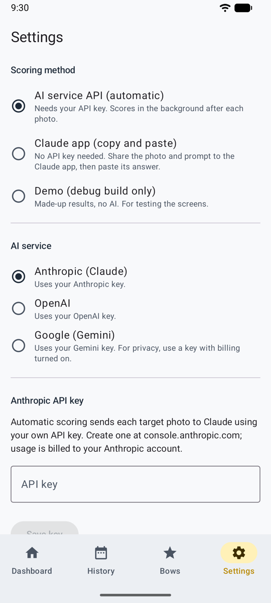
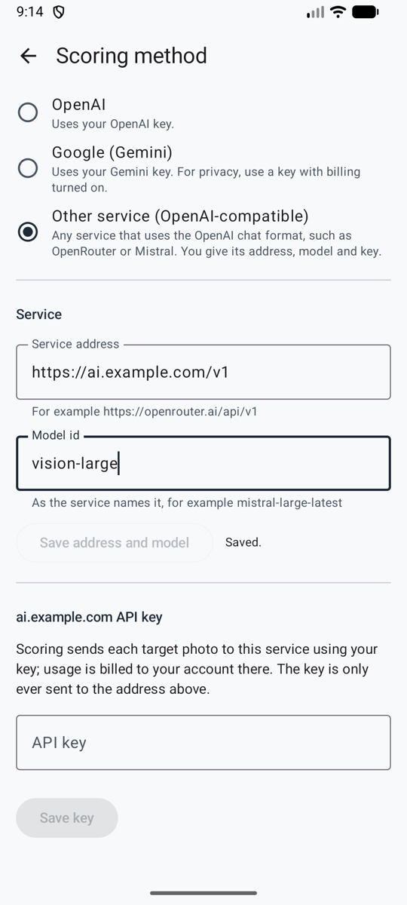
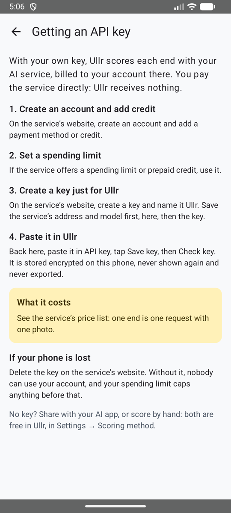

# Dein eigener API-Schlüssel { #your-own-api-key }

Die automatische Methode: Nach jedem Foto sendet Ullr die Scheibe an den KI-Dienst deiner Wahl, mit **deinem eigenen Schlüssel** (bring your own key). Der Dienst findet jeden Pfeil und seinen Ring, und die Passe ist ein paar Sekunden später bereit zum Prüfen. Pfeile, bei denen er sich nicht sicher ist, sind bernsteinfarben eingekreist, damit du sie [prüfst](review.md).

**Einstellungen → Wertungsmethode → Dein eigener API-Schlüssel (automatisch)**.

<figure markdown>
{ .shot }
<figcaption>Methode und Dienst wählen</figcaption>
</figure>
<figure markdown>
{ .shot }
<figcaption>Jeder OpenAI-kompatible Dienst</figcaption>
</figure>

## Den KI-Dienst wählen { #choose-the-ai-service }

| Dienst | Modelle |
|---------|--------|
| **Anthropic (Claude)** | Opus 5.5 (Standard), Sonnet 5.5 (günstiger) |
| **OpenAI** | GPT-6.1 Sol (Standard), GPT-6 Astra (am leistungsfähigsten, etwa 5-facher Preis) |
| **Google (Gemini)** | Gemini 4 Carbon (Standard), Gemini 3.8 Flash (schneller, günstiger). Nimm einen Schlüssel aus einem Projekt mit aktivierter Abrechnung (siehe [Datenschutz](privacy.md)). |
| **Anderer Dienst (OpenAI-kompatibel)** | Jedes Modell, das du angibst, bei jedem Dienst, der das Chat-Format von OpenAI nutzt: OpenRouter, Mistral, Groq, ein Firmen-Gateway… |

Jeder Dienst bekommt dieselben Anweisungen. Jeder behält seinen eigenen Schlüssel, du kannst also wechseln und zurückkommen, ohne einen Schlüssel neu einzugeben.

## Ein OpenAI-kompatibler Dienst { #an-openai-compatible-service }

Wähle **Anderer Dienst (OpenAI-kompatibel)** und fülle dann den Bereich **Dienst** aus:

1. **Adresse des Dienstes**: die Adresse, die der Dienst für seine API angibt, mit ihrer Version, zum Beispiel `https://openrouter.ai/api/v1`. Sie muss mit `https://` beginnen.
2. **Modell-ID**: genau so, wie der Dienst das Modell nennt. Wähle ein Modell, das Bilder lesen kann.
3. **Adresse und Modell speichern**, dann den Schlüssel darunter einfügen.

Der Schlüsselbereich ist nach der Adresse des Dienstes benannt (zum Beispiel *openrouter.ai-API-Schlüssel*), so weißt du immer, wohin dein Schlüssel geht.

!!! note "Eine neue Adresse entfernt den Schlüssel"
    Wenn du die Adresse eines Dienstes änderst, wird der dafür gespeicherte Schlüssel gelöscht, nachdem Ullr gefragt hat. So wird ein Schlüssel nie an eine Adresse gesendet, für die er nicht gespeichert wurde. Füg ihn für die neue Adresse erneut ein.

## Erweitert: eine andere Adresse oder ein anderes Modell { #advanced-another-address-or-model }

Bei den drei großen Diensten kannst du unter den Modellen mit **Erweitert: Adresse und Modell** Folgendes festlegen:

- eine **Adresse des Dienstes**, für einen Proxy oder ein Firmen-Gateway vor dem Dienst;
- eine **Modell-ID**, die nicht in der Liste steht, zum Beispiel ein neueres Modell.

Lass ein Feld leer, um den Standard zu nutzen, der darunter steht.

## Einen API-Schlüssel bekommen und speichern { #get-and-save-an-api-key }

{ .shot width="220" align=right }

Die App führt dich hindurch: Unter dem Schlüssel gibt dir **Wie du einen Schlüssel bekommst und was er kostet** die Schritte für den gewählten Dienst, vom Konto bis zu einem Schlüssel nur für Ullr, mit einem Ausgabenlimit, und die Kosten pro Passe.

- **Anthropic:** Erstelle einen Schlüssel in der Anthropic Console (console.anthropic.com → API keys). Er beginnt meist mit `sk-ant-`.
- **OpenAI:** Erstelle einen Schlüssel auf platform.openai.com → API keys. Er beginnt meist mit `sk-`.
- **Google Gemini:** Erstelle einen Schlüssel in Google AI Studio (aistudio.google.com → Get API key), in einem Projekt mit aktivierter Abrechnung. Er beginnt meist mit `AIza`.
- **Anderer Dienst:** Erstelle einen Schlüssel auf der Website des Dienstes.

Füg ihn dann bei **API-Schlüssel** ein, tippe auf **Schlüssel speichern** und auf **Schlüssel prüfen**. Die App sagt dir, ob der Schlüssel funktioniert. **Jeder Schlüssel lässt sich speichern**: Wenn er nicht wie das übliche Format dieses Dienstes aussieht (zum Beispiel der Schlüssel eines Wiederverkäufers), weist die App nur darauf hin.

!!! tip "Schütze deinen Schlüssel"
    Erstelle einen Schlüssel nur für Ullr und leg beim Dienst ein niedriges monatliches Ausgabenlimit fest. Geht das Handy verloren, lösch den Schlüssel dort, und niemand kann mehr als das Limit ausgeben.

Der Schlüssel wird verschlüsselt auf dem Handy gespeichert. Er wird nie wieder angezeigt, nie exportiert, und **Schlüssel entfernen** löscht ihn, nachdem Ullr gefragt hat.

## Kosten { #cost }

Du bezahlst den Dienst direkt, eine Anfrage pro Passe. Grobe Schätzungen, bis sie an echten Fotos gemessen sind:

| Modell | Pro Passe | Einheit mit 30 Passen |
|-------|---------|----------------|
| Claude Opus 5.5 | etwa 0,05–0,10 $ | etwa 1,50–3,00 $ |
| Claude Sonnet 5.5 | etwa 0,03–0,05 $ | etwa 0,90–1,50 $ |
| GPT-6.1 Sol | etwa 0,02–0,05 $ | etwa 0,60–1,50 $ |
| GPT-6 Astra | etwa 0,10–0,25 $ | etwa 3–7,50 $ |
| Gemini 4 Carbon | etwa 0,02–0,05 $ | etwa 0,60–1,50 $ |
| Gemini 3.8 Flash | etwa 0,01–0,02 $ | etwa 0,30–0,60 $ |

Bei einem anderen Dienst schau in seine Preisliste: Eine Passe ist eine Anfrage mit einem Foto.

## Am Bogenplatz { #at-the-range }

Kein Empfang? Schieß einfach weiter. Die Fotos werden gespeichert und gewertet, sobald das Handy wieder online ist, auch wenn die App geschlossen wurde. Schieß die nächste Passe, während die vorige gewertet wird.

| Status | Bedeutung |
|--------|---------|
| wartet auf Wertung | Noch kein Netz, oder in der Warteschlange. Es geht von selbst los, wenn das Netz zurück ist. |
| wird gewertet… | Die KI liest das Foto. |
| bereit zum Prüfen | Öffne sie und bestätige. |
| nicht gewertet | Etwas ist schiefgegangen. Öffne sie, um es erneut zu versuchen, stattdessen mit deiner KI-App zu teilen oder von Hand zu werten. |
