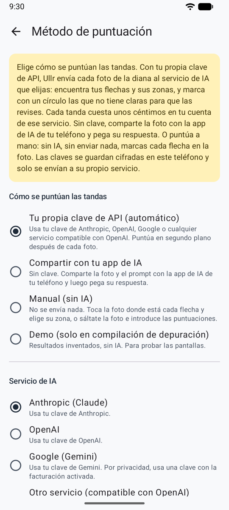
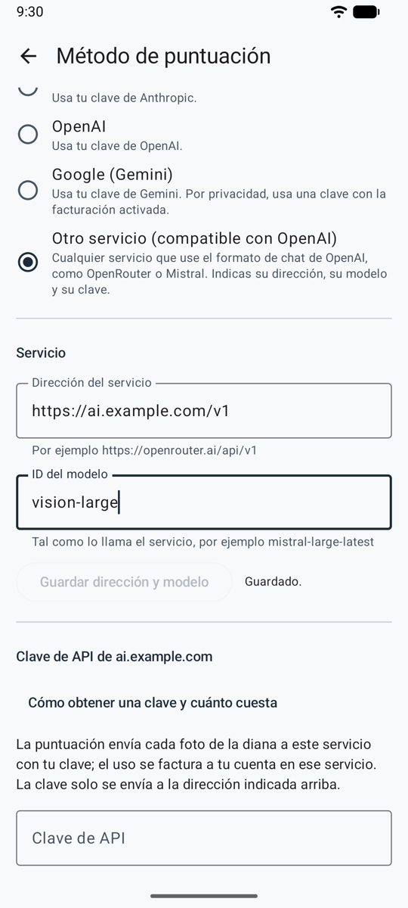
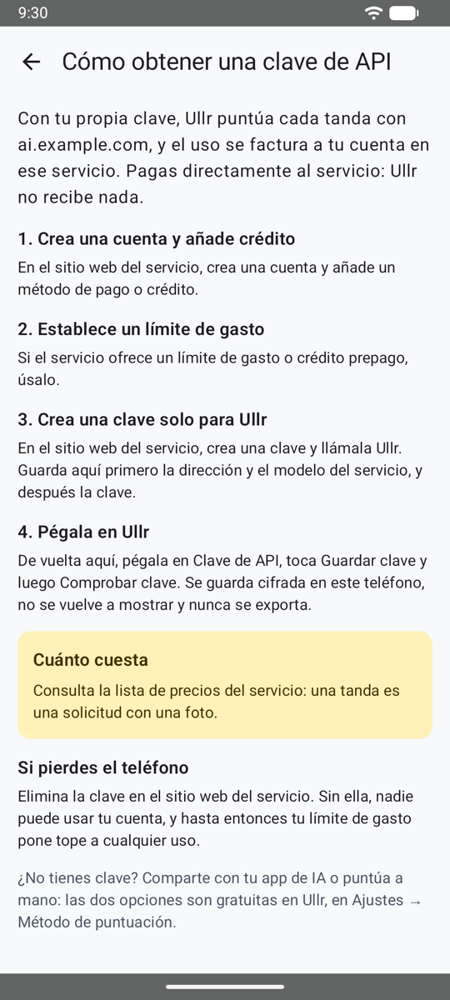

# Tu propia clave de API { #your-own-api-key }

El método automático: después de cada foto, Ullr envía la diana al servicio de IA que elijas, con **tu propia clave** (trae tu propia clave). El servicio encuentra cada flecha y su zona, y la tanda está lista para revisar unos segundos después. Las flechas de las que no está seguro aparecen marcadas con un círculo ámbar para que las [revises](review.md).

**Ajustes → Método de puntuación → Tu propia clave de API (automático)**.

<figure markdown>
{ .shot }
<figcaption>Elige el método y el servicio</figcaption>
</figure>
<figure markdown>
{ .shot }
<figcaption>Cualquier servicio compatible con OpenAI</figcaption>
</figure>

## Elige el servicio de IA { #choose-the-ai-service }

| Servicio | Modelos |
|---------|--------|
| **Anthropic (Claude)** | Opus 5.5 (predeterminado), Sonnet 5.5 (más barato) |
| **OpenAI** | GPT-6.1 Sol (predeterminado), GPT-6 Astra (el más capaz, unas 5 veces el precio) |
| **Google (Gemini)** | Gemini 4 Carbon (predeterminado), Gemini 3.8 Flash (más rápido, más barato). Usa una clave de un proyecto con la facturación activada (consulta [Privacidad](privacy.md)). |
| **Otro servicio (compatible con OpenAI)** | El modelo que indiques, en cualquier servicio que use el formato de chat de OpenAI: OpenRouter, Mistral, Groq, la pasarela de una empresa… |

Todos los servicios reciben las mismas instrucciones. Cada uno guarda su propia clave, así que puedes cambiar de servicio y volver sin tener que escribir la clave otra vez.

## Un servicio compatible con OpenAI { #an-openai-compatible-service }

Elige **Otro servicio (compatible con OpenAI)** y luego completa la sección **Servicio**:

1. **Dirección del servicio**: la dirección que da el servicio para su API, con su versión, por ejemplo `https://openrouter.ai/api/v1`. Debe empezar por `https://`.
2. **ID del modelo**: tal como lo nombra el servicio. Elige un modelo que pueda leer imágenes.
3. **Guardar dirección y modelo**, y luego pega la clave más abajo.

La sección de la clave lleva el nombre de la dirección del servicio (por ejemplo *Clave de API de openrouter.ai*), así siempre sabes adónde va tu clave.

!!! note "Una dirección nueva elimina la clave"
    Cambiar la dirección de un servicio borra la clave guardada para él, después de preguntarte, para que una clave nunca se envíe a una dirección para la que no se guardó. Vuelve a pegarla para la nueva dirección.

## Avanzado: otra dirección u otro modelo { #advanced-another-address-or-model }

En los tres servicios principales, **Avanzado: dirección y modelo**, debajo de los modelos, te permite indicar:

- una **dirección del servicio**, para un proxy o la pasarela de una empresa delante del servicio;
- un **ID del modelo** que no está en la lista, por ejemplo un modelo más reciente.

Deja un campo vacío para usar el valor predeterminado que aparece debajo.

## Obtén y guarda una clave de API { #get-and-save-an-api-key }

{ .shot width="220" align=right }

La app te guía paso a paso: debajo de la clave, **Cómo obtener una clave y cuánto cuesta** te da los pasos para el servicio que elegiste, desde la cuenta hasta una clave creada solo para Ullr, con un límite de gasto, y el coste por tanda.

- **Anthropic:** crea una clave en la Anthropic Console (console.anthropic.com → API keys). Suele empezar por `sk-ant-`.
- **OpenAI:** crea una clave en platform.openai.com → API keys. Suele empezar por `sk-`.
- **Google Gemini:** crea una clave en Google AI Studio (aistudio.google.com → Get API key), en un proyecto con la facturación activada. Suele empezar por `AIza`.
- **Otro servicio:** crea una clave en el sitio web del servicio.

Luego pégala en **Clave de API**, toca **Guardar clave** y **Comprobar clave**. La app te dice si la clave funciona. **Se puede guardar cualquier clave**: si no tiene el formato habitual de ese servicio (la clave de un revendedor, por ejemplo), la app solo te lo señala.

!!! tip "Protege tu clave"
    Crea una clave solo para Ullr y pon un límite de gasto mensual bajo en el servicio. Si pierdes el teléfono, borra la clave allí, y nadie podrá gastar más que el límite.

La clave se guarda cifrada en el teléfono. Nunca se vuelve a mostrar, nunca se exporta, y **Eliminar la clave** la borra, después de preguntarte.

## Coste { #cost }

Pagas directamente al servicio, una solicitud por tanda. Estimaciones aproximadas hasta que se midan con fotos reales:

| Modelo | Por tanda | Sesión de 30 tandas |
|-------|---------|----------------|
| Claude Opus 5.5 | unos 0,05–0,10 USD | unos 1,50–3,00 USD |
| Claude Sonnet 5.5 | unos 0,03–0,05 USD | unos 0,90–1,50 USD |
| GPT-6.1 Sol | unos 0,02–0,05 USD | unos 0,60–1,50 USD |
| GPT-6 Astra | unos 0,10–0,25 USD | unos 3–7,50 USD |
| Gemini 4 Carbon | unos 0,02–0,05 USD | unos 0,60–1,50 USD |
| Gemini 3.8 Flash | unos 0,01–0,02 USD | unos 0,30–0,60 USD |

Para otro servicio, consulta su lista de precios: una tanda es una solicitud con una foto.

## En el campo de tiro { #at-the-range }

¿Sin cobertura? Sigue tirando. Las fotos se guardan y se puntúan cuando el teléfono vuelve a tener conexión, aunque la app se haya cerrado. Tira la siguiente tanda mientras se puntúa la anterior.

| Estado | Significado |
|--------|---------|
| pendiente de puntuar | Todavía no hay red, o está en cola. Empieza sola cuando vuelve la red. |
| puntuando… | La IA está leyendo la foto. |
| lista para revisar | Ábrela y confírmala. |
| sin puntuar | Algo ha fallado. Ábrela para reintentar, compártela con tu app de IA o puntúala a mano. |
