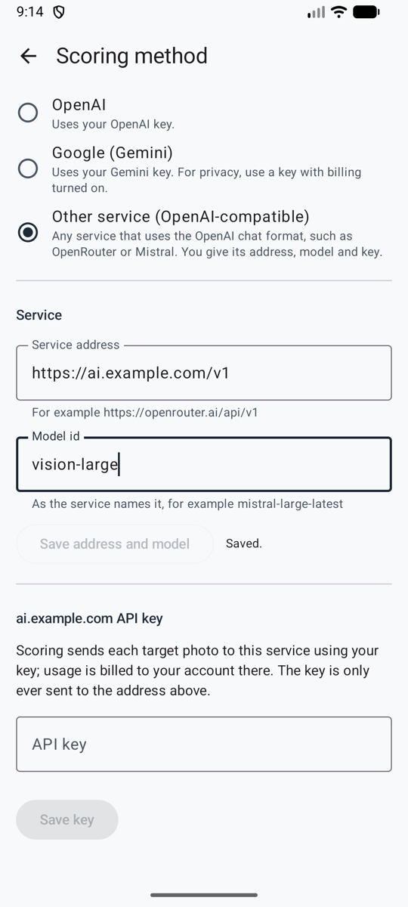

# Your own API key

The automatic method: after each photo, Ullr sends the target to the AI service you choose, using **your own key** (bring your own key). The service finds every arrow and its ring, and the end is ready to check a few seconds later. Arrows it isn't sure about are circled in amber for you to [check](review.md).

**Settings → Scoring method → Your own API key (automatic)** (*Réglages → Méthode de comptage → Votre propre clé API (automatique)*).

<figure markdown>
{ .shot }
<figcaption>Choose the method and the service</figcaption>
</figure>
<figure markdown>
{ .shot }
<figcaption>Any OpenAI-compatible service</figcaption>
</figure>

## Choose the AI service

| Service | Models |
|---------|--------|
| **Anthropic (Claude)** | Opus 5.5 (default), Sonnet 5.5 (cheaper) |
| **OpenAI** | GPT-6.1 Sol (default), GPT-6 Astra (most capable, about 5 times the price) |
| **Google (Gemini)** | Gemini 4 Carbon (default), Gemini 3.8 Flash (faster, cheaper). Use a key from a project with billing turned on (see [Privacy](privacy.md)). |
| **Other service (OpenAI-compatible)** (*Autre service (compatible OpenAI)*) | Any model you name, on any service that uses the OpenAI chat format: OpenRouter, Mistral, Groq, a company gateway… |

Every service gets the same instructions. Each one keeps its own key, so you can switch and come back without typing a key again.

## An OpenAI-compatible service

Choose **Other service (OpenAI-compatible)**, then fill in the **Service** section:

1. **Service address** (*Adresse du service*): the address the service gives for its API, with its version, for example `https://openrouter.ai/api/v1`. It must start with `https://`.
2. **Model id** (*Identifiant du modèle*): exactly as the service names it. Pick a model that can read images.
3. **Save address and model** (*Enregistrer l’adresse et le modèle*), then paste the key below.

The key section is named after the service's address (for example *openrouter.ai API key*), so you always know where your key goes.

!!! note "A new address removes the key"
    Changing the address of a service deletes the key saved for it, after asking, so a key is never sent to an address it wasn't saved for. Paste it again for the new address.

## Advanced: another address or model

For the three main services, **Advanced: address and model** (*Avancé : adresse et modèle*), under the models, lets you set:

- a **service address**, for a proxy or a company gateway in front of the service;
- a **model id** that isn't in the list, for example a newer model.

Leave a field empty to use the default shown under it.

## Get and save an API key

- **Anthropic:** create a key in the Anthropic Console (console.anthropic.com → API keys). It usually starts with `sk-ant-`.
- **OpenAI:** create a key at platform.openai.com → API keys. It usually starts with `sk-`.
- **Google Gemini:** create a key in Google AI Studio (aistudio.google.com → Get API key), in a project with billing turned on. It usually starts with `AIza`.
- **Other service:** create a key on the service's website.

Then paste it in **API key** (*Clé API*), **Save key** (*Enregistrer la clé*), and **Check key** (*Vérifier la clé*). The app tells you whether the key works. **Any key can be saved**: if it doesn't look like the usual format for that service (a reseller's key, for example), the app only points it out.

!!! tip "Protect your key"
    Create a key just for Ullr, and set a low monthly spending limit with the service. If the phone is lost, delete the key there, and nobody can spend more than the limit.

The key is stored encrypted on the phone. It is never shown again, never exported, and **Remove key** (*Supprimer la clé*) deletes it, after asking.

## Cost

You pay the service directly, one request per end. Rough estimates until they are measured on real photos:

| Model | Per end | 30-end session |
|-------|---------|----------------|
| Claude Opus 5.5 | about $0.05–0.10 | about $1.50–3.00 |
| Claude Sonnet 5.5 | about $0.03–0.05 | about $0.75–1.50 |
| GPT-6.1 Sol | about $0.02–0.05 | about $0.60–1.50 |
| GPT-6 Astra | about $0.10–0.25 | about $3–7.50 |
| Gemini 4 Carbon | about $0.02–0.05 | about $0.60–1.50 |
| Gemini 3.8 Flash | about $0.01–0.02 | about $0.30–0.60 |

For another service, see its price list: one end is one request with one photo.

## At the range

No signal? Keep shooting. Photos are saved and scored when the phone is back online, even if the app was closed. Shoot the next end while the previous one is being scored.

| Status | Meaning |
|--------|---------|
| waiting to score (*en attente de comptage*) | No network yet, or queued. It starts by itself when the network comes back. |
| scoring… (*comptage en cours…*) | The AI is reading the photo. |
| ready to check (*à vérifier*) | Open it and confirm. |
| not scored (*non comptée*) | Something went wrong. Open it to retry, share with your AI app instead, or score by hand. |
