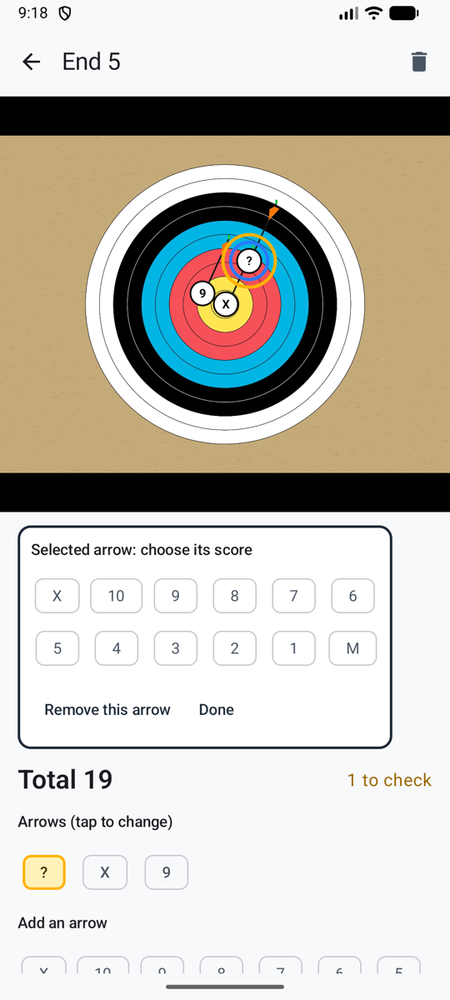
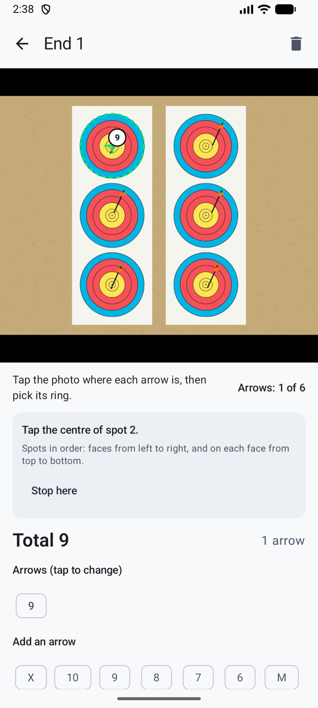

# Wertung von Hand { #manual-scoring }

Gar keine KI, und nichts verlässt das Handy. Du fotografierst die Passe trotzdem, tippst dann im Foto auf jeden Pfeil und wählst seinen Ring: zwei Tipps pro Pfeil. Das Foto bleibt der Beweis. Oder du lässt das Foto weg und tippst nur die Ergebnisse ein.

**Einstellungen → Wertungsmethode → Von Hand (ohne KI)**.

<figure markdown>
{ .shot }
<figcaption>Auf den Pfeil tippen, seinen Ring wählen</figcaption>
</figure>

## Eine Passe auf ihrem Foto werten { #score-an-end-on-its-photo }

1. Schieß deine Passe und **mach dann das Foto** wie gewohnt (oder **Aus der Galerie**). Die Kamera erinnert dich daran, dass du darauf deine Pfeile antippst.
2. Die Passe öffnet sich bereit zum Setzen: **Tippe auf dem Foto auf jeden Pfeil und wähle dann seinen Ring.**
3. Tipp im Foto auf einen Pfeil. Er bekommt eine Markierung **?**, und die Ringauswahl öffnet sich direkt unter dem Foto.
4. Wähl seinen Ring. Die Auswahl schließt sich, bereit für den nächsten Pfeil. Der Zähler zeigt, wie viele du gesetzt hast, zum Beispiel **Pfeile: 4 von 6**.
5. Wenn alle gesetzt sind, bestätige die Passe: **Bestätigen · nächste Passe** führt direkt zurück zur Kamera.

Zieh die Finger auseinander, um vor dem Antippen an einen Linienschuss heranzuzoomen, und tipp zweimal, um wieder herauszuzoomen. Tipp auf eine Markierung, um ihren Ring zu ändern oder sie zu entfernen. Ein Pfeil ohne Ring bleibt mit **?** markiert und gilt als *zu prüfen*, damit er nicht versehentlich als Fehlschuss durchgeht.

## Die Scheibe markieren { #mark-the-target }

{ .shot width="220" align=right }

Sobald ein Pfeil im Foto ist, gibt **Scheibe markieren** deinen Pfeilen ihren Platz auf der Auflage, sodass sie in **Wo sich deine Pfeile gruppieren** und **Wo deine Pfeile landen** zählen:

1. Tipp auf die Mitte der Scheibe.
2. Tipp auf den äußeren Rand ihres letzten Rings (Ring 6 bei einer Dreifach-Auflage, Ring 1 bei einer vollen Auflage).
3. Bei einer Dreifach-Auflage machst du dasselbe für jeden Spot, der Reihe nach: Auflagen von links nach rechts und auf jeder Auflage von oben nach unten. **Hier aufhören** lässt den Rest unmarkiert.

Die Markierungen erscheinen als grüne Kreise. Pfeile, die du danach setzt, bekommen ebenfalls ihren Platz. Auf kleinen Spots werden die Markierungen außerdem kleiner, damit sich dicht beieinander steckende Pfeile nicht verdecken.

## Eine Passe ohne Foto werten { #score-an-end-without-a-photo }

Tipp an der Kamera auf **Kein Foto**. Die Passe öffnet sich mit der Ringtastatur oben: Tipp einen Ring pro Pfeil, in beliebiger Reihenfolge. Die Tastatur bleibt an ihrem Platz, während die Liste der Pfeile darunter wächst, sodass du schnell tippen kannst.

## Gut zu wissen { #good-to-know }

- Es wird nie etwas gesendet: kein Foto, kein Ergebnis, kein Schlüssel. Die Seite [Datenschutz](privacy.md) in den Einstellungen sagt das auch.
- Es funktioniert ganz ohne Empfang.
- Passen, die du fotografiert hast, bevor du auf „von Hand“ umgestellt hast, öffnen sich direkt zum Setzen.
- Du kannst jederzeit zu einer anderen Methode wechseln; deine von Hand gewerteten Passen bleiben, wie sie sind.
- Von Hand gesetzte Pfeile zählen in jeder Statistik. Für **Wo sich deine Pfeile gruppieren** und die Heatmap musst du zuerst [die Scheibe markieren](#mark-the-target).
