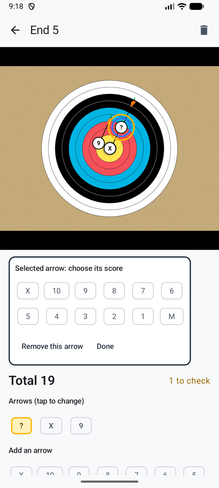
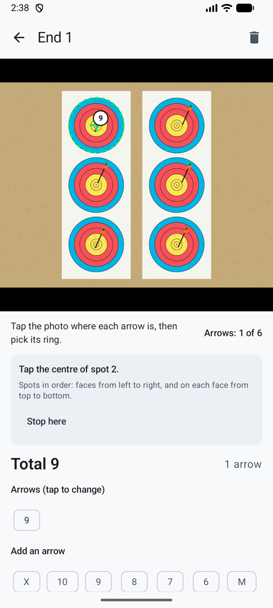

# Puntuación manual { #manual-scoring }

Nada de IA, y nada sale del teléfono. Sigues fotografiando la tanda, y luego tocas cada flecha en la foto y eliges su zona: dos toques por flecha. La foto guarda la prueba. O sáltate la foto y toca solo las puntuaciones.

**Ajustes → Método de puntuación → Manual (sin IA)**.

<figure markdown>
{ .shot }
<figcaption>Toca la flecha, elige su zona</figcaption>
</figure>

## Puntuar una tanda en su foto { #score-an-end-on-its-photo }

1. Tira tu tanda y luego **haz la foto** como siempre (o **De la galería**). La cámara te recuerda que tocarás tus flechas en ella.
2. La tanda se abre lista para colocar: **Toca la foto donde está cada flecha y luego elige su zona**.
3. Toca una flecha en la foto. Recibe un marcador **?** y el selector de zona se abre justo debajo de la foto.
4. Elige su zona. El selector se cierra, listo para la siguiente flecha. El contador muestra cuántas has colocado, por ejemplo **Flechas: 4 de 6**.
5. Cuando estén todas colocadas, confirma la tanda: **Confirmar · tirar la siguiente tanda** te lleva directamente de vuelta a la cámara.

Pellizca para ampliar una flecha en la línea antes de tocarla, y toca dos veces para alejar. Toca un marcador para cambiar su zona o quitarlo. Una flecha colocada sin zona se queda marcada con **?** y cuenta como *por revisar*, así que no puede colarse como un fallo.

## Marcar la diana { #mark-the-target }

{ .shot width="220" align=right }

Una vez que hay una flecha en la foto, **Marcar la diana** da a tus flechas su lugar en la diana, para que cuenten en **Dónde se agrupan tus flechas** y **Dónde caen tus flechas**:

1. Toca el centro de la diana.
2. Toca el borde exterior de su última zona (la zona 6 en una triple diana, la zona 1 en una diana completa).
3. En una triple diana, haz lo mismo con cada spot, en orden: las dianas de izquierda a derecha, y en cada diana de arriba abajo. **Parar aquí** deja el resto sin marcar.

Las marcas aparecen como círculos verdes. Las flechas que coloques después también reciben su lugar. Los marcadores además se hacen más pequeños en los spots pequeños, para que las flechas juntas no se tapen entre sí.

## Puntuar una tanda sin foto { #score-an-end-without-a-photo }

En la cámara, toca **Sin foto**. La tanda se abre con el teclado de zonas arriba: toca una zona por flecha, en cualquier orden. El teclado se queda en su sitio mientras la lista de flechas crece debajo, para que puedas tocar rápido.

## Conviene saber { #good-to-know }

- Nunca se envía nada: ni foto, ni puntuación, ni clave. La página [Privacidad](privacy.md) de Ajustes lo indica.
- Funciona sin ninguna cobertura.
- Las tandas fotografiadas antes de pasar a manual se abren directamente para colocar las flechas.
- Puedes cambiar a otro método en cualquier momento; tus tandas manuales se quedan como están.
- Las flechas colocadas a mano cuentan en todas las estadísticas. Para **Dónde se agrupan tus flechas** y el mapa de calor, [marca la diana](#mark-the-target) primero.
