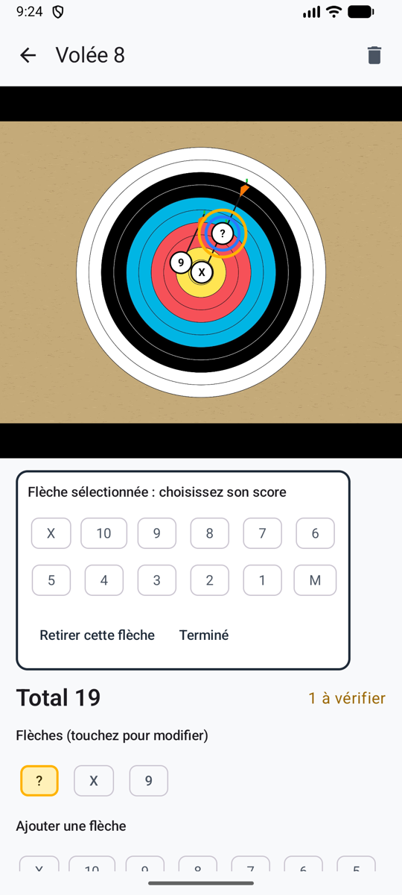

# Comptage manuel

Aucune IA, et rien ne sort du téléphone. Vous photographiez quand même la volée, puis vous touchez chaque flèche sur la photo et choisissez sa zone : deux touches par flèche. La photo garde la preuve. Ou passez la photo et touchez simplement les points.

**Réglages → Méthode de comptage → Manuel (sans IA)**.

<figure markdown>
{ .shot }
<figcaption>Touchez la flèche, choisissez sa zone</figcaption>
</figure>

## Compter une volée sur sa photo

1. Tirez votre volée, puis **prenez la photo** comme d’habitude (ou **Depuis la galerie**). L’appareil photo vous rappelle que vous toucherez vos flèches sur la photo.
2. La volée s’ouvre prête pour le placement : **Touchez la photo à l’emplacement de chaque flèche, puis choisissez sa zone.**
3. Touchez une flèche sur la photo. Elle reçoit un repère **?**, et le choix de la zone s’ouvre juste sous la photo.
4. Choisissez sa zone. Le choix se referme, prêt pour la flèche suivante. Le compteur indique combien vous en avez placé, par exemple **Flèches : 4 sur 6**.
5. Quand elles sont toutes placées, validez la volée : **Valider · volée suivante** revient directement à l’appareil photo.

Écartez deux doigts pour zoomer sur une flèche sur la ligne avant de la toucher, et touchez deux fois pour revenir. Touchez un repère pour changer sa zone ou le retirer. Une flèche placée sans zone reste marquée **?** et compte comme *à vérifier* : elle ne peut pas passer inaperçue comme un manqué.

## Compter une volée sans photo

À l’appareil photo, touchez **Sans photo**. La volée s’ouvre avec le clavier des zones en haut : touchez une zone par flèche, dans n’importe quel ordre. Le clavier reste en place pendant que la liste des flèches s’allonge en dessous : vous pouvez toucher rapidement.

## Bon à savoir

- Rien n’est envoyé, jamais : ni photo, ni score, ni clé. La page [Confidentialité](privacy.md) des réglages le dit aussi.
- Ça fonctionne sans aucun réseau.
- Les volées photographiées avant de passer au comptage manuel s’ouvrent directement en mode placement.
- Vous pouvez passer à une autre méthode à tout moment ; vos volées manuelles restent telles quelles.
- Les flèches placées à la main comptent dans toutes les statistiques, sauf **Où se groupent vos flèches**, qui a besoin de la position de la cible sur la photo : seule l’IA la mesure.
