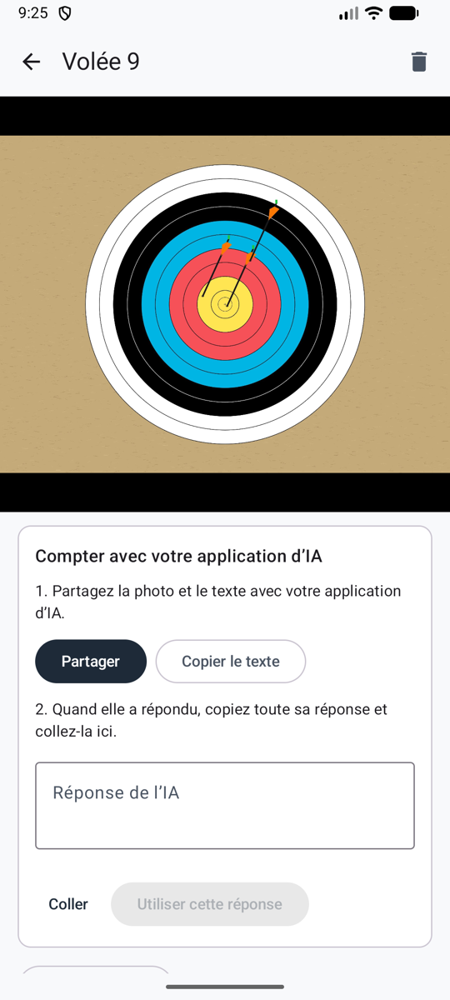

# Partager avec votre application d’IA

Sans clé API : c’est l’application d’IA que vous utilisez déjà sur votre téléphone qui compte. Ullr prépare la photo et un texte tout prêt, vous les partagez avec l’application, et vous collez sa réponse dans Ullr. La réponse est vérifiée comme une réponse automatique, avec les flèches incertaines entourées.

**Réglages → Méthode de comptage → Partager avec votre application d’IA**.

<figure markdown>
{ .shot }
<figcaption>Partager, puis coller la réponse</figcaption>
</figure>

## Compter une volée

1. Prenez la photo de la volée comme d’habitude. La volée s’ouvre avec la carte **Compter avec votre application d’IA**.
2. Touchez **Partager**, et choisissez votre application d’IA dans la liste. La photo et le texte partent ensemble, et le texte est aussi copié, au cas où l’application ne prendrait que la photo : collez-le alors vous-même dans l’application.
3. Envoyez-les dans l’application, et attendez la réponse.
4. Copiez **toute** la réponse, revenez dans Ullr, touchez **Coller**, puis **Utiliser cette réponse**.
5. [Vérifiez les flèches entourées](review.md) et validez la volée.

**Copier le texte** copie seulement le texte, si vous préférez ajouter vous-même la photo dans l’application.

## Bon à savoir

- **Utilisez une application qui sait lire les images** et donner une longue réponse. Le texte demande un seul bloc dans un format fixe (JSON) ; Ullr le lit même si l’application ajoute une phrase ou deux autour.
- **« Aucune réponse trouvée dans le texte collé »** : copiez toute la réponse, pas seulement une partie.
- **« Les positions doivent être des fractions… »** : demandez à l’application de répondre à nouveau avec le même texte.
- **Vous changez d’idée ?** **Saisir à la main** se trouve sous la carte.
- Avec la [méthode automatique](scoring-api.md), une volée dont le comptage a échoué propose **Partager plutôt avec une application d’IA**.

## Confidentialité

C’est vous qui partagez la photo : elle passe donc par **votre propre compte dans cette application**, selon ses conditions. Ullr partage la même copie que celle qu’il enverrait pour le comptage automatique : sans position ni détails sur le téléphone, et recadrée sur la cible si **N’envoyer que la zone de la cible** est activé (voir [Confidentialité](privacy.md)). La copie partagée est effacée du téléphone une fois la réponse utilisée.
