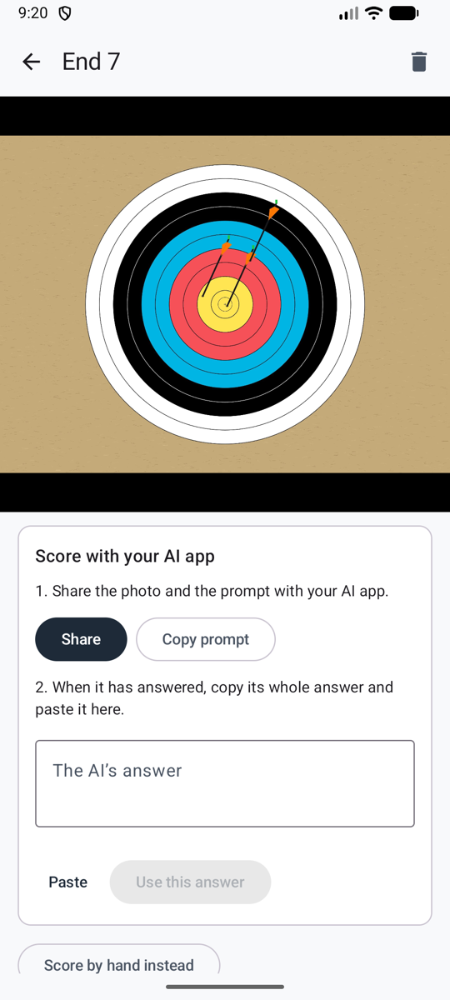

# Share with your AI app

No API key: the AI app you already use on your phone does the scoring. Ullr prepares the photo and a ready-made prompt, you share them with the app, and you paste its answer back. The answer is checked like an automatic one, with the uncertain arrows circled.

**Settings → Scoring method → Share with your AI app** (*Réglages → Méthode de comptage → Partager avec votre application d’IA*).

<figure markdown>
{ .shot }
<figcaption>Share, then paste the answer</figcaption>
</figure>

## Score an end

1. Take the photo of the end as usual. The end opens with the card **Score with your AI app** (*Compter avec votre application d’IA*).
2. **Share** (*Partager*), and pick your AI app in the list. The photo and the prompt go with it, and the prompt is also copied, in case the app only takes the photo: then paste it in the app yourself.
3. Send it in the app, and wait for the answer.
4. Copy the **whole** answer, come back to Ullr, and tap **Paste** (*Coller*), then **Use this answer** (*Utiliser cette réponse*).
5. [Check the circled arrows](review.md) and confirm the end.

**Copy prompt** (*Copier le texte*) copies only the prompt, if you prefer to add the photo in the app yourself.

## Good to know

- **Use an app that can read images** and give a long answer. The prompt asks for one block of text in a fixed format (JSON); Ullr reads it even if the app adds a sentence or two around it.
- **"No answer found in the pasted text"** (*Aucune réponse trouvée dans le texte collé*): copy the whole answer, not only part of it.
- **"Positions should be fractions…"**: ask the app to answer again with the same prompt.
- **Change your mind:** **Score by hand instead** (*Saisir à la main*) is under the card.
- With the [automatic method](scoring-api.md), an end that fails to score offers **Share with an AI app instead** (*Partager plutôt avec une application d’IA*).

## Privacy

You share the photo yourself, so it goes through **your own account in that app**, under its terms. Ullr shares the same copy it would send for automatic scoring: no location or phone details, and cropped to the target if **Send only the target area** is on (see [Privacy](privacy.md)). The shared copy is deleted from the phone once the answer is used.
