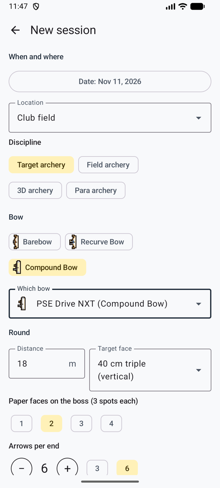
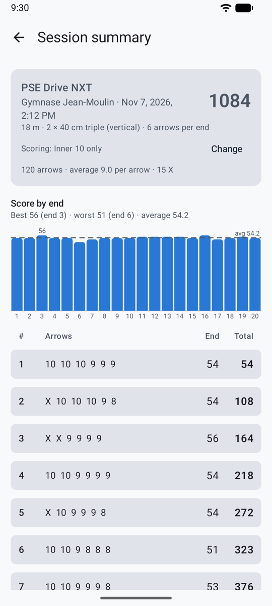
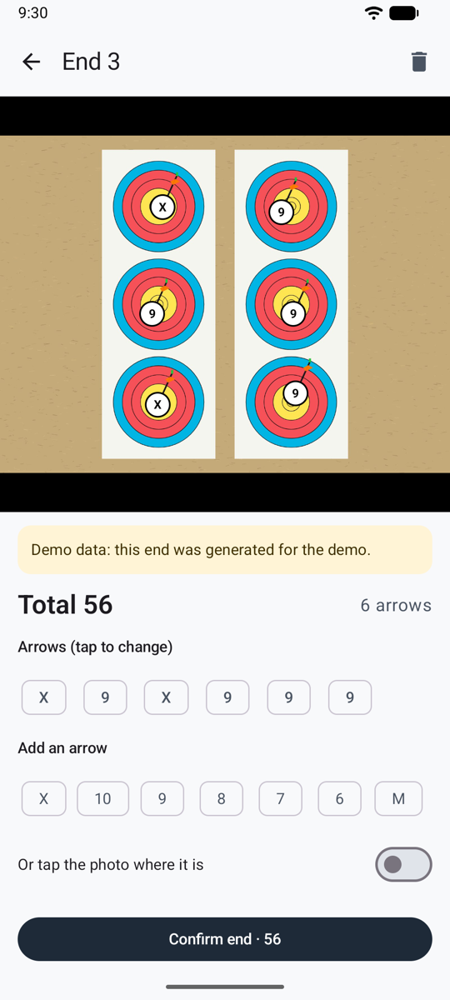
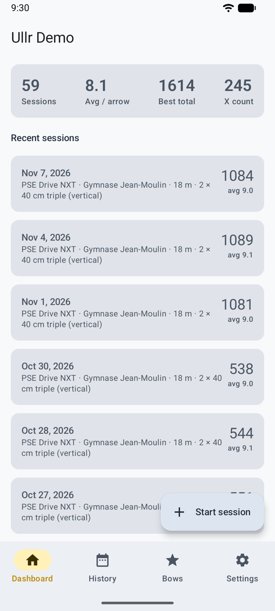
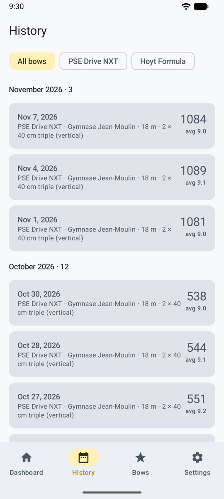
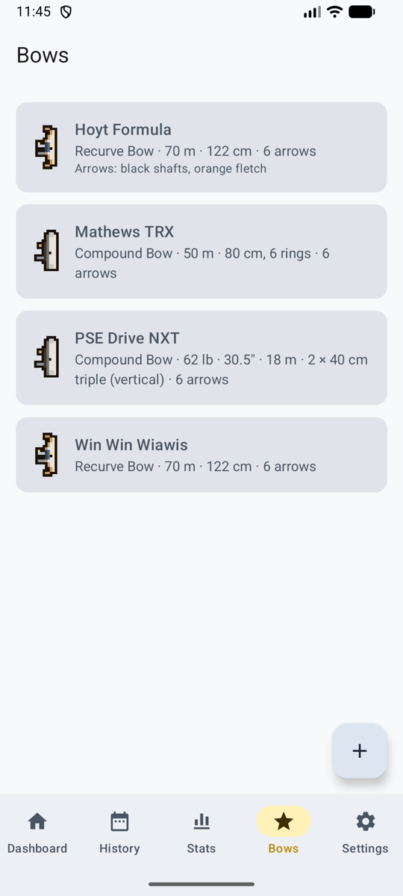
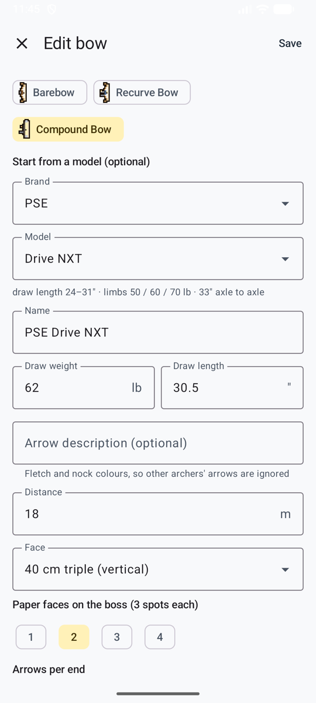
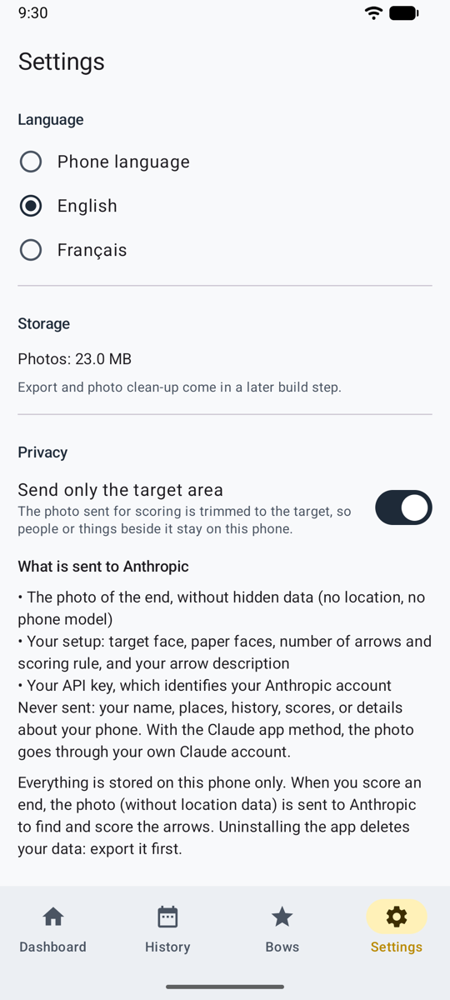

# Screenshots

Taken with **Ullr Demo**, a version of the app filled with six months of made-up sessions, so you can see every screen with real-looking data.

## Shooting a session

<figure markdown>
{ .shot }
<figcaption><b>New session.</b> Place, bow, distance, face, paper faces, arrows per end and scoring rule.</figcaption>
</figure>
<figure markdown>
{ .shot }
<figcaption><b>2 to check.</b> Arrows near a line or with low confidence are circled in amber and listed first.</figcaption>
</figure>
<figure markdown>
{ .shot }
<figcaption><b>Fixing an arrow.</b> The AI's two candidate rings are highlighted, with its confidence.</figcaption>
</figure>
<figure markdown>
{ .shot }
<figcaption><b>Session.</b> Total, scoring rule, score-by-end chart and the scoresheet.</figcaption>
</figure>
<figure markdown>
{ .shot }
<figcaption><b>A past end.</b> Every end keeps its photo.</figcaption>
</figure>
<figure markdown>
{ .shot }
<figcaption><b>Loading.</b> About 2 seconds at launch.</figcaption>
</figure>

## History and bows

<figure markdown>
{ .shot }
<figcaption><b>Dashboard.</b> Sessions, average per arrow, best total, X count.</figcaption>
</figure>
<figure markdown>
{ .shot }
<figcaption><b>History.</b> Every session by month, filtered by bow.</figcaption>
</figure>
<figure markdown>
{ .shot }
<figcaption><b>Bows.</b> Each bow with its setup.</figcaption>
</figure>
<figure markdown>
{ .shot }
<figcaption><b>Bow catalog.</b> Start from a brand and model.</figcaption>
</figure>

## Settings

<figure markdown>
{ .shot }
<figcaption><b>Choice of AI.</b> The service of your choice, with your own key.</figcaption>
</figure>
<figure markdown>
{ .shot }
<figcaption><b>Privacy.</b> Exactly what is sent, and the target-only switch.</figcaption>
</figure>

