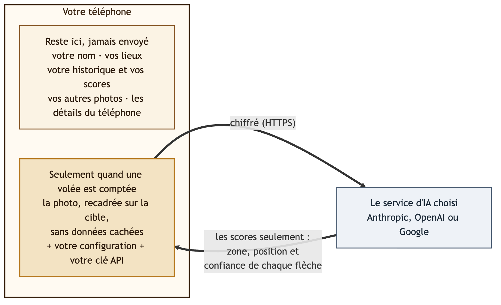

# Sécurité

Ullr a été conçu pour qu'il y ait très peu de choses à protéger hors de votre téléphone, et que ce qui en sort soit réduit au minimum. Voici ce qui vous protège, vous et vos données, en mots simples.

{ width="640" }

## Ce qui vous protège

-   :material-account-off-outline: **Pas de compte, rien à pirater**

    ---

    Ullr n'a ni serveur ni comptes d'utilisateurs. Il n'existe aucune base de données d'archers en ligne qui pourrait fuiter.

-   :material-cellphone-lock: **Votre historique reste sur votre téléphone**

    ---

    Séances, scores, lieux, arcs et photos vivent dans l'espace privé de l'application, protégés par le verrouillage de votre téléphone. Pas de sauvegarde en ligne, pas de copie vers un nouveau téléphone sauf si vous exportez.

-   :material-lock-outline: **Connexions chiffrées seulement**

    ---

    L'application refuse les connexions non chiffrées, et ne parle qu'au service d'IA que vous avez choisi.

-   :material-key-chain-variant: **Votre clé, sous clé**

    ---

    Votre clé API est chiffrée avec le coffre sécurisé de votre téléphone (sur la plupart des téléphones, une puce de sécurité dédiée). Elle n'est plus jamais affichée, jamais exportée, et n'est envoyée qu'au service auquel elle appartient.

-   :material-incognito: **Rien sur votre téléphone ni sur vous**

    ---

    Les photos perdent leurs données cachées (position, modèle de téléphone). Les détails techniques que les applications envoient d'habitude sur le téléphone sont remplacés par « unknown ». Votre nom, vos lieux et votre historique ne sont jamais envoyés.

-   :material-crop: **Seulement la cible**

    ---

    Par défaut, la photo est recadrée sur la cible avant l'envoi : les personnes et les objets autour restent sur votre téléphone.

-   :material-robot-outline: **L'IA ne peut que répondre**

    ---

    L'IA reçoit une photo et renvoie des scores, rien d'autre. Elle ne peut pas lire vos données, ouvrir quoi que ce soit, ni agir sur votre téléphone. Une réponse qui n'a pas le format attendu est refusée.

-   :material-check-decagram-outline: **Le dernier mot est à vous**

    ---

    Aucun score ne compte tant que vous n'avez pas validé la volée. Les flèches incertaines sont entourées pour que vous les vérifiiez.

-   :material-broom: **Rien ne traîne**

    ---

    Les copies faites pour un partage sont effacées une fois utilisées, et une séance abandonnée emporte ses photos.

-   :material-package-variant-closed-check: **Des composants vérifiés**

    ---

    Chaque bibliothèque de l'application est vérifiée à chaque compilation contre une empreinte enregistrée, et leur liste complète accompagne chaque version.

## Les questions des archers

**Et si je perds mon téléphone ?**
Votre historique est protégé par l'écran de verrouillage du téléphone, comme vos autres applications. Par prudence, supprimez votre clé API sur le site du service d'IA : elle cesse de fonctionner aussitôt. Une limite de dépenses chez le service garantit que personne ne pourra jamais dépenser plus.

**Le service d'IA voit-il mon historique ?**
Non. Il reçoit seulement la photo de la volée comptée, les paramètres de la séance (blason, nombre de flèches, règle de comptage, description des flèches) et votre clé. Voir [Confidentialité](privacy.md) pour ce que chaque service en fait.

**Ullr me piste-t-il ou affiche-t-il des publicités ?**
Non. Pas de statistiques d'utilisation, pas de publicité, pas de pistage. L'application ne demande ni votre position, ni vos contacts, ni le micro, ni vos fichiers.

**De quelles autorisations a-t-elle besoin ?**
Seulement l'appareil photo, pour photographier la cible, et l'accès à Internet, pour compter avec un service d'IA. L'import d'une photo passe par le sélecteur de photos d'Android, qui ne donne à Ullr que la photo que vous choisissez.

**Quelqu'un vérifie-t-il l'application ?**
Chaque modification est testée automatiquement : plus de 75 tests couvrent le comptage, les consignes envoyées à l'IA, et exactement ce qui sort du téléphone. La conception a été revue sous l'angle de la confidentialité et de la sécurité, et les bibliothèques utilisées sont tenues à jour.

## Une bonne habitude

!!! tip "Trois minutes, une seule fois"
    1. Créez une clé API **réservée à Ullr**.
    2. Fixez une **limite de dépenses mensuelle** chez le service.
    3. Pour Google Gemini, utilisez un projet avec la **facturation activée**, pour que vos photos ne servent pas à améliorer les produits de Google.
