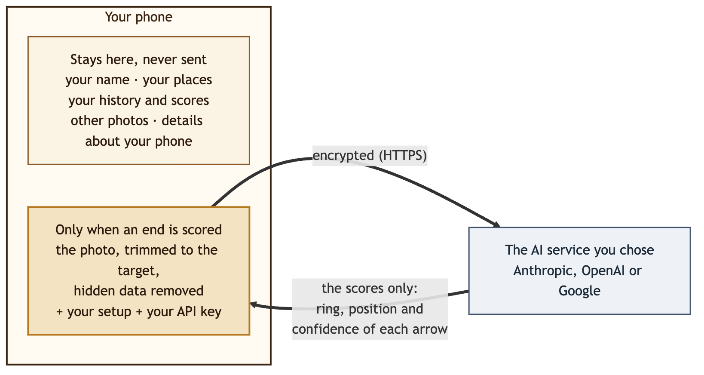

# Security

Ullr was designed so that there's very little to protect away from your phone, and what does leave it is kept to a minimum. Here's what keeps you and your data safe, in plain words.

{ width="640" }

## What protects you

-   :material-account-off-outline: **No account, nothing to break into**

    ---

    Ullr has no server and no user accounts. There's no online database of archers that could leak.

-   :material-cellphone-lock: **Your records stay on your phone**

    ---

    Sessions, scores, places, bows and photos live in the app's private storage, protected by your phone's lock. No cloud backup, no copy to a new phone unless you export.

-   :material-lock-outline: **Encrypted connections only**

    ---

    The app refuses unencrypted connections, and only talks to the one AI service you chose, at its own address or the https address you gave. With manual scoring, it talks to no one.

-   :material-key-chain-variant: **Your key, locked away**

    ---

    Your API key is encrypted with your phone's secure key store (on most phones, a dedicated security chip). It's never shown again, never exported, and only sent to the service it belongs to. Change a service's address and its key is deleted, so it can't follow to the new one.

-   :material-incognito: **Nothing about your phone or you**

    ---

    Photos lose their hidden data (location, phone model). The technical details apps usually send about the phone are replaced with "unknown". Your name, places and history are never sent.

-   :material-crop: **Only the target**

    ---

    By default, the photo is trimmed to the target before it's sent, so the people and things around it stay on your phone.

-   :material-robot-outline: **The AI can only answer**

    ---

    The AI receives a photo and sends back scores, nothing else. It can't read your data, open anything, or act on your phone. An answer that isn't in the expected format is refused.

-   :material-check-decagram-outline: **You have the last word**

    ---

    No score counts until you confirm the end. Uncertain arrows are circled for you to check.

-   :material-broom: **Nothing left lying around**

    ---

    Copies made for sharing are deleted once used, and a discarded session takes its photos with it.

-   :material-package-variant-closed-check: **Checked building blocks**

    ---

    Every library inside the app is checked against a recorded fingerprint at each build, and the full list is kept with every build.

## Questions archers ask

**What if I lose my phone?**
Your records are protected by your phone's lock screen, like your other apps. To be safe, delete your API key on the AI service's website: it stops working at once. A spending limit with the service means nobody could ever spend more than that.

**I use another service at my own address. Is that safe?**
Ullr only accepts `https://` addresses, without a user name or password in them. The key you save is only ever sent to that address, and addresses aren't in exports, so a file you restore can't send your key elsewhere. Choose a service you trust: it receives the photo and your key, like the main services.

**Can the AI service see my history?**
No. It only receives the photo of the end being scored, your setup for that end (face, number of arrows, scoring rule, arrow description) and your key. See [Privacy](privacy.md) for what each service does with it.

**Does Ullr track me, or show ads?**
No. There's no analytics, no advertising and no tracking. The app doesn't ask for your location, contacts, microphone or files.

**What permissions does it need?**
Only the camera, to photograph the target, and internet access, to score with an AI service. Manual scoring doesn't use the internet. Importing a photo uses Android's photo picker, which only gives Ullr the photo you choose.

**Is someone checking the app?**
Every change is tested automatically, more than 75 tests that cover scoring, the instructions sent to the AI, and exactly what leaves the phone. The design was reviewed for privacy and security, and the libraries it uses are kept up to date.

## A good habit

!!! tip "Three minutes, once"
    1. Create an API key **just for Ullr**.
    2. Set a **monthly spending limit** with the service.
    3. For Google Gemini, use a project with **billing turned on**, so your photos aren't used to improve Google's products.
