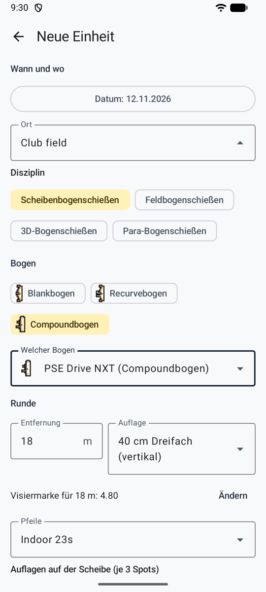
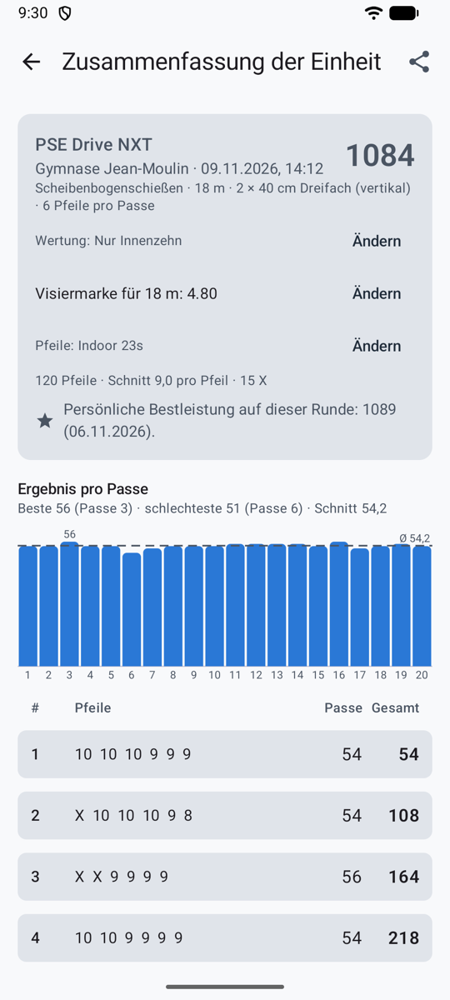
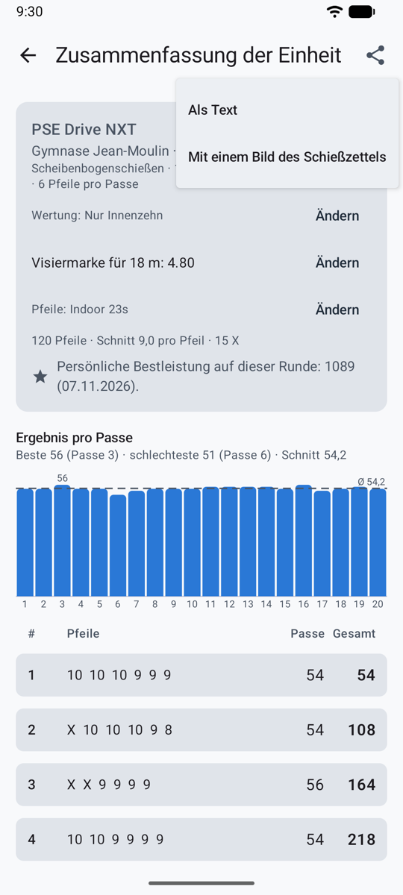
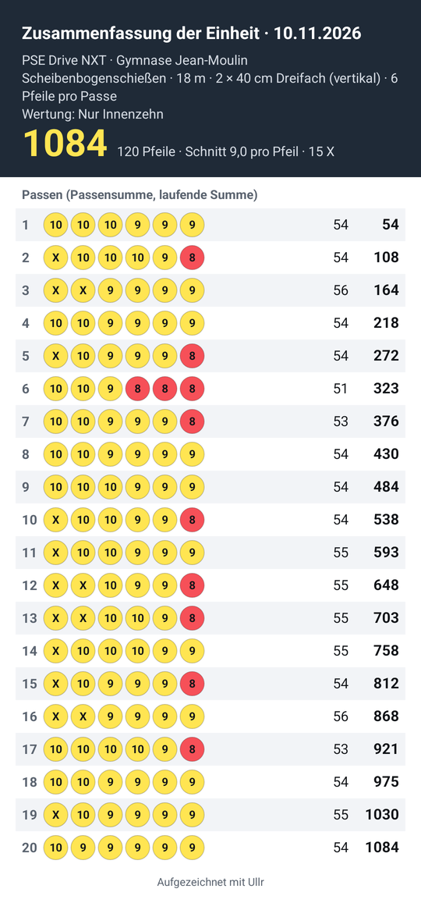
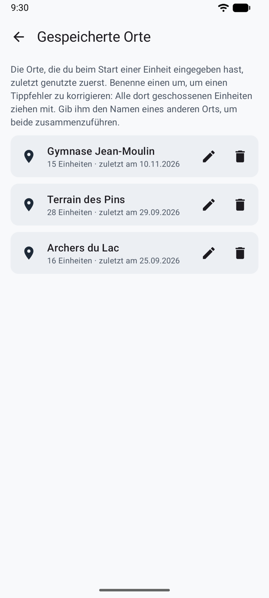

# Einheiten { #sessions }

Eine Einheit ist ein Besuch am Bogenplatz: ein Ort, ein Datum, ein Bogen und eine Runde, und die Passen, die du schießt. Im Spielmodus startet die **Schießlinie** eine Einheit, und **Jetzt schießen** führt direkt zur Kamera.

<figure markdown>
{ .shot }
<figcaption><b>Neue Einheit.</b> Die Vorgaben des Bogens füllen den Rest aus.</figcaption>
</figure>
<figure markdown>
{ .shot }
<figcaption><b>Die Einheit.</b> Gesamt, Diagramm und Schießzettel.</figcaption>
</figure>

## Eine Einheit starten { #start-a-session }

Tippe in der Übersicht auf **Einheit starten** und fülle dann aus:

- **Ort**: Gib einen neuen ein oder wähle einen, den du schon benutzt hast. Um einen Tippfehler zu korrigieren, zwei Namen für denselben Platz zusammenzuführen oder einen zu entfernen, siehe [Gespeicherte Orte](#saved-places).
- **Datum**: standardmäßig jetzt.
- **Disziplin**: Scheibenbogenschießen (der Standard), Feldbogenschießen, 3D-Bogenschießen oder Para-Bogenschießen.
- **Bogentyp** (Blankbogen, Recurvebogen oder Compoundbogen, jeder mit seiner kleinen Zeichnung) und **Bogen**. Die Vorgaben des Bogens füllen den Rest aus. Siehe [Bögen](bows.md).
- Unter der Entfernung die **Visiermarke** des Bogens dafür, und die **Pfeile**, wenn der Bogen Pfeilsätze hat: der Satz, den er zuletzt benutzt hat. Siehe [Visiermarken, Pfeilsätze und Tuning-Logbuch](bows.md#sight-marks-arrow-sets-and-tuning-log).
- **Entfernung**, **Auflage**, **Auflagen auf der Scheibe** (bei Dreifach-Auflagen: wie viele auf der Scheibe hängen, zum Beispiel 2 Auflagen = 6 Spots) und **Pfeile pro Passe** (beliebig viele, oft 3 oder 6). Die Auflagen richten sich nach der Disziplin: Scheibenauflagen, **Feld**-Auflagen (80, 60, 40 cm oder 20 cm in Spalten zu drei) oder das **3D**-Tier. Siehe [Feld und 3D](rules.md#field-and-3d).
- **Wertungsregel**: kommt aus den Einstellungen und dem Bogentyp. Siehe [Wertungsregeln](rules.md).

## Eine Passe schießen { #shoot-an-end }

1. Schieß deine Passe und geh zur Scheibe.
2. Tippe auf **Foto aufnehmen**. Stell dich vor die Scheibe und bring die Auflage in den Kreis auf dem Bildschirm. Du kannst auch mit **Aus der Galerie** ein Foto wählen oder die Passe von Hand werten.
3. Was dann passiert, hängt von der [Wertungsmethode](scoring.md) ab: Wertung im Hintergrund, Teilen mit deiner KI-App oder Setzen durch dich.
4. [Prüf die Passe](review.md) und bestätige sie. **Bestätigen · nächste Passe** führt direkt zurück zur Kamera.

Bei der automatischen Wertung musst du nicht warten: Schieß die nächste Passe, während die vorige gewertet wird. Jede Passe zeigt ihren Status im Schießzettel (siehe [Dein eigener API-Schlüssel](scoring-api.md#at-the-range)).

## Der Bildschirm der Einheit { #the-session-screen }

- **Schießzettel:** Passe für Passe, mit der laufenden Summe. Tippe auf eine Passe, um ihr Foto und ihre Pfeile wieder zu sehen.
- Diagramm **Ergebnis pro Passe**, mit der Durchschnittslinie und den besten und schlechtesten Passen.
- **Ändern** wechselt die Wertungsregel, jederzeit. Alle Ergebnisse werden neu berechnet.
- Die **Visiermarke** auf dieser Entfernung und die geschossenen **Pfeile**, jeweils mit **Ändern**.
- **Beenden**. Passen, die nicht bestätigt sind, zählen erst, wenn du sie bestätigst, was du auch später noch tun kannst.
- **Diese Einheit verwerfen** löscht sie, nachdem Ullr gefragt hat.
- **Persönliche Bestleistung:** Sobald sie beendet ist, zeigt die Einheit, wo sie auf ihrer Runde steht (gleiche Entfernung, Auflage, Auflagen auf der Scheibe und Pfeilzahl): deine persönliche Bestleistung, und welches Ergebnis sie übertroffen hat; gleichauf damit; oder die Bestleistung, die es zu schlagen gilt.

## Eine Einheit teilen { #share-a-session }

{ .shot width="220" align=right }

Die Schaltfläche **Diese Einheit teilen**, oben in einer Einheit mit mindestens einer bestätigten Passe, öffnet das Teilen-Menü deines Handys: E-Mail, Nachrichten, ein Chat mit deinem Trainer.

- **Als Text**: Datum, Bogen und Ort, Runde, Wertungsregel, Gesamtergebnis, Schnitt und Anzahl X, dann jede Passe mit ihren Pfeilen, ihrer Summe und der laufenden Summe.
- **Mit einem Bild des Schießzettels**: derselbe Text, dazu ein Bild mit den Summen und jedem Pfeil in der Farbe seines Rings.

{ .shot width="220" }

Geteilt wird nur, was der Bildschirm der Einheit zeigt, und nur mit der App, die du wählst: nie die Fotos deiner Passen.

Eine laufende Einheit erscheint in der Übersicht mit **Fortsetzen**. Wird die App während einer Einheit geschlossen, geht nichts verloren.

## Gespeicherte Orte { #saved-places }

{ .shot width="220" align=right }

**Einstellungen → Gespeicherte Orte** listet jeden Ort, den du eingegeben hast, die zuletzt benutzten zuerst, mit der Anzahl Einheiten, die du dort geschossen hast.

- **Umbenennen** (der Stift, oder tippe auf den Ort): korrigiert einen Tippfehler überall auf einmal, denn jede dort geschossene Einheit zieht mit.
- **Zusammenführen:** Gib einem Ort den Namen eines anderen (*vereinsplatz* und *Vereinsplatz*, zum Beispiel). Ullr sagt es dir vorher, und die Schaltfläche heißt **Zusammenführen**. Die Einheiten beider landen unter einem Namen.
- **Löschen** (der Papierkorb), nachdem Ullr gefragt hat: Der Ort verschwindet aus der Liste, und die dort geschossenen Einheiten bleiben erhalten, ohne Ort.
