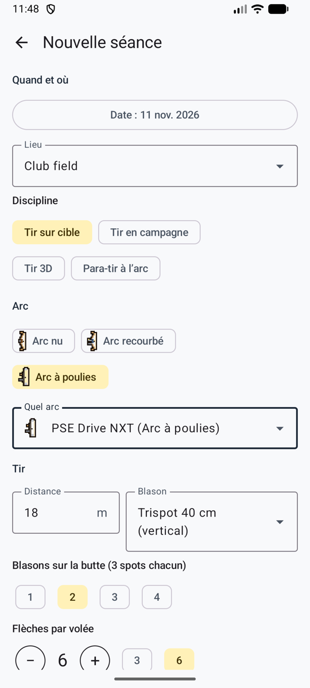
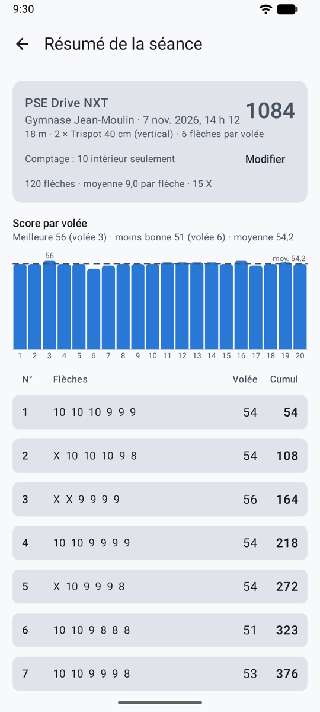
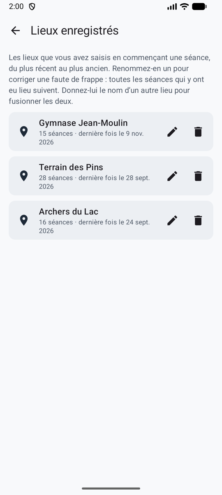

# Séances

Une séance, c’est une visite au pas de tir : un lieu, une date, un arc et une épreuve, et les volées que vous tirez. En mode jeu, la **ligne de tir** en commence une, et **Tirer maintenant** ouvre directement l’appareil photo.

<figure markdown>
{ .shot }
<figcaption><b>Nouvelle séance.</b> Les valeurs par défaut de l’arc remplissent le reste.</figcaption>
</figure>
<figure markdown>
{ .shot }
<figcaption><b>La séance.</b> Total, graphique et feuille de marque.</figcaption>
</figure>

## Commencer une séance

Dans l’onglet **Accueil**, touchez **Commencer une séance**, puis remplissez :

- **Lieu** : tapez-en un nouveau, ou choisissez-en un déjà utilisé. Pour corriger une faute de frappe, réunir deux noms du même terrain ou en retirer un, voir [Lieux enregistrés](#lieux-enregistres).
- **Date** : maintenant, par défaut.
- **Discipline** : tir sur cible (par défaut), tir en campagne, tir 3D ou para-tir à l’arc.
- **Type d’arc** (arc nu, arc recourbé ou arc à poulies, chacun avec son petit dessin) et **arc**. Les valeurs par défaut de l’arc remplissent le reste. Voir [Arcs](bows.md).
- **Distance**, **blason**, **blasons sur la butte** (pour les trispots : combien il y en a sur la butte, par exemple 2 blasons = 6 spots) et **flèches par volée** (n’importe quel nombre, souvent 3 ou 6).
- **Comptage** : la règle, proposée d’après les réglages et le type d’arc. Voir [Règles de comptage](rules.md).

## Tirer une volée

1. Tirez votre volée et allez à la cible.
2. Touchez **Prendre la photo**. Placez-vous face à la cible et cadrez le blason dans le cercle à l’écran. Vous pouvez aussi choisir une photo avec **Depuis la galerie**, ou saisir la volée à la main.
3. La suite dépend de la [méthode de comptage](scoring.md) : comptée en arrière-plan, partagée avec votre application d’IA, ou placée par vous.
4. [Vérifiez la volée](review.md) et validez-la. **Valider · volée suivante** revient directement à l’appareil photo.

Avec le comptage automatique, pas besoin d’attendre : tirez la volée suivante pendant que la précédente est comptée. Chaque volée affiche son état dans la feuille de marque (voir [Votre propre clé API](scoring-api.md#au-pas-de-tir)).

## L’écran de la séance

- **Feuille de marque :** volée par volée, avec le cumul. Touchez une volée pour revoir sa photo et ses flèches.
- Le graphique **Score par volée**, avec la ligne de moyenne, et la meilleure et la moins bonne volée.
- **Modifier** change la règle de comptage, à tout moment. Tous les totaux sont recalculés.
- **Terminer**. Les volées non validées ne comptent pas tant que vous ne les validez pas, ce que vous pouvez encore faire plus tard.
- **Supprimer cette séance** l’efface, après confirmation.

Une séance en cours apparaît dans l’onglet **Accueil** avec **Reprendre**. Si l’application se ferme pendant une séance, rien n’est perdu.

## Lieux enregistrés

{ .shot width="220" align=right }

**Réglages → Lieux enregistrés** liste tous les lieux que vous avez saisis, du plus récent au plus ancien, avec le nombre de séances qui y ont eu lieu.

- **Renommer** (le crayon, ou touchez le lieu) : corrige une faute de frappe partout à la fois, puisque toutes les séances qui y ont eu lieu suivent.
- **Fusionner** : donnez à un lieu le nom d’un autre (*terrain du club* et *Terrain du club*, par exemple). Ullr vous le dit d’abord, et le bouton devient **Fusionner**. Les séances des deux se retrouvent sous un seul nom.
- **Supprimer** (la corbeille), après confirmation : le lieu quitte la liste, et les séances qui y ont eu lieu sont conservées, sans lieu.
