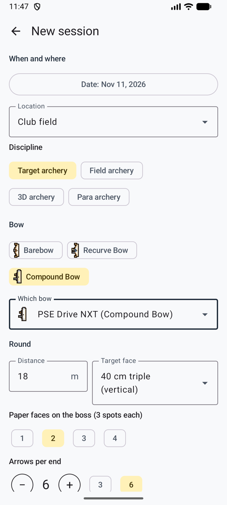
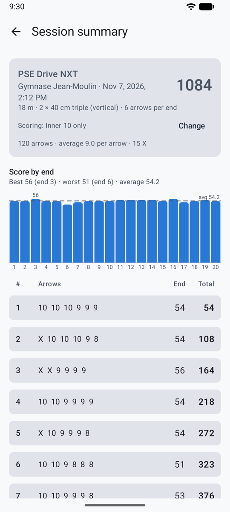
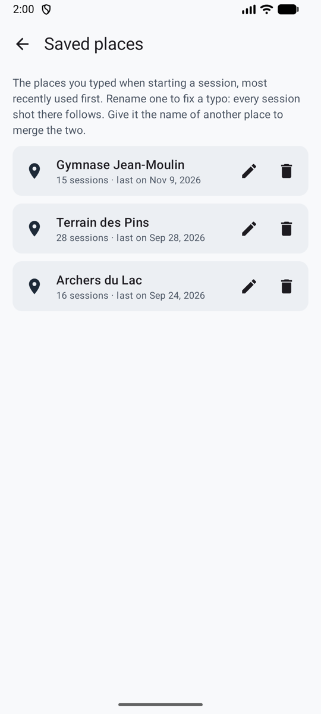

# Sessions

A session is one visit to the range: a place, a date, a bow and a round, and the ends you shoot. In game mode, the **shooting line** starts one, and **Shoot now** goes straight to the camera.

<figure markdown>
{ .shot }
<figcaption><b>New session.</b> The bow's defaults fill in the rest.</figcaption>
</figure>
<figure markdown>
{ .shot }
<figcaption><b>The session.</b> Total, chart and scoresheet.</figcaption>
</figure>

## Start a session

On the Dashboard, tap **Start session** (*Commencer une séance*), then fill in:

- **Location** (*Lieu*): type a new one, or pick one you used before. To fix a typo, merge two names for the same range, or remove one, see [Saved places](#saved-places).
- **Date**: now by default.
- **Discipline**: target archery (the default), field archery, 3D archery or para archery.
- **Bow type** (barebow, recurve bow or compound bow, each with its small drawing) and **bow**. The bow's defaults fill in the rest. See [Bows](bows.md).
- **Distance**, **target face**, **paper faces** (for 3-spot faces: how many are on the boss, for example 2 faces = 6 spots), and **arrows per end** (any number, often 3 or 6).
- **Scoring rule**: set from Settings and the bow type. See [Scoring rules](rules.md).

## Shoot an end

1. Shoot your end and walk to the target.
2. Tap **Take photo** (*Prendre la photo*). Stand in front of the target and fit the face in the circle on screen. You can also pick a photo with **From gallery** (*Depuis la galerie*), or score the end by hand.
3. What happens next depends on the [scoring method](scoring.md): scored in the background, shared with your AI app, or placed by you.
4. [Check the end](review.md) and confirm it. **Confirm · shoot next end** (*Valider · volée suivante*) goes straight back to the camera.

With automatic scoring you don't have to wait: shoot the next end while the previous one is being scored. Each end shows its status in the scoresheet (see [Your own API key](scoring-api.md#at-the-range)).

## The session screen

- **Scoresheet:** end by end, with the running total. Tap an end to see its photo and arrows again.
- **Score by end** chart, with the average line, and the best and worst ends.
- **Change** (*Modifier*) the scoring rule at any time. All the totals are recalculated.
- **Finish** (*Terminer*). Ends that aren't confirmed don't count until you confirm them, which you can still do later.
- **Discard this session** (*Supprimer cette séance*) deletes it, after asking.

A session in progress shows on the Dashboard with **Resume** (*Reprendre*). If the app is closed during a session, nothing is lost.

## Saved places

{ .shot width="220" align=right }

**Settings → Saved places** (*Réglages → Lieux enregistrés*) lists every place you've typed, most recently used first, with how many sessions you shot there.

- **Rename** (the pencil, or tap the place): fixes a typo everywhere at once, since every session shot there follows.
- **Merge:** give a place the name of another one (*club field* and *Club Field*, say). Ullr says so first, and the button reads **Merge** (*Fusionner*). The sessions of both end up under one name.
- **Delete** (the bin), after asking: the place leaves the list, and the sessions shot there are kept, with no place.
