# Statistik { #statistics }

Der Tab **Statistik** zeigt, was in Training und Wettkampf zählt: dein Niveau und wie es sich entwickelt, wie viel du schießt, wo deine Pfeile punkten, wie gleichmäßig du bist, wo sie sich gruppieren, und deine Rekorde pro Runde. Im Spielmodus gehst du zur **Feuerstelle**: Dort öffnet sich dieselbe Statistik „am Feuer“, im Look des Spiels.

Nur bestätigte Passen abgeschlossener Einheiten zählen. Nichts wird irgendwohin gesendet: Alles wird auf deinem Handy berechnet.

<figure markdown>
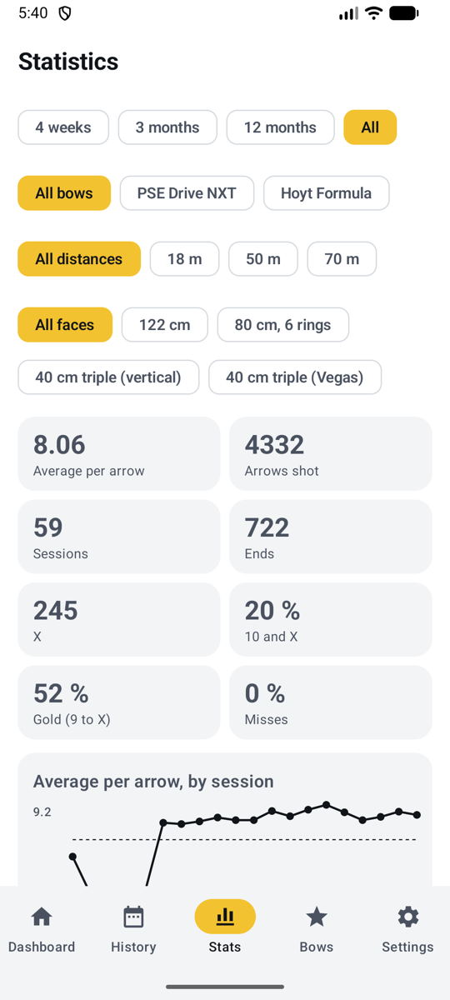{ .shot }
<figcaption><b>Normalmodus</b>, der Tab Statistik</figcaption>
</figure>
<figure markdown>
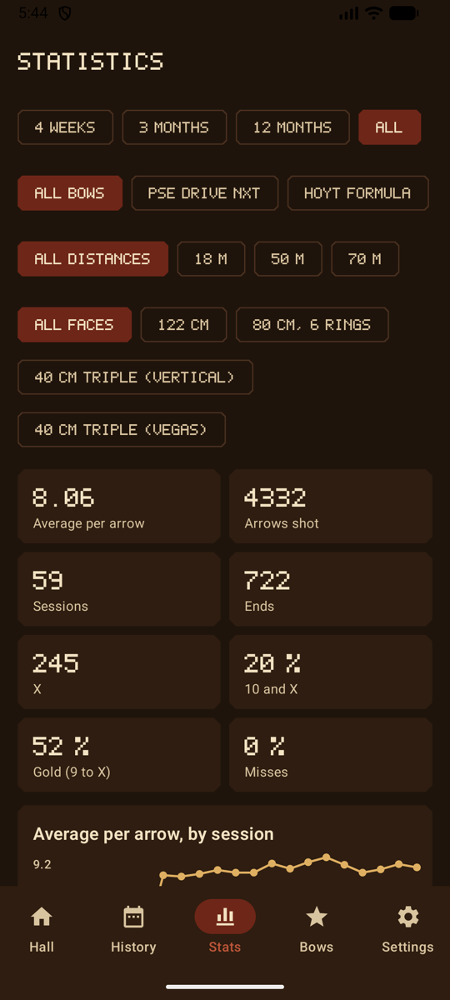{ .shot }
<figcaption><b>Spielmodus</b>, an der Feuerstelle</figcaption>
</figure>

## Filter { #filters }

Wähle oben, was die Statistik abdeckt:

| Filter | Auswahl |
|--------|---------|
| **Zeitraum** | 4 Wochen, 3 Monate (Standard), 12 Monate oder alle |
| **Bogen** | Alle Bögen oder einer (erscheint, wenn du mehr als einen hast) |
| **Entfernung** | Alle Entfernungen oder eine, etwa 18 m (erscheint, wenn du auf mehr als eine geschossen hast) |
| **Auflage** | Alle Auflagen oder eine, etwa 40 cm Dreifach oder 20 cm Feld (erscheint, wenn du auf mehr als eine geschossen hast) |
| **Pfeile** | Alle Pfeilsätze oder einer (erscheint, wenn die gezeigten Einheiten mehr als einen genutzt haben; siehe [Pfeilsätze](bows.md#sight-marks-arrow-sets-and-tuning-log)) |

Wenn alle gezeigten Einheiten dieselbe Auflage nutzen, werden ihre eigenen Ringe hinter die Gruppierung und die Heatmap gezeichnet, und auf einer Dreifach-Auflage bekommst du außerdem eine Karte pro Spot.

## Überblick { #overview }

| Kachel | Was sie dir sagt |
|------|-------------------|
| **Schnitt pro Pfeil** | Dein Niveau, nach der Wertungsregel jeder Einheit |
| **Geschossene Pfeile**, **Einheiten**, **Passen** | Trainingsumfang |
| **X**, **10 und X**, **Gold (9 bis X)** | Wie oft du die Mitte triffst (nur Scheibenauflagen) |
| **Fehlschüsse** | Anteil der Pfeile außerhalb der Wertungszonen |

## Schnitt pro Pfeil, nach Einheit { #average-per-arrow-by-session }

<figure markdown>
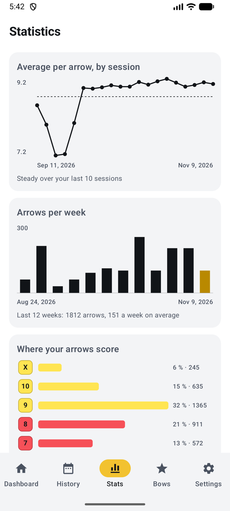{ .shot }
<figcaption><b>Entwicklung und Umfang</b></figcaption>
</figure>
<figure markdown>
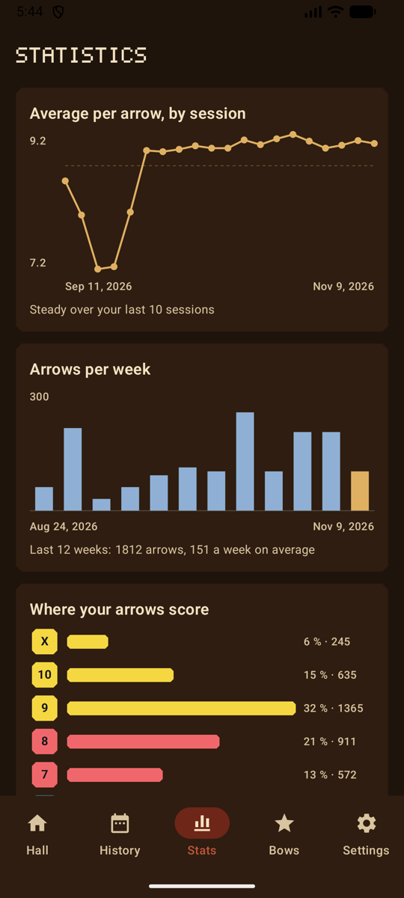{ .shot }
<figcaption>Im Spielmodus</figcaption>
</figure>

- **Entwicklung:** der Schnitt pro Pfeil jeder Einheit (die letzten 20), mit dem Durchschnitt des Zeitraums als gestrichelter Linie. Ab zehn Einheiten vergleicht die Zeile darunter deine letzten fünf Einheiten mit den fünf davor: aufwärts, abwärts oder stabil.
- **Tuning-Änderungen:** Ist ein Bogen gewählt, erscheint jede Notiz aus seinem [Tuning-Logbuch](bows.md#sight-marks-arrow-sets-and-tuning-log) als gepunktete Linie zwischen den Einheiten davor und danach und steht mit Datum unter dem Diagramm. Hat die neue Sehne geholfen? Vergleich die Punkte auf beiden Seiten.

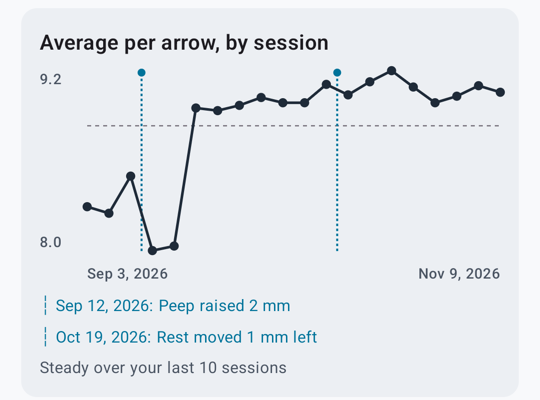{ .shot width="300" }
- **Pfeile pro Woche**: die geschossenen Pfeile jeder Woche über die letzten 12 Wochen, die aktuelle Woche hervorgehoben, mit Gesamtzahl und Wochenschnitt. Praktisch, um zu sehen, wie viel du wirklich trainierst.

## Wo deine Pfeile punkten { #where-your-arrows-score }

<figure markdown>
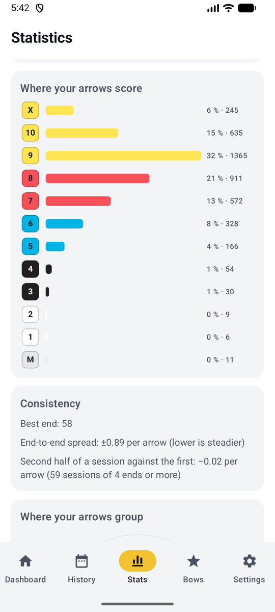{ .shot }
<figcaption><b>Ringe und Konstanz</b></figcaption>
</figure>
<figure markdown>
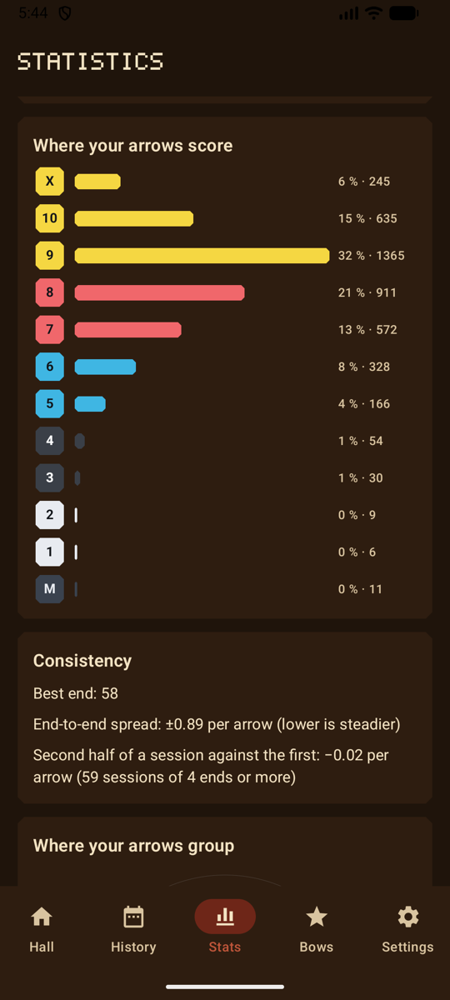{ .shot }
<figcaption>Im Spielmodus</figcaption>
</figure>

Wie viele Pfeile in jedem Ring gelandet sind, von X (oder 11 bei einem 3D-Tier) bis zum Fehlschuss, mit Anteil und Anzahl. In den Designs „Tag am Platz“ und „Nacht am Platz“ sowie im Spielmodus trägt jeder Balken die Farbe seines Rings.

## Konstanz { #consistency }

- **Beste Passe**.
- **Streuung von Passe zu Passe**: wie stark deine Passen schwanken, als Standardabweichung ihres Schnitts pro Pfeil. Niedriger ist gleichmäßiger.
- **Zweite Hälfte gegen die erste**: In Einheiten mit 4 Passen oder mehr ist das dein Schnitt pro Pfeil in der zweiten Hälfte minus dem in der ersten. Negativ heißt, du lässt nach (Ermüdung); positiv heißt, du kommst erst in Schwung.

## Wo sich deine Pfeile gruppieren { #where-your-arrows-group }

<figure markdown>
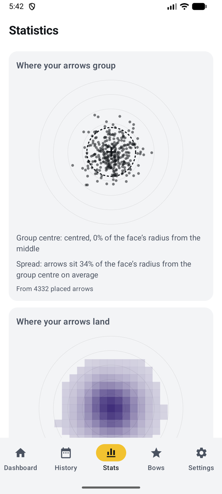{ .shot }
<figcaption><b>Gruppierung</b></figcaption>
</figure>
<figure markdown>
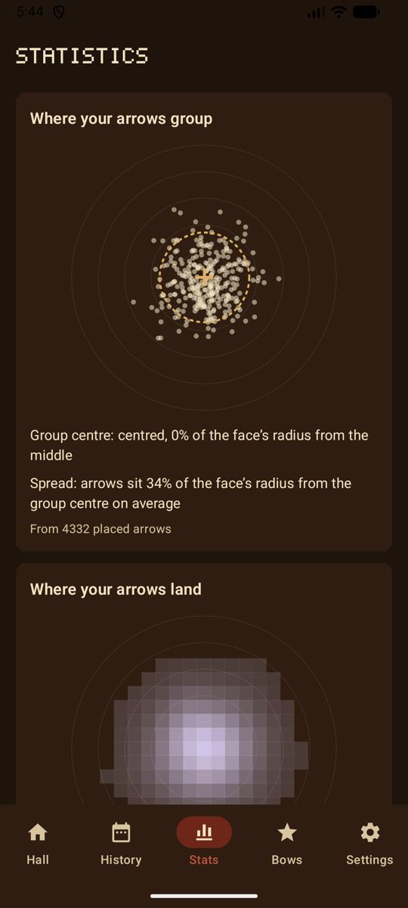{ .shot }
<figcaption>Im Spielmodus</figcaption>
</figure>

Jeder platzierte Pfeil auf einer Scheibe, jeder auf seinem eigenen Spot gezeichnet, mit:

- der **Gruppenmitte** (ein Kreuz): hoch, tief, links oder rechts, als Anteil am Radius der Auflage. Praktisch für Visiermarken;
- der **Streuung** (ein gestrichelter Kreis): wie weit die Pfeile im Schnitt von der Gruppenmitte entfernt sitzen.

Pfeile, die die KI platziert hat, zählen immer. Von Hand platzierte Pfeile zählen, sobald du [die Scheibe markiert](scoring-manual.md#mark-the-target) hast.

## Wo deine Pfeile landen { #where-your-arrows-land }

<figure markdown>
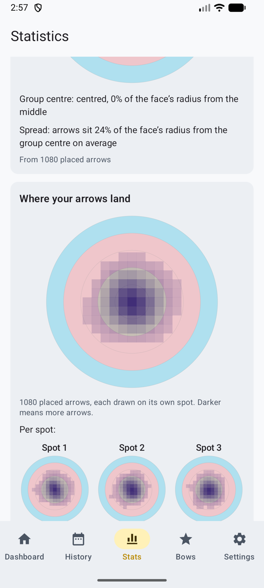{ .shot }
<figcaption><b>Heatmap pro Spot</b></figcaption>
</figure>
<figure markdown>
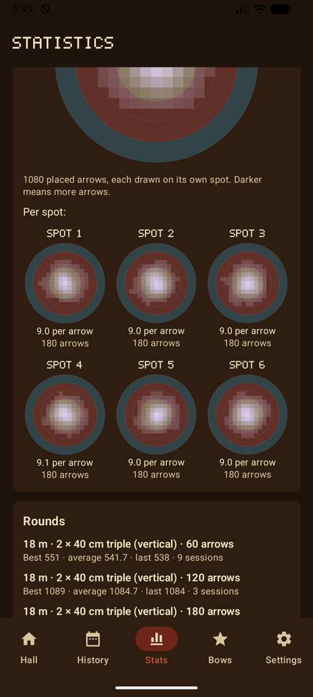{ .shot }
<figcaption>Im Spielmodus</figcaption>
</figure>

Dieselben Pfeile als **Heatmap**: dunkler (im Spielmodus heller), wo mehr Pfeile landen, über den Ringen der gewählten Auflage. Auf einer Dreifach-Auflage (in den Filtern wählen) gibt es eine kleine Karte pro Spot, mit ihrem Schnitt pro Pfeil und ihrer Pfeilzahl, und du siehst, welcher Spot dein **bester** und welcher dein **schwächster** ist: Bei einer senkrechten Dreifach-Auflage deutet ein schwacher unterer Spot oft auf einen absinkenden Bogenarm hin.

## Runden { #rounds }

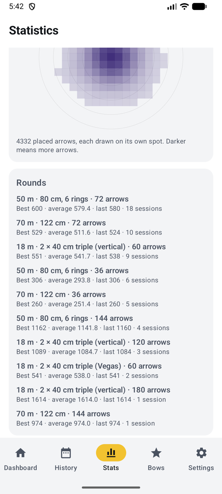{ .shot width="220" align=right }

Für jede Runde, die du schießt (gleiche Entfernung, gleiche Auflage, gleich viele Auflagen auf der Scheibe und gleiche Pfeilzahl): dein **bestes**, **durchschnittliches** und **letztes** Ergebnis und wie viele Einheiten du darauf geschossen hast. Verglichen wird nur Gleiches mit Gleichem: Eine Runde mit 60 Pfeilen auf 18 m mischt sich nie mit einer Runde mit 72 Pfeilen auf 70 m. Deine Bestleistung pro Runde erscheint auch in der Übersicht und bei jeder Einheit.

## Feld und 3D { #field-and-3d }

Feldauflagen (6 bis 1) und 3D-Tiere (11, 10, 8 und 5) werden anders gewertet als Scheibenauflagen. Wählst du in den Filtern eine Feld- oder 3D-Auflage, verschwinden deshalb die Kacheln **X**, **10 und X** und **Gold**, und du siehst die eigenen Ringe und Werte dieser Auflage. Siehe [Wertungsregeln](rules.md#field-and-3d).

## Neu anfangen { #starting-over }

Um deine Statistik neu zu beginnen, siehe [Daten löschen](backup.md#erase-data). Wenn du im Spielmodus Erfahrung und Abzeichen zurücksetzt, bleibt deine Statistik erhalten.
