# Estadísticas { #statistics }

La pestaña **Estadísticas** muestra lo que importa en el entrenamiento y en competición: tu nivel y su tendencia, cuánto tiras, dónde puntúan tus flechas, lo regular que eres, dónde se agrupan y tus récords por tirada. En el modo juego, ve al **hogar**: las mismas estadísticas se abren «junto al fuego», con el aspecto del juego.

Solo cuentan las tandas confirmadas de sesiones terminadas. No se envía nada a ningún sitio: todo se calcula en tu teléfono.

<figure markdown>
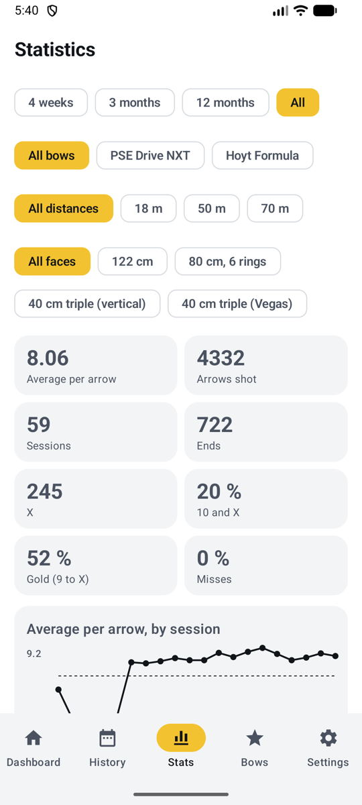{ .shot }
<figcaption><b>Modo normal</b>, la pestaña Estadísticas</figcaption>
</figure>
<figure markdown>
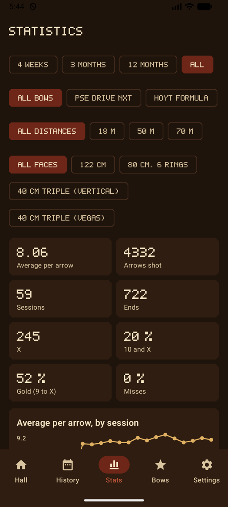{ .shot }
<figcaption><b>Modo juego</b>, junto al hogar</figcaption>
</figure>

## Filtros { #filters }

Elige arriba lo que abarcan las estadísticas:

| Filtro | Opciones |
|--------|---------|
| **Periodo** | 4 semanas, 3 meses (por defecto), 12 meses o todo |
| **Arco** | Todos los arcos, o uno (aparece cuando tienes más de uno) |
| **Distancia** | Todas las distancias, o una, como 18 m (aparece cuando has tirado a más de una) |
| **Diana** | Todas las dianas, o una, como la triple diana de 40 cm o la de campo de 20 cm (aparece cuando has tirado en más de una) |
| **Flechas** | Todos los juegos de flechas, o uno (aparece cuando las sesiones mostradas usaron más de uno; consulta [juegos de flechas](bows.md#sight-marks-arrow-sets-and-tuning-log)) |

Cuando todas las sesiones mostradas usan la misma diana, sus propias zonas se dibujan detrás de la agrupación y del mapa de calor, y en una triple diana tienes además un mapa por spot.

## Resumen { #overview }

| Recuadro | Qué te dice |
|------|-------------------|
| **Media por flecha** | Tu nivel, con la regla de puntuación de cada sesión |
| **Flechas tiradas**, **sesiones**, **tandas** | Volumen de entrenamiento |
| **X**, **10 y X**, **oro (del 9 a la X)** | Con qué frecuencia das en el centro (solo en dianas de tiro a diana) |
| **Fallos** | Proporción de flechas fuera de las zonas de puntuación |

## Media por flecha, por sesión { #average-per-arrow-by-session }

<figure markdown>
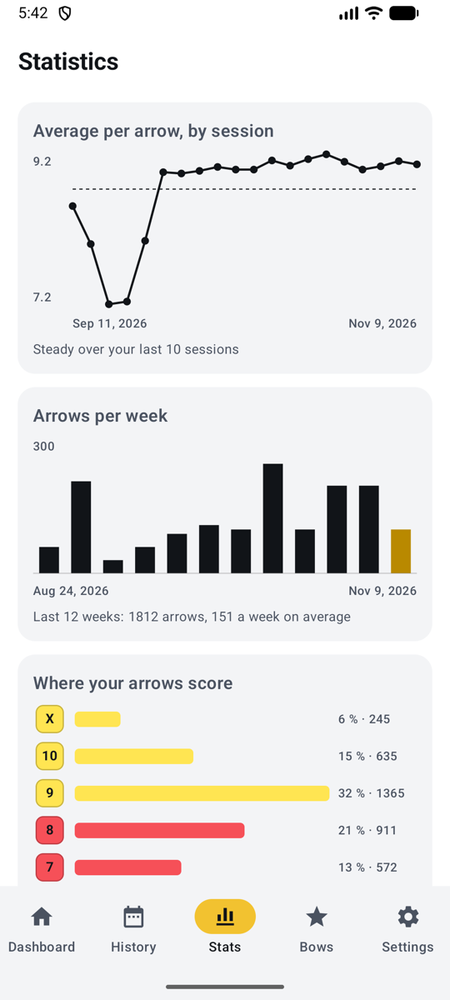{ .shot }
<figcaption><b>Tendencia y volumen</b></figcaption>
</figure>
<figure markdown>
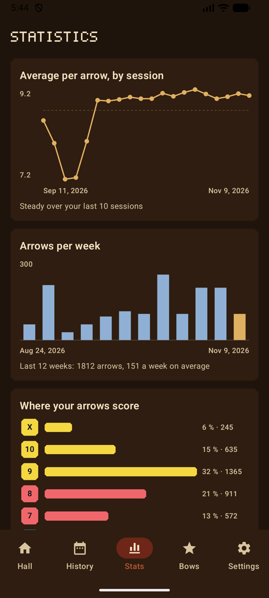{ .shot }
<figcaption>En el modo juego</figcaption>
</figure>

- **Tendencia:** la media por flecha de cada sesión (las 20 últimas), con la media del periodo como línea discontinua. Con diez sesiones o más, la línea de debajo compara tus cinco últimas sesiones con las cinco anteriores: sube, baja o estable.
- **Cambios de ajuste:** con un arco elegido, cada nota de su [registro de ajustes](bows.md#sight-marks-arrow-sets-and-tuning-log) aparece como una línea de puntos entre las sesiones de antes y de después, con su fecha en la lista bajo el gráfico. ¿Te ayudó la cuerda nueva? Compara los puntos a cada lado.

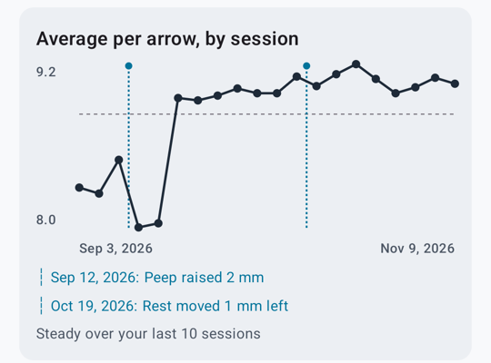{ .shot width="300" }
- **Flechas por semana**: las flechas tiradas cada semana durante las 12 últimas semanas, con la semana actual resaltada, el total y la media semanal. Práctico para ver cuánto entrenas de verdad.

## Dónde puntúan tus flechas { #where-your-arrows-score }

<figure markdown>
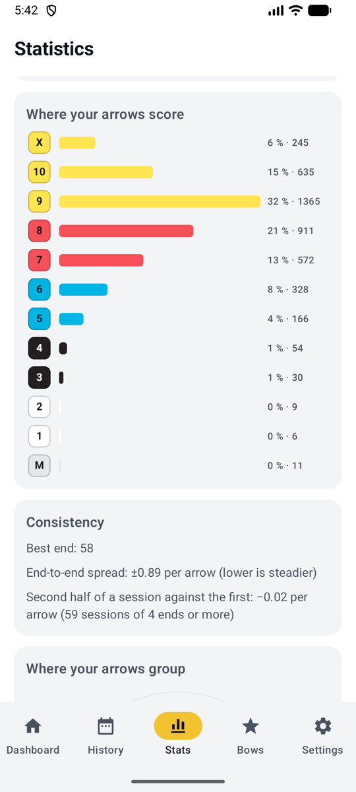{ .shot }
<figcaption><b>Zonas y regularidad</b></figcaption>
</figure>
<figure markdown>
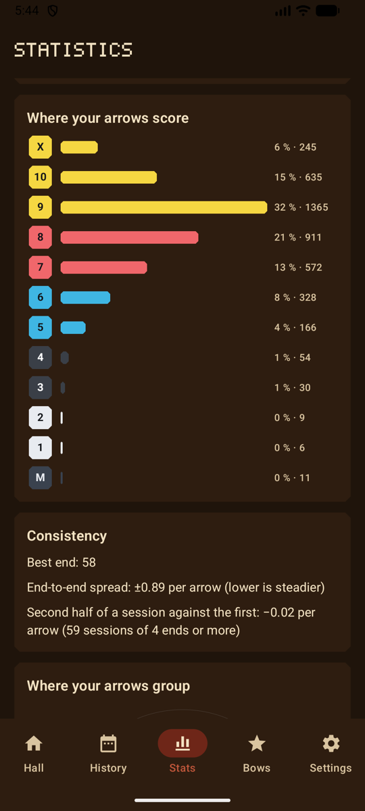{ .shot }
<figcaption>En el modo juego</figcaption>
</figure>

Cuántas flechas cayeron en cada zona, desde la X (o el 11 en un animal 3D) hasta el fallo, con la proporción y el número. En los temas Día de tiro y Noche de tiro, y en el modo juego, cada barra toma el color de su zona.

## Regularidad { #consistency }

- **Mejor tanda**.
- **Dispersión entre tandas**: cuánto varían tus tandas, como la desviación típica de su media por flecha. Cuanto menor, más regular.
- **Segunda mitad frente a la primera**: en sesiones de 4 tandas o más, tu segunda mitad por flecha menos tu primera mitad. Negativo significa que bajas (cansancio); positivo, que vas entrando en calor.

## Dónde se agrupan tus flechas { #where-your-arrows-group }

<figure markdown>
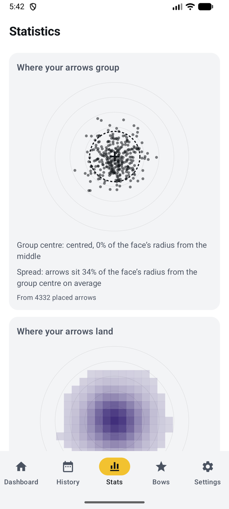{ .shot }
<figcaption><b>Agrupación</b></figcaption>
</figure>
<figure markdown>
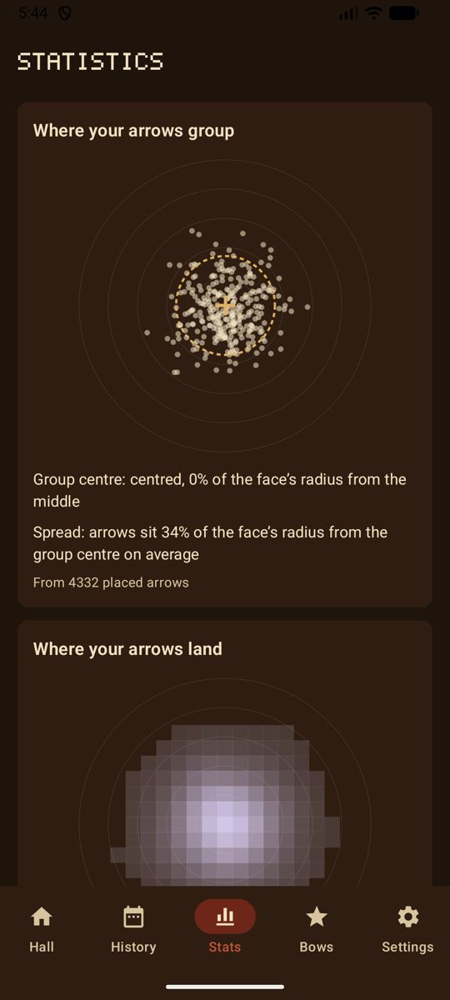{ .shot }
<figcaption>En el modo juego</figcaption>
</figure>

Cada flecha colocada sobre una sola diana, cada una dibujada en su propio spot, con:

- el **centro del grupo** (una cruz): alto, bajo, a la izquierda o a la derecha, como proporción del radio de la diana. Práctico para las marcas de visor;
- la **dispersión** (un círculo discontinuo): a qué distancia del centro del grupo quedan las flechas de media.

Las flechas que colocó la IA siempre cuentan. Las flechas colocadas a mano cuentan una vez que has [marcado la diana](scoring-manual.md#mark-the-target).

## Dónde caen tus flechas { #where-your-arrows-land }

<figure markdown>
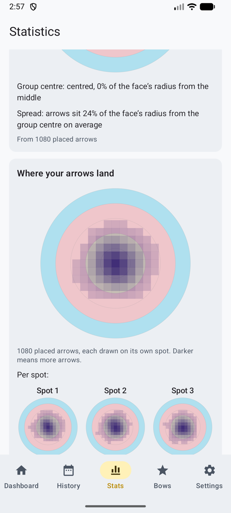{ .shot }
<figcaption><b>Mapa de calor por spot</b></figcaption>
</figure>
<figure markdown>
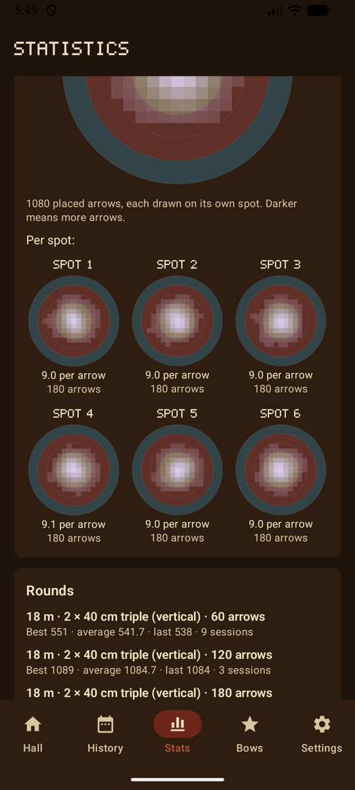{ .shot }
<figcaption>En el modo juego</figcaption>
</figure>

Las mismas flechas como **mapa de calor**: más oscuro (más claro en el modo juego) donde caen más flechas, sobre las zonas de la diana que elegiste. En una triple diana (elígela en los filtros), un pequeño mapa por spot, con su media por flecha y su número de flechas, y cuál es tu spot **mejor** y cuál el **más débil**: en una triple diana vertical, un spot de abajo débil suele indicar que bajas el brazo del arco.

## Tiradas { #rounds }

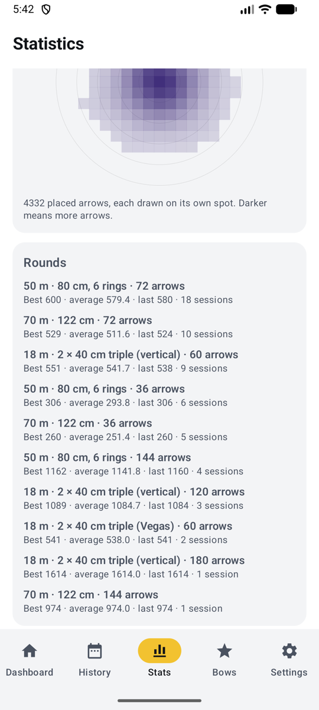{ .shot width="220" align=right }

Para cada tirada que haces (misma distancia, diana, dianas de papel y número de flechas): tu puntuación **mejor**, **media** y **última**, y cuántas sesiones la has tirado. Solo se compara lo comparable: una tirada de 60 flechas a 18 m nunca se mezcla con una de 72 flechas a 70 m. Tu mejor marca personal por tirada aparece también en Inicio y en cada sesión.

## Campo y 3D { #field-and-3d }

Las dianas de campo (del 6 al 1) y los animales 3D (11, 10, 8 y 5) puntúan de otra forma que las dianas de tiro a diana, así que al elegir una diana de campo o 3D en los filtros se ocultan los recuadros **X**, **10 y X** y **oro**, y se muestran las zonas y estadísticas propias de esa diana. Consulta [Reglas de puntuación](rules.md#field-and-3d).

## Empezar de nuevo { #starting-over }

Para empezar de nuevo tus estadísticas, consulta [Borrar datos](backup.md#erase-data). Reiniciar la experiencia y las insignias en el modo juego conserva tus estadísticas.
