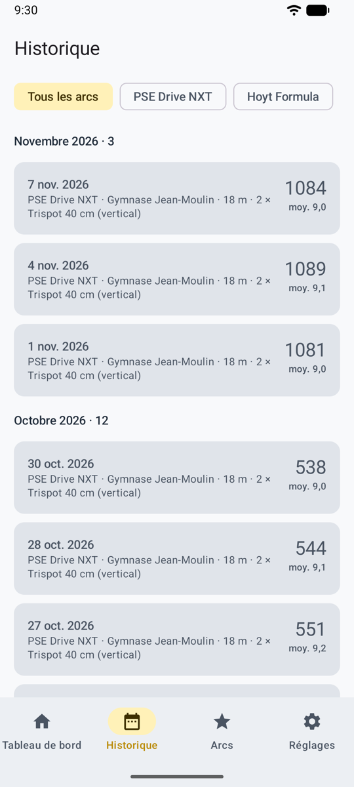
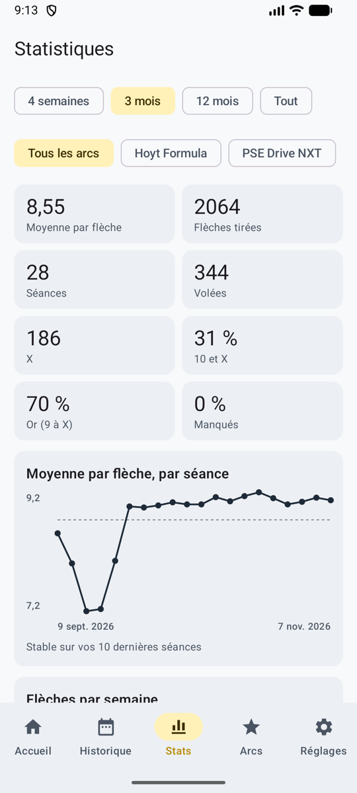

# Historique et statistiques

Chaque séance reste sur votre téléphone avec ses photos. L’onglet **Historique** les liste, et l’onglet **Stats** montre ce qui compte à l’entraînement et en compétition. En mode jeu, le **mur des trophées** montre votre niveau, vos insignes et vos records personnels, avec un lien vers toutes vos séances, et l’**âtre** vos statistiques, « au coin du feu ».

<figure markdown>
{ .shot }
<figcaption><b>L’historique</b>, filtré par arc</figcaption>
</figure>
<figure markdown>
{ .shot }
<figcaption><b>Niveau, volume et tendance</b></figcaption>
</figure>
<figure markdown>
{ .shot }
<figcaption><b>Où se groupent vos flèches</b></figcaption>
</figure>

## Historique

- **Accueil :** séances, moyenne par flèche, meilleur total, nombre de X et séances récentes.
- **Historique :** toutes les séances terminées, par mois, filtrées par arc. Ouvrez-en une pour voir sa feuille de marque, son graphique et la photo de chaque volée.

## Statistiques

Sur une période (de 4 semaines à tout) et pour un arc :

- **Moyenne par flèche** et sa tendance par séance, **flèches tirées** et **flèches par semaine** (volume d’entraînement sur 12 semaines).
- Parts de **10 et X**, d’**or** (9 à X) et de **manqués**, et combien de flèches dans chaque zone.
- **Régularité :** votre meilleure volée, l’écart d’une volée à l’autre (plus c’est bas, plus c’est régulier), et la seconde moitié de vos séances contre la première (fatigue).
- **Où se groupent vos flèches :** toutes les flèches placées par l’IA, sur une même cible, avec le centre du groupe (haut, bas, gauche ou droite : utile pour régler le viseur) et la dispersion. Les flèches placées à la main n’y sont pas, car seule l’IA mesure la cible sur la photo.
- **Épreuves :** pour chaque épreuve tirée, votre meilleur score, votre moyenne et votre dernier score.

Seules les volées validées des séances terminées comptent.
