# Statistiques

L’onglet **Stats** montre ce qui compte à l’entraînement et en compétition : votre niveau et sa tendance, combien vous tirez, où arrivent vos flèches, votre régularité, votre groupement et vos records par épreuve. En mode jeu, rendez-vous à l’**âtre** : les mêmes statistiques s’ouvrent « au coin du feu », au style du jeu.

Seules les volées validées des séances terminées comptent. Rien n’est envoyé : tout est calculé sur votre téléphone.

<figure markdown>
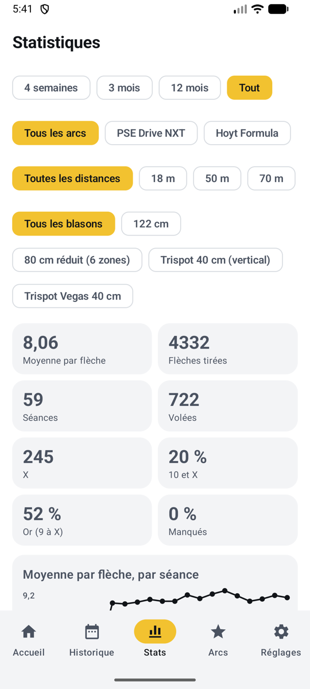{ .shot }
<figcaption><b>Mode normal</b>, l’onglet Stats</figcaption>
</figure>
<figure markdown>
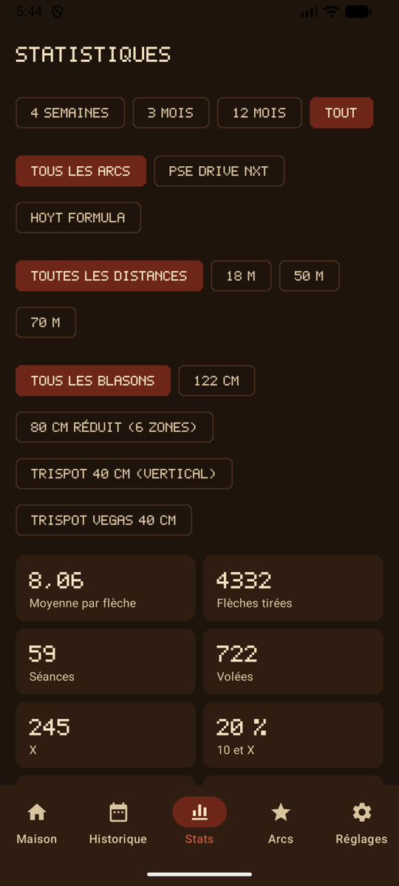{ .shot }
<figcaption><b>Mode jeu</b>, au coin du feu</figcaption>
</figure>

## Filtres

Choisissez ce que couvrent les statistiques, en haut :

| Filtre | Choix |
|--------|-------|
| **Période** | 4 semaines, 3 mois (par défaut), 12 mois, ou tout |
| **Arc** | Tous les arcs, ou un seul (affiché si vous en avez plus d’un) |
| **Distance** | Toutes les distances, ou une seule, comme 18 m (affiché si vous en avez tiré plus d’une) |
| **Blason** | Tous les blasons, ou un seul, comme le trispot 40 cm ou la campagne 20 cm (affiché si vous en avez tiré plus d’un) |

Quand toutes les séances affichées utilisent le même blason, ses propres zones sont dessinées derrière le groupement et la carte de chaleur, et sur un trispot vous obtenez aussi une carte par spot.

## Vue d’ensemble

| Tuile | Ce qu’elle vous dit |
|-------|---------------------|
| **Moyenne par flèche** | Votre niveau, selon la règle de comptage de chaque séance |
| **Flèches tirées**, **séances**, **volées** | Le volume d’entraînement |
| **X**, **10 et X**, **or (9 à X)** | La fréquence à laquelle vous touchez le centre (blasons de tir sur cible seulement) |
| **Manqués** | La part des flèches hors des zones de points |

## Moyenne par flèche, par séance

<figure markdown>
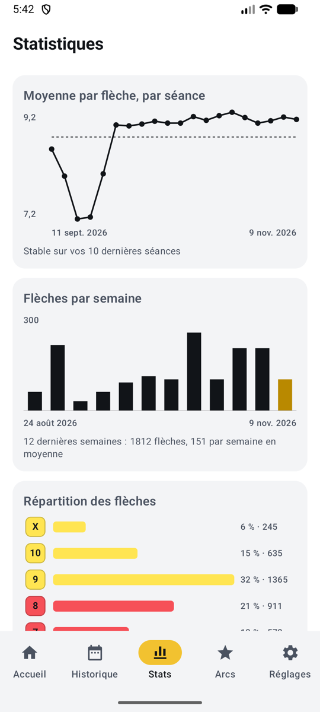{ .shot }
<figcaption><b>Tendance et volume</b></figcaption>
</figure>
<figure markdown>
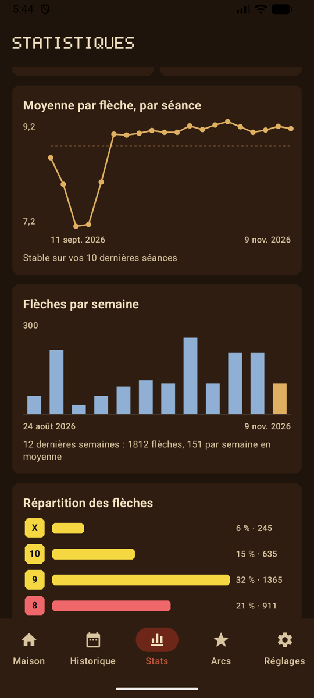{ .shot }
<figcaption>En mode jeu</figcaption>
</figure>

- **Tendance :** la moyenne par flèche de chaque séance (les 20 dernières), avec la moyenne de la période en pointillé. À partir de dix séances, la ligne dessous compare vos cinq dernières séances aux cinq précédentes : en hausse, en baisse ou stable.
- **Flèches par semaine :** les flèches tirées chaque semaine sur les 12 dernières semaines, la semaine en cours mise en évidence, avec le total et la moyenne hebdomadaire. Pratique pour voir combien vous vous entraînez vraiment.

## Répartition des flèches

<figure markdown>
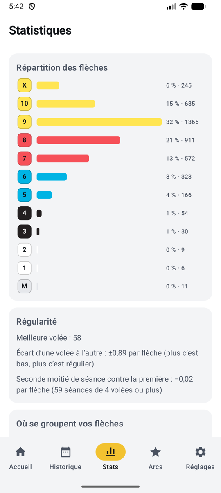{ .shot }
<figcaption><b>Zones et régularité</b></figcaption>
</figure>
<figure markdown>
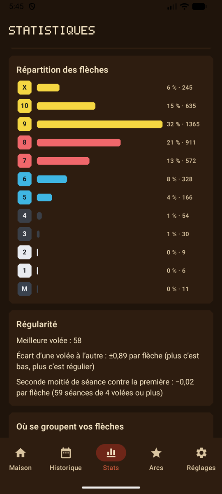{ .shot }
<figcaption>En mode jeu</figcaption>
</figure>

Le nombre de flèches dans chaque zone, du X (ou du 11 sur une cible 3D) jusqu’au manqué, avec la part et le nombre. Avec les thèmes Jour de tir et Tir de nuit, et en mode jeu, chaque barre prend la couleur de sa zone.

## Régularité

- **Meilleure volée.**
- **Écart d’une volée à l’autre :** à quel point vos volées varient, mesuré par l’écart type de leur moyenne par flèche. Plus c’est bas, plus c’est régulier.
- **Seconde moitié contre la première :** dans les séances de 4 volées ou plus, votre seconde moitié par flèche moins votre première moitié. Négatif, vous faiblissez (fatigue); positif, vous vous échauffez.

## Où se groupent vos flèches

<figure markdown>
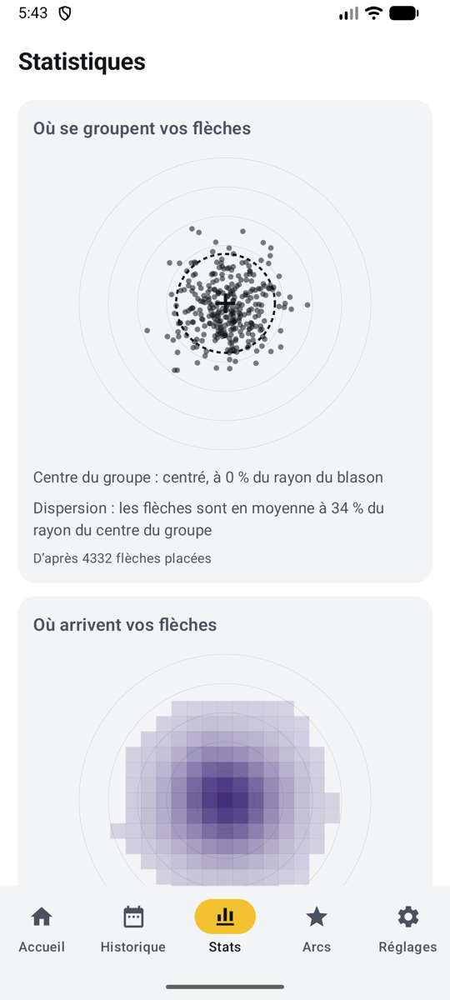{ .shot }
<figcaption><b>Groupement</b></figcaption>
</figure>
<figure markdown>
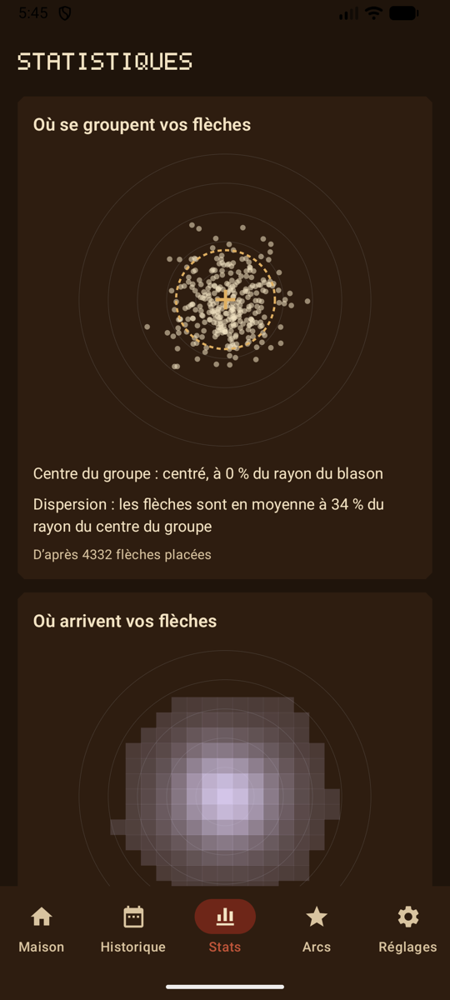{ .shot }
<figcaption>En mode jeu</figcaption>
</figure>

Chaque flèche placée sur une même cible, chacune dessinée sur son propre spot, avec :

- le **centre du groupe** (une croix) : haut, bas, gauche ou droite, en part du rayon du blason. Utile pour régler le viseur;
- la **dispersion** (un cercle pointillé) : la distance moyenne des flèches au centre du groupe.

Les flèches placées par l’IA comptent toujours. Les flèches placées à la main comptent une fois la [cible marquée](scoring-manual.md#marquer-la-cible).

## Où arrivent vos flèches

<figure markdown>
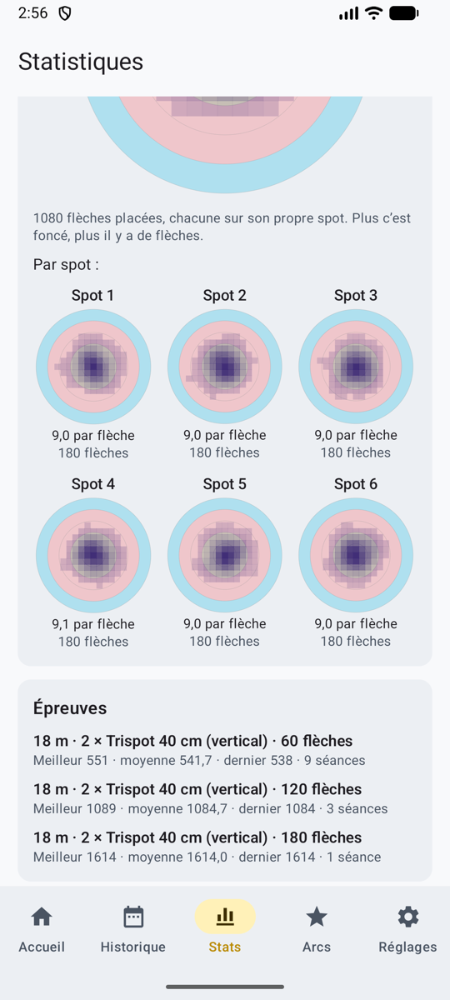{ .shot }
<figcaption><b>Carte de chaleur par spot</b></figcaption>
</figure>
<figure markdown>
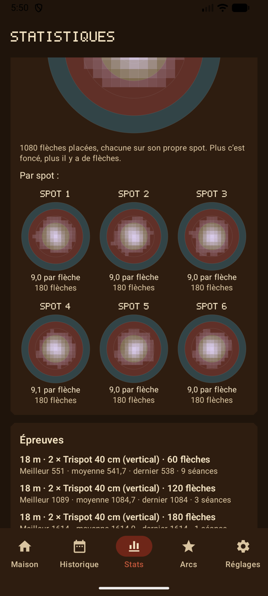{ .shot }
<figcaption>En mode jeu</figcaption>
</figure>

Les mêmes flèches en **carte de chaleur** : plus foncée (plus claire en mode jeu) là où arrivent le plus de flèches, sur les zones du blason choisi. Sur un trispot (choisissez-le dans les filtres), une petite carte par spot, avec sa moyenne par flèche et son nombre de flèches, et votre **meilleur** spot et le **plus faible** : sur un trispot vertical, un spot du bas plus faible trahit souvent un bras d’arc qui tombe.

## Épreuves

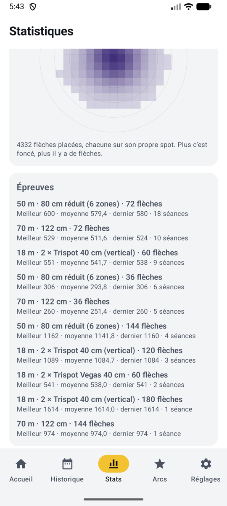{ .shot width="220" align=right }

Pour chaque épreuve tirée (même distance, même blason, même nombre de blasons sur la butte et de flèches) : votre **meilleur** score, votre **moyenne**, votre **dernier** score, et le nombre de séances. On ne compare que ce qui est comparable : une épreuve de 60 flèches à 18 m ne se mélange jamais à une de 72 flèches à 70 m. Votre record personnel par épreuve apparaît aussi à l’accueil et sur chaque séance.

## Campagne et 3D

Les blasons de campagne (de 6 à 1) et les cibles 3D (11, 10, 8 et 5) ne se comptent pas comme les blasons de tir sur cible : choisir un blason de campagne ou une cible 3D dans les filtres masque les tuiles **X**, **10 et X** et **or**, et montre les zones et les statistiques propres à ce blason. Voir [Règles de comptage](rules.md#campagne-et-3d).

## Repartir de zéro

Pour repartir de zéro, voir [Effacer les données](backup.md#effacer-les-donnees). Remettre à zéro l’expérience et les insignes en mode jeu garde vos statistiques.
