# Statistics

The **Stats** tab shows what matters in training and competition: your level and its trend, how much you shoot, where your arrows score, how steady you are, where they group, and your records per round. In game mode, walk to the **hearth** (*Âtre*): the same statistics open "by the fire", in the game's look.

Only confirmed ends of finished sessions count. Nothing is sent anywhere: it's all worked out on your phone.

<figure markdown>
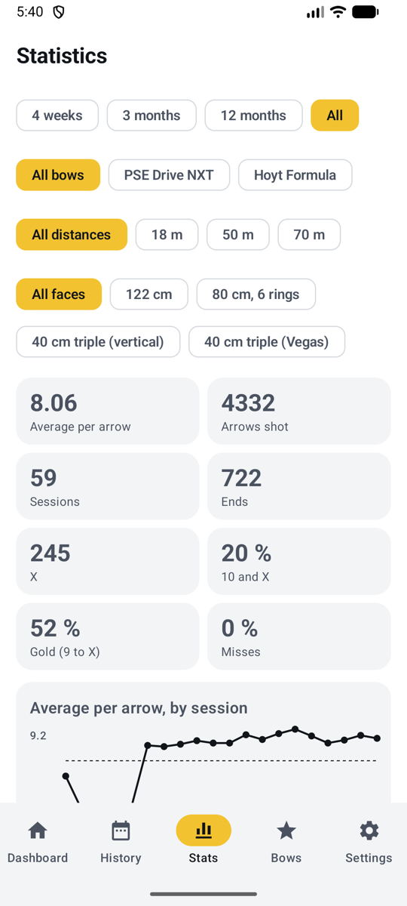{ .shot }
<figcaption><b>Normal mode</b>, the Stats tab</figcaption>
</figure>
<figure markdown>
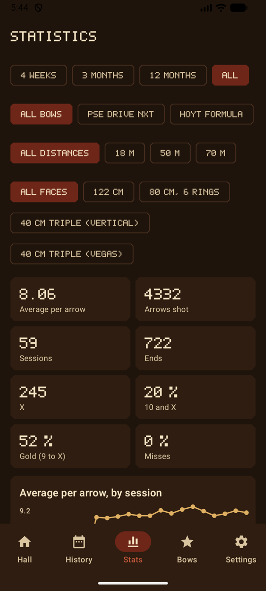{ .shot }
<figcaption><b>Game mode</b>, by the hearth</figcaption>
</figure>

## Filters

Choose what the statistics cover, at the top:

| Filter | Choices |
|--------|---------|
| **Period** (*Période*) | 4 weeks, 3 months (the default), 12 months, or all |
| **Bow** (*Arc*) | All bows, or one (shown when you have more than one) |
| **Distance** (*Distance*) | All distances, or one, such as 18 m (shown when you've shot more than one) |
| **Face** (*Blason*) | All faces, or one, such as 40 cm triple or 20 cm field (shown when you've shot more than one) |

When every session shown uses the same face, its own rings are drawn behind the grouping and the heat map, and on a 3-spot face you also get one map per spot.

## Overview

| Tile | What it tells you |
|------|-------------------|
| **Average per arrow** (*Moyenne par flèche*) | Your level, under each session's scoring rule |
| **Arrows shot**, **sessions**, **ends** | Training volume |
| **X**, **10 and X**, **gold (9 to X)** | How often you hit the middle (target faces only) |
| **Misses** (*Manqués*) | Share of arrows outside the scoring zones |

## Average per arrow, by session

<figure markdown>
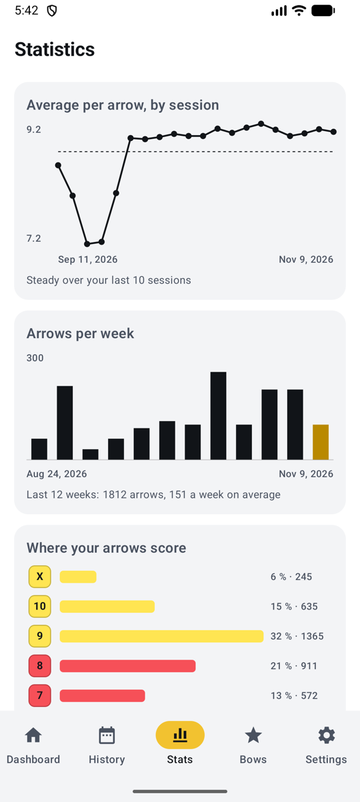{ .shot }
<figcaption><b>Trend and volume</b></figcaption>
</figure>
<figure markdown>
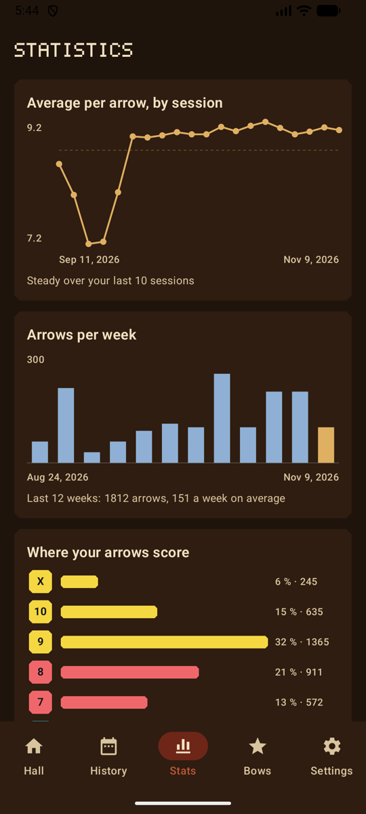{ .shot }
<figcaption>In game mode</figcaption>
</figure>

- **Trend:** the average per arrow of each session (the last 20), with the period's average as a dashed line. With ten sessions or more, the line under it compares your last five sessions with the five before: up, down, or steady.
- **Arrows per week** (*Flèches par semaine*): arrows shot each week over the last 12 weeks, this week highlighted, with the total and the weekly average. Handy to see how much you really train.

## Where your arrows score

<figure markdown>
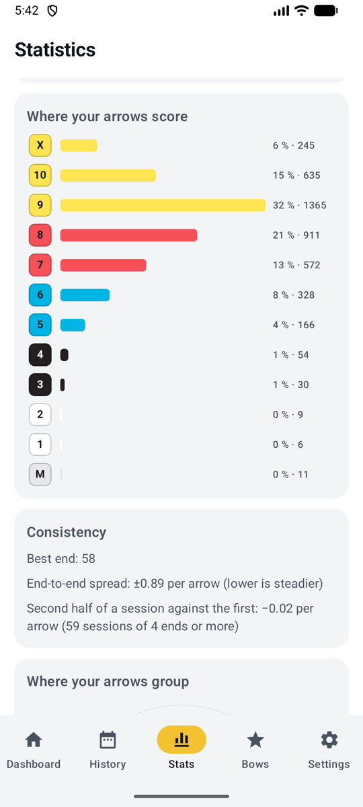{ .shot }
<figcaption><b>Rings and consistency</b></figcaption>
</figure>
<figure markdown>
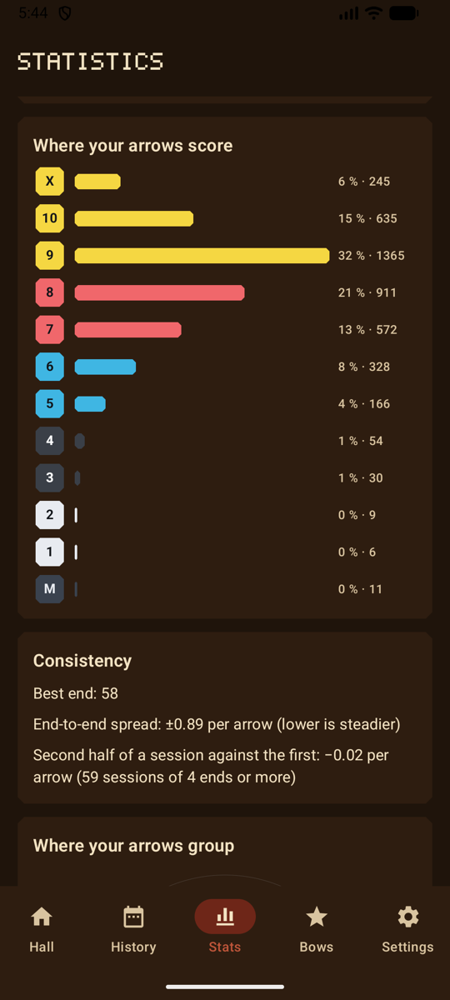{ .shot }
<figcaption>In game mode</figcaption>
</figure>

How many arrows landed in each ring, from X (or 11 on a 3D animal) down to a miss, with the share and the count. In the Range day and Night range themes, and in game mode, each bar takes its ring's colour.

## Consistency

- **Best end** (*Meilleure volée*).
- **End-to-end spread** (*Écart d’une volée à l’autre*): how much your ends vary, as the standard deviation of their average per arrow. Lower is steadier.
- **Second half against the first** (*Seconde moitié contre la première*): in sessions of 4 ends or more, your second half per arrow minus your first half. Negative means you fade (fatigue); positive means you warm up.

## Where your arrows group

<figure markdown>
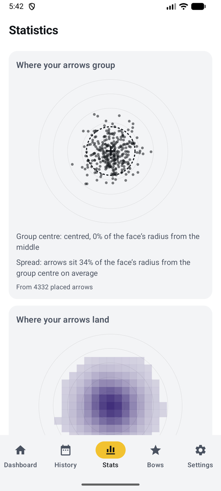{ .shot }
<figcaption><b>Grouping</b></figcaption>
</figure>
<figure markdown>
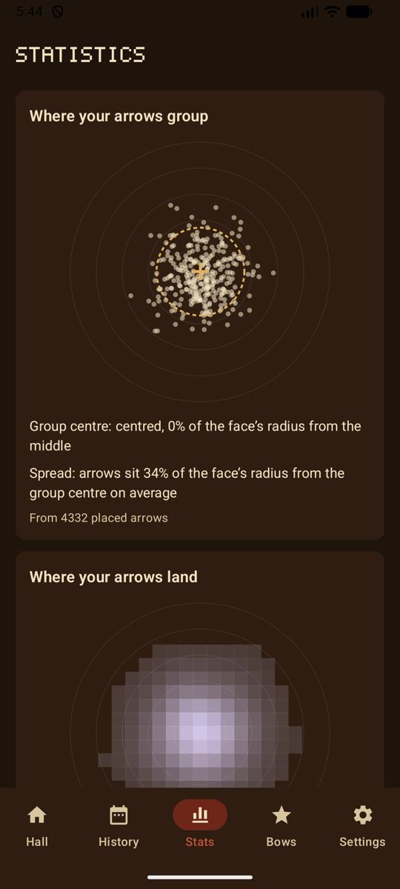{ .shot }
<figcaption>In game mode</figcaption>
</figure>

Every placed arrow on one target, each drawn on its own spot, with:

- the **group centre** (a cross): high, low, left or right, as a share of the face's radius. Handy for sight marks;
- the **spread** (a dashed circle): how far arrows sit from the group centre on average.

Arrows the AI placed always count. Arrows placed by hand count once you've [marked the target](scoring-manual.md#mark-the-target).

## Where your arrows land

<figure markdown>
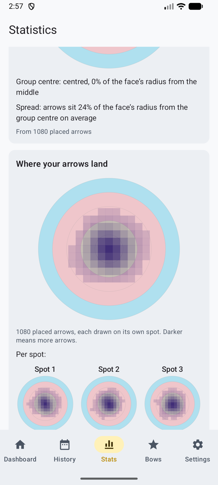{ .shot }
<figcaption><b>Heat map per spot</b></figcaption>
</figure>
<figure markdown>
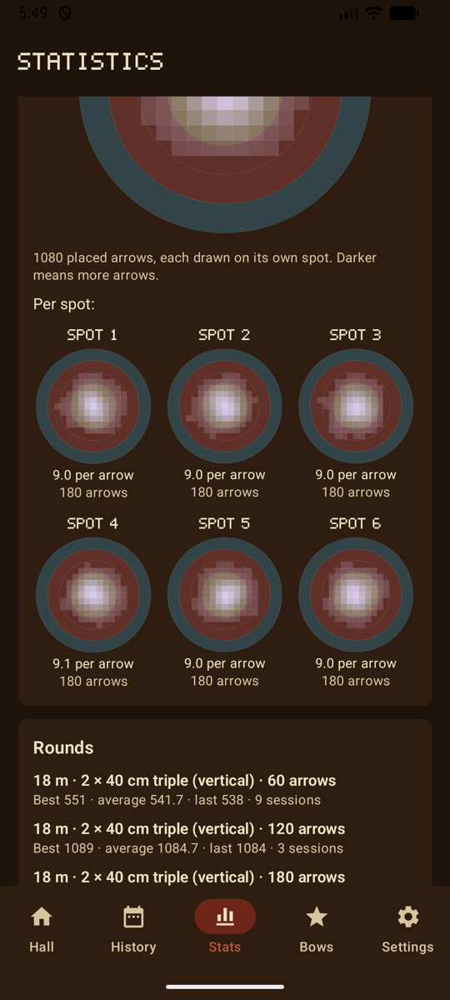{ .shot }
<figcaption>In game mode</figcaption>
</figure>

The same arrows as a **heat map**: darker (lighter in game mode) where more arrows land, over the rings of the face you chose. On a 3-spot face (choose it in the filters), one small map per spot, with its average per arrow and its number of arrows, and which spot is your **best** and your **weakest**: on a vertical triple face, a weak bottom spot often means a dropped bow arm.

## Rounds

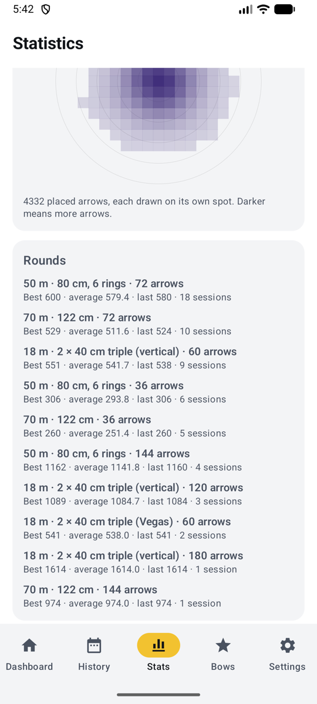{ .shot width="220" align=right }

For each round you shoot (the same distance, face, paper faces and number of arrows): your **best**, **average** and **last** score, and how many sessions you shot it. Only like is compared with like: a 60-arrow 18 m round never mixes with a 72-arrow 70 m round. Your personal best per round also shows on the Dashboard and on each session.

## Field and 3D

Field faces (6 to 1) and 3D animals (11, 10, 8 and 5) score differently from target faces, so choosing a field or 3D face in the filters hides the **X**, **10 and X** and **gold** tiles and shows that face's own rings and statistics. See [Scoring rules](rules.md#field-and-3d).

## Starting over

To start your statistics again, see [Erase data](backup.md#erase-data). Resetting experience and badges in game mode keeps your statistics.
